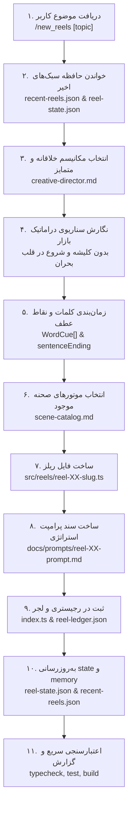

# Skill: `/new_reels` — Zero-Discovery Universal Promo Reel Generator
> **Command:** `/new_reels [موضوع]` or `/new-reels [موضوع]`  
> **Entrypoint:** `.claude/skills/new-reels/SKILL.md`  
> **Execution Mode:** Zero-Scan Fast-Track (Reads ONLY pre-indexed plugin contracts)

---

## 1. Zero-Discovery Rule (DO NOT SCAN `src/`)

When this skill is invoked:
- **FORBIDDEN:** Do NOT recursively scan or grep `src/`, `src/scenes/`, `src/ui/`, or `src/engine/`.
- **FORBIDDEN:** Do NOT rediscover types, scene kinds, icon names, or registration arrays from source.
- **MANDATORY:** Read ONLY the pre-indexed fast-track context files in `.claude/reel-plugin/`:
  1. `.claude/reel-plugin/plugin-manifest.json`
  2. `.claude/reel-plugin/fast-track-sdk.md`
  3. `.claude/reel-plugin/production-guardrails.md`
  4. `.claude/reel-plugin/creative-director.md`
  5. `.claude/reel-plugin/scene-catalog.md`
  6. `.claude/reel-plugin/token-catalog.md`
  7. `.claude/reel-plugin/registration-contract.md`
  8. `.claude/reel-plugin/reel-state.json`
  9. `.claude/reel-plugin/recent-reels.json`

### The Single Exception:
The AI agent MAY inspect a specific `src/` file ONLY IF:
1. TypeScript reports a compile error after authoring.
2. An SDK contract appears contradictory or missing a specific prop.
3. In that case, read ONLY the single smallest relevant file, fix the issue, and update the SDK.

---

## 2. Fast-Track Execution Algorithm



---

## 3. Step-by-Step Execution Guide

### Step 1: Determine Next Reel ID & Check Style Memory
- Read `.claude/reel-plugin/reel-state.json` to get `nextReelId` (e.g. `55`).
- Read `.claude/reel-plugin/recent-reels.json` to review the last 5 reels. Choose a creative mechanism and art direction different from the last 3 reels to ensure diversity.

### Step 2: Scriptwriting & Voiceover Breakdown
- Transform the user's topic using `creative-director.md` into 5 cohesive scenes (approx. 26.0s total):
  - Scene 1 (0.0s – 3.5s): Urgent hook / pattern interrupt.
  - Scene 2 (3.5s – 8.5s): Escalating tension / hidden contradiction.
  - Scene 3 (8.5s – 15.0s): Root cause breakdown / manual friction leak.
  - Scene 4 (15.0s – 21.5s): Product mechanism resolving the crisis.
  - Scene 5 (21.5s – 26.0s): High-conversion CTA with `hisabche.com`.
- **Quality Check:** Zero lazy clichés. Start in medias res. Authentic Persian business terms.

### Step 3: Author Reel Definition (`src/reels/reel-XX-<slug>.ts`)
- Use the exact schema from `fast-track-sdk.md`.
- Every scene must include `vo: string` and `sentence: SentencePlan` with word-level cues.
- Set `alignmentStatus: 'PROVISIONAL_CADENCE_MODEL_ACTIVE'`, `isProvisional: true`, and `confidence: null`.
- Respect `production-guardrails.md`:
  - Climax turning points trigger 1.2s–1.8s BEFORE scene ends at 100% opacity.
  - Scene exit fade-outs confined to final 0.18s.
  - Clamp all countdown math (zero negative numbers).
  - Fill the upper third of 9:16 canvas.

### Step 4: Author Strategy Prompt (`docs/prompts/reel-XX-prompt.md`)
- Complete guide for the voiceover artist and audio ingestion pipeline.
- Move all strategy labels, persona intents, and debug metadata into this document.

### Step 5: Wire into Registry & Ledger
- In `src/reels/index.ts`: Import and add to `REELS` array and export list.
- In `src/data/reel-ledger.json`: Append entry with component types and dominant layout.

### Step 6: Update Plugin State
- Update `reel-state.json` (`lastReelId = XX`, `nextReelId = XX + 1`).
- Append entry to `recent-reels.json`.

### Step 7: Fast Verification
Run:
```bash
npm run typecheck
npm test
npm run build
```
Deliver final summary in Persian following AGENTS.md §9.
