# استانداردهای استودیویی موشن‌گرافیک SaaS حسابچه (SaaS Premium Motion Standards)

## چارچوب فنی، هنری و مهندسی هوک‌های وایرال ۳ ثانیه‌ای برای خروجی‌های سطح یک استودیویی

این سند، مرجع حاکم بر تمام تولیدات ویدیویی، ریل‌ها، کامپوننت‌های بصری و موتور انیمیشن حسابچه است. هدف این قواعد، تضمین خروجی‌های هم‌رده با بهترین استودیوهای بین‌المللی SaaS (نظیر Stripe، Linear، Ramp و Apple) با تمرکز بر دردهای واقعی و اعتبارسنجی‌شده کسب‌وکارهای بازار است.

---

### بخش اول: مهارت‌های ضروری و اصول حرکت در رابط کاربری (UI Motion Principles)

#### ۱. منحنی‌های سرعت و فیزیک حرکت (Graph Editor & Easing)

- **پرهیز از حرکت‌های خطی و F9 پیش‌فرض:** استفاده از حرکت‌های خطی (`Linear`) یا `Easy Ease` پیش‌فرض نرم‌افزارها اکیداً ممنوع است.
- **شتاب در شروع، نرمی در فرود (`Exponential Ease-Out`):** اکثر المان‌های رابط کاربری با شتاب سریع وارد شده و با منحنی ملایم و کنترل‌شده فرود می‌آیند (`cubic-bezier(0.16, 1, 0.3, 1)` با ضریب تأثیر ۷۵٪ تا ۸۵٪).
- **حرکت فنری و اضافه فرود (`Spring / Overshoot`):** در بج‌ها، چک‌مارک‌ها و کارت‌های کلیدی، از فیزیک میرای نوسانی (`spring(t, damping, stiffness)`) برای القای حس وزن و واکنش مکانیکی طبیعی استفاده می‌شود.
- **مکث قبل از حرکت (`Anticipation`):** قبل از خروج کارت‌ها یا پرتاب داده‌ها، یک کشش کوچک معکوس (۱ تا ۲ فریم) اعمال می‌شود تا حرکت طبیعی جلوه کند.

#### ۲. سلسله‌مراتب بصری و ریتم نگاه (Visual Hierarchy & Pacing)

- **قانون نقطه کانونی واحد (Single Focal Point):** در هر ثانیه از ویدیو، چشم بیننده فقط باید یک نقطه تمرکز فعال داشته باشد. تکان خوردن همزمان چندین المان نامربوط ممنوع است.
- **توالی ورود آبشاری (`Staggering & Overlapping Action`):** ردیف‌های جدول، آیتم‌های منو یا کارت‌ها نباید همزمان وارد شوند. ورود آن‌ها باید با تأخیر ۵۰ تا ۱۲۰ میلی‌ثانیه‌ای (۲ تا ۴ فریم) نسبت به یکدیگر و منطبق بر ضرباهنگ صوت رخ دهد.

#### ۳. کارگردانی هنری و طراحی UI/UX برای ویدیو (Art Direction & Product Staging)

- **ساده‌سازی و انتزاع رابط کاربری (`UI Abstraction / Simplification`):** هرگز اسکرین‌شات شلوغ یا خام دسکتاپ را درون کادر عمودی موبایل قرار ندهید. بخش مرتبط بازطراحی، ساده‌سازی و درشت‌نمایی می‌شود تا پیام اصلی در کمتر از ۲ ثانیه بدون سردرگمی ادراک شود.
- **کار با فضای ۲.۵ بعدی و دوربین مجازی (`2.5D Spatial & Camera Rigging`):** لایه‌ها در محور Z چیده می‌شوند، سایه‌های چندلایه نرم (`ambient + key shadows`) اعمال می‌گردد و دوربین مجازی به آرامی با تغییر عمق میدان (`Depth of Field`) بین نماها حرکت می‌کند.
- **تایپوگرافی کینتیک و اصول فارسی/RTL (`Kinetic Typography`):** رعایت دقیق اتصال حروف فارسی، عدم شکست کلمات در میان‌نویس‌ها، نمایش اعداد به صورت فرمت‌شده با ارقام فارسی (`faNumber`)، و وزن‌دهی حساب‌شده به واژگان کلیدی با تگ‌های رنگی هایلایت (`[c:...]`, `[g:...]`, `[r:...]`).

#### ۴. مهندسی صدا و ریتم (`Sound Design & Audio Sync`)

- **صدای بدون نویز و لایه‌بندی‌شده:** هماهنگی میلی‌ثانیه‌ای هر ورود بصری با افکت‌های صوتی لایه‌بندی‌شده وب‌آدیو (Web Audio API).
- **لایه‌های صوتی محیطی (`Ambient Drones / Risers`):** بسترسازی صوتی ملایم برای القای فضای مدرن و سینمایی.
- **افکت‌های میکرو رابط کاربری (`UI SFX`):** صدای کلیک، پاپ، سوئیچ، کسر انبار، کشیده شدن خطوط نمودار و زنگ تایید تراکنش.
- **کاهش خودکار صدای زمینه (`Audio Ducking`):** هنگام صحبت نریتور یا نمایش ارقام حیاتی، صدای افکت‌ها نرم‌تر شده و فرکانس‌های مزاحم فیلتر می‌شوند.

---

### بخش دوم: چک‌لیست طلایی کیفیت پروداکشن (Production Quality Gates)

هر ویدیو قبل از ورود به چرخه انتشار باید از ۷ دروازه زیر عبور کند:

| ردِیف | معیار ارزیابی                              | استاندارد پذیرش                                                                             |
| :---: | :----------------------------------------- | :------------------------------------------------------------------------------------------ |
| **۱** | **تشخیص فوری مسئله (Hook)**                | طرح صریح بحران یا سوال کلیدی مخاطب در حداکثر ۷ تا ۸ ثانیه اول                               |
| **۲** | **تنوع ساختاری (Non-repetitive)**          | هر ویدیو چیدمان سکانس‌های کاملاً متمایزی دارد (ترکیب‌های منحصر‌به‌فرد از ۲۲ سبک موجود)      |
| **۳** | **خوانایی عمودی موبایل (9:16)**            | تمام متون و دکمه‌ها در نمایشگر کوچک گوشی بدون ریزه‌کاری اضافه و با کنتراست بالا خوانا هستند |
| **۴** | **صداقت و انطباق با محصول (Truthfulness)** | هیچ ادعای غیرواقعی، داده ساختگی یا سود تضمینی بدون ورودی نمایش داده نمی‌شود                 |
| **۵** | **حذف واحدهای ارزی هاردکدشده**             | هیچ نام ارزی ثابتی (افغانی، تومان، دلار) در فاکتورها نیست؛ ارقام فرمت‌شده خالص هستند        |
| **۶** | **عمومی‌سازی اقلام (B2B Generic)**         | کدهای استاندارد بازرگانی («کالای تجاری کد ۱۰۱») به‌جای اسامی سنتی خوراکی استفاده می‌شوند    |
| **۷** | **تایمینگ ریاضی بی‌نقص**                   | مجموع ثانیه‌های سکانس‌ها در هر ریل پرچمدار دقیقاً ۵۹ ثانیه است                              |

---

### بخش سوم: مهندسی هوک‌های وایرال ۳ ثانیه‌ای (Viral Hook Engineering)

هوک در موشن‌گرافیک هرگز یک جمله تصادفی یا سوال کلیشه‌ای (مثل «آیا می‌خواهید حسابداری راحتی داشته باشید؟») نیست. هوک وایرال حاصل **تأثیر سه‌لایه همزمان در ثانیه‌های ۰.۰ تا ۳.۰** است:

1. **ضربه بصری فریم صفر (`Frame-0 Visual Arrest` بین ۰.۰ تا ۰.۷ ثانیه):** ناهنجاری بصری با کنتراست بالا، دوراهی دو نیم‌شده، پرش ناگهانی شمارنده، یا شکست وضعیت UI که انگشت کاربر را قبل از خواندن حتی یک کلمه متوقف کند.
2. **شوک کلامی و متنی (`Verbal / Copy Hook` بین ۰.۲ تا ۳.۰ ثانیه):** جمله صوتی و متن متحرک فارسی (حداکثر ۷ تا ۱۰ کلمه) که مستقیماً اضطراب غریزی کسب‌وکار را هدف می‌گیرد (کسری پول، قطعی نت، خستگی اکسل، کسری انبار، آشفتگی نسیه).
3. **تکانه صوتی لحظه‌ای (`Sonic Transient` در ثانیه ۰.۰ و ۱.۵):** تریگر صوتی فوری (Sub-drop، وزوز خطا، تیک مکانیکی استاپ‌واچ، شکستن شیشه، یا صدای کوبنده ایمپکت).

#### منابع استخراج هوک‌های واقعی:

- **کتابخانه‌های تبلیغات فعال (`Ad Libraries`):** تبلیغاتی که بیش از ۱ ماه در Meta Ad Library یا TikTok Creative Center فعال مانده‌اند، ساختار ۳ ثانیه اولشان اعتبارسنجی شده است.
- **معدن کلام واقعی مشتری (`Voice of Customer Mining`):** جملات واقعی با لحن عصبانیت یا کلافگی در نظرات ۱ و ۲ ستاره اپ‌های رقبا، توییتر و کامنت‌ها.
- **مهندسی معکوس ریلزهای میلیونی فین‌تک (`Format Hijacking`):** الگوبرداری ساختاری از موفق‌ترین تیزرهای فین‌تک بین‌المللی (Stripe، Ramp، Linear).

#### ۶ فرمول روانشناسی هوک دوگانه در حسابچه:

| ردِیف | نام فرمول هوک                                                 | مکانیزم روانشناسی                 | نمونه پیاده‌شده در ریل‌های حسابچه                                                 | اجرای موشن در ۳ ثانیه اول                                             |
| :---: | :------------------------------------------------------------ | :-------------------------------- | :-------------------------------------------------------------------------------- | :-------------------------------------------------------------------- |
| **۱** | **هوک تضاد و دوراهی** `The Binary Dilemma`                 | انتخاب میان دو وضعیت متضاد        | «سیستم می‌گه جنس هست، انباردار می‌گه نیست!» (فیلم ۴)                              | صفحه دو نیم‌شده با دو رنگ متضاد و علامت سوال تپنده در مرکز            |
| **۲** | **هوک فاجعه آشنا** `The Micro-Disaster`                    | وقوع اضطراب واقعی بازار پای باجه  | «مشتری پای صندوق منتظره و ناگهان اینترنت قطع شد!» (فیلم ۱)                        | آیکون وایفای قرمز چشمک‌زن با افکت صوتی بازر ارور و لرزش صفحه          |
| **۳** | **هوک افشای نشت پنهان** `The Silent Profit Leak`           | ترس از دست دادن سرمایه بدون آگاهی | «دخل شلوغه، فروش هم بالاست؛ اما سود واقعیت داره نشت می‌کنه!» (فیلم ۳)             | کنتور درخشان فروش که ناگهان خطوط قرمز نشت از زیرش کسر می‌شوند         |
| **۴** | **هوک وقفه در کار دستی** `The "Stop Doing This" Interrupt` | پایان اتلاف وقت و دوباره‌کاری     | «صبر کن! هنوز بعد از زدن فاکتور، کاردکس انبار و دفتر رو دستی کم می‌کنی؟» (فیلم ۲) | ضربدر قرمز کوبنده (❌) روی پوشه‌های موازی با صدای کوبنده TitleHit     |
| **۵** | **هوک سرعت و عدد عجیب** `The Specific Metric Hook`         | اثبات سرعت فرابشری سیستم          | «۱ کلیک تایید فاکتور = ۵ ثبت همزمان در ۳ ثانیه!»                                  | تایمر استاپ‌واچ شتاب‌دار که در کسری از ثانیه چند عملیات را تیک می‌زند |
| **۶** | **هوک ضد باور رایج** `The Role Paradox / Myth Buster`      | شکستن پیش‌فرض‌های سنگین           | «برای ترازنامه و سند دوبل رسمی، نیازی نیست فروشنده حسابدار باشه!» (فیلم ۵)        | تقسیم صفحه نامتقارن سوئیسی: باجه ۲ کلیکه در کنار سند ۴ سطری دوبل      |

#### خط قرمزها و ممنوعیت‌های صریح (Strict Bans):

- **ممنوع:** هرگز شروع با لود آهسته لوگوی حسابچه.
- **ممنوع:** هرگز شروع با «سلام»، «در این ویدیو می‌خواهیم...» یا «آیا به دنبال نرم‌افزار حسابداری هستید؟».
- **ممنوع:** هرگز ادبیات نامفهوم یا اصطلاحات خشک اداری در ۳ ثانیه اول. استفاده از واژگان صریح و آشنای بازار (صندوق، فاکتور، نسیه، انبار، دخل، سود خالص).

---

### بخش چهارم: بانک ساختار روایی ویدیوهای پرچمدار (SaaS Flagship Narrative Arcs)

پنج ساختار بدون تکرار برای سناریوهای پنج‌گانه حسابچه:

```mermaid
flowchart LR
    subgraph Film1["فیلم ۱: تاب‌آوری آفلاین (فرمول ۲: فاجعه آشنا)"]
        H1["قلاب شوک قطعی"] --> CP1["معماری ۲.۵ بعدی"] --> OD1["دموی صف آفلاین"] --> CT1["ترانسفورم ۳ مرحله‌ای"] --> CTA1["اقدام پایدار"]
    end
    subgraph Film2["فیلم ۲: پایان دوباره‌کاری (فرمول ۴: توقف کار دستی)"]
        KM2["مانفیستو کینتیک"] --> FT2["همگرایی ابزارها"] --> M2["دموی فاکتور دسکتاپ"] --> P2["ادغام پوشه‌ها"] --> CTA2["اقدام یکپارچگی"]
    end
    subgraph Film3["فیلم ۳: سود واقعی (فرمول ۳: نشت پنهان سود)"]
        D3["خط زمانی روز"] --> PW3["آبشار بهای خرید"] --> FI3["هوش مالی لایه‌ای"] --> CH3["نمودار رشد مارجین"] --> CTA3["اقدام شفافیت"]
    end
    subgraph Film4["فیلم ۴: زنجیره انبارها (فرمول ۱: دوراهی و تضاد)"]
        BR4["دوراهی انبار"] --> WM4["رهگیری برداری بار"] --> HB4["شبکه چندشعبه‌ای"] --> CM4["ماتریس تطبیقی"] --> CTA4["اقدام انبارداری"]
    end
    subgraph Film5["فیلم ۵: فروشنده و حسابدار (فرمول ۶: ضد باور رایج)"]
        SP5["دیدگاه دوگانه"] --> DP5["دموی همگام دخل/دفتر"] --> LD5["صورت‌حساب قطعی"] --> BD5["پل هماهنگی"] --> CTA5["اقدام سازمانی"]
    end
```

---

### بخش پنجم: سوالات تخصصی ارزیابی موشن‌دیزاینر (Interview & Architecture Audit)

1. **چگونه هوک وایرال ۳ ثانیه اول را طراحی می‌کنید؟**
   - _پاسخ استاندارد:_ ایجاد تلاقی همزمان ضربه بصری (Frame-0 Anomaly)، قلاب کلامی غریزی و تکانه صوتی در کسری از ثانیه؛ پرهیز کامل از لوگوموشن‌های آرام یا سلام و احوال‌پرسی.
2. **مدیریت پیچیدگی رابط کاربری در کادر عمودی (9:16):**
   - _پاسخ استاندارد:_ استخراج هسته اصلی عملکرد، حذف حواشی شلوغ و ساخت کامپوننت انتزاعی با تایپوگرافی درشت و بزرگنمایی روی جریان داده‌ها.
3. **ترنزیشن بدون اسلاید پاورپوینت:**
   - _پاسخ استاندارد:_ استفاده از تکنیک‌های `Match Cut` (تبدیل مستقیم یک المان از صحنه قبل به صحنه بعد)، `Spatial Camera Pass` و انیمیشن مسیرهای برداری (`Path Morphing`).
4. **ساختار سیستم طراحی و توکن‌ها:**
   - _پاسخ استاندارد:_ تعریف توکن‌های مرکزی رنگ، سایه، فونت و کنترلرهای مرکزی پارامترها جهت امکان بازآفرینی سریع کمپین‌ها بدون نیاز به کی‌فریم‌گذاری مجدد.
