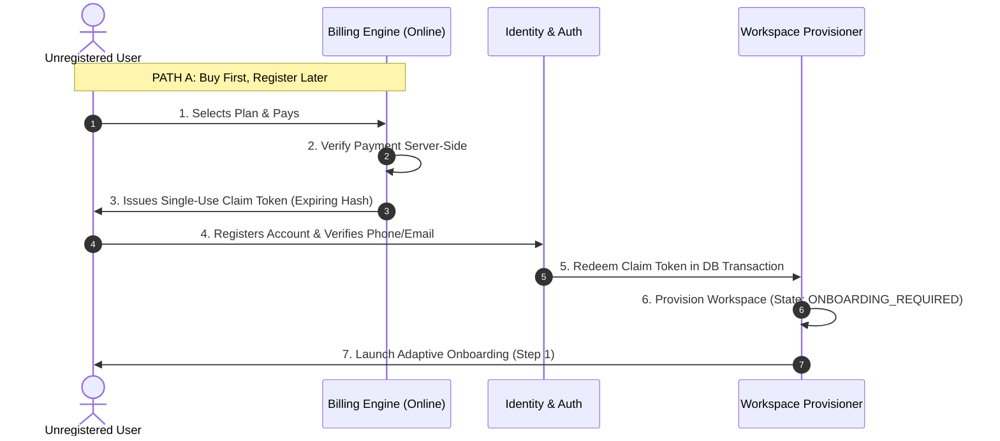
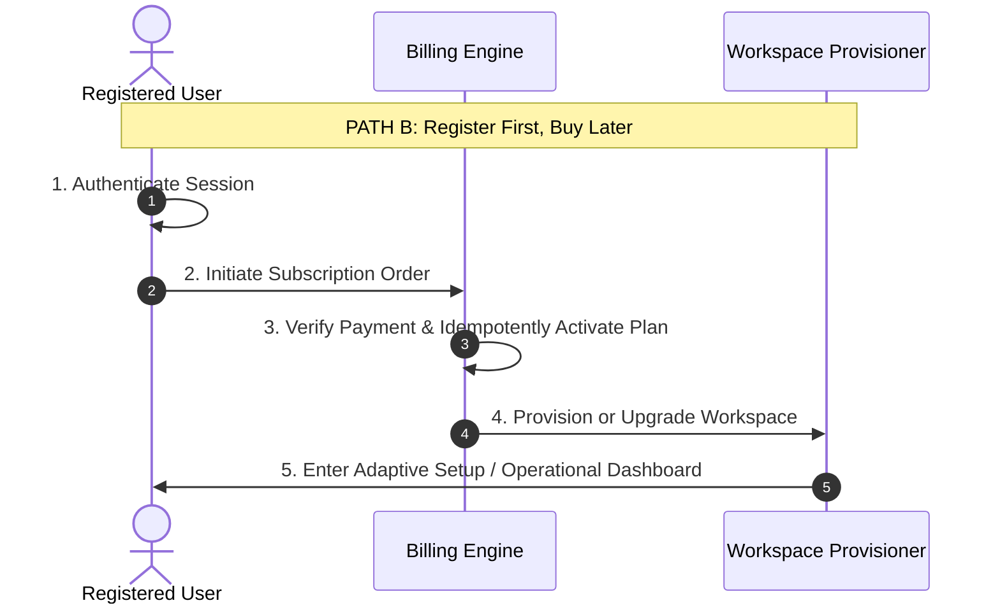

# SUBSCRIPTION-TO-WORKSPACE LIFECYCLE & IDENTITY DESIGN

**Repository Context:** `backend/src/services/billing.service.ts`, `backend/src/routes/workspace.routes.ts`  
**Date:** 2026-11-04

---

## 1. Entity Disambiguation

To prevent authorization bypasses, entitlement drift, and data corruption, the system cleanly isolates the following entities:

1. **User (`users`):** Authentication identity (email/phone, password hash, MFA).
2. **SubscriptionOrder (`subscription_orders`):** Commercial intent to purchase a plan (plan tier, duration, payment status).
3. **Payment (`payments`):** Verified transaction proof with external reference (Stripe/bank slip/cash).
4. **Subscription (`subscriptions`):** Active entitlement bound to a user or workspace (status, quota limits, expiry).
5. **Workspace (`workspaces`):** The isolated tenant boundary containing business data (`workspace_id`).
6. **BusinessProfile (`business_profiles` / `workspaces.business_dna`):** 8-axis configuration and trade metadata.
7. **CapabilitySet:** Resolved operational capabilities derived deterministically.
8. **PermissionSet (`role_capabilities`):** Role-based access control governing user actions.

---

## 2. Purchase Path Workflows

---

## 3. Security & Anti-Takeover Invariants

- **Never Trust Client Redirects:** Payment success must be verified directly via backend webhook or server-to-server inquiry.
- **Cryptographic Claim Tokens:** Claim tokens for Path A are high-entropy (256-bit), single-use, time-bounded (24 hours), and stored as SHA-256 hashes.
- **Idempotent Workspace Provisioning:** Retrying workspace creation with the same order/claim token returns the existing workspace without duplication.
- **Preservation on Expiry:** When a subscription lapses or expires, business data is **never deleted**. The workspace enters read-only grace period; historical invoices, ledgers, and offline mutations are preserved.
