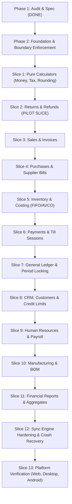

# HISABCHE — UNIFIED ONLINE/OFFLINE BUSINESS CORE AUDIT & ARCHITECTURE SPECIFICATION

**Canonical Audit Artifact**: `docs/architecture/UNIFIED-CORE-AUDIT.md`  
**Generated Date**: 2026-11-01  
**Architecture Principle**: **ONE DOMAIN CORE, MULTIPLE EXECUTION ADAPTERS.**  
No business capability may have two independent implementations of rules, financial calculations, validation, or state machines.

---

## 1. Comprehensive Capability Matrix

The following table documents the audited state of every major capability across the repository, based directly on source code inspection (`packages/validation`, `backend/src/services`, `packages/local-engine/src/routes`, `packages/app-shell/src/features/sync`, `packages/app-bridge`).

| Module / Feature                  | Rules Source (Canonical Core)                                                                              | Online Path (Server / DB)                                                                                  | Offline Path (Local Engine / SQLite)                                                                                       | Sync Mechanism                                                                      | Duplicate Logic Identified                                                                                                           | Online ↔ Offline Behavior Differences                                                                                                                      | Test Coverage                                                                                                          | Classification                                              |
| :-------------------------------- | :--------------------------------------------------------------------------------------------------------- | :--------------------------------------------------------------------------------------------------------- | :------------------------------------------------------------------------------------------------------------------------- | :---------------------------------------------------------------------------------- | :----------------------------------------------------------------------------------------------------------------------------------- | :--------------------------------------------------------------------------------------------------------------------------------------------------------- | :--------------------------------------------------------------------------------------------------------------------- | :---------------------------------------------------------- |
| **Invoice Returns (Pilot)**       | `packages/validation/src/schemas/universal-core/returns.domain.ts` & `returns-settlement.domain.ts`        | `backend/src/services/sales/invoice-return.service.ts` -> `invoice_return_create` (plpgsql)                | `packages/local-engine/src/routes/invoice-returns.ts` -> `calculateReturnDocument`                                         | Push via `sync-engine.ts:600` (`POST /invoices/:id/returns`) with stable `clientId` | Local engine historically used inline `Date.now()` / `Math.random()` for IDs instead of deterministic ID generator.                  | Server atomically creates journal reversal + restocks layers in SQL; local engine inserted rows without automatic layer restoration in SQLite.             | `returns-settlement.domain.test.ts`, `invoice-return-core.test.ts`, `invoice-return-05.pg.test.ts`                     | `SHARED_ALREADY` (Core extracted; adapter sync in progress) |
| **Cash Refunds & Payouts**        | `packages/validation/src/schemas/universal-core/returns-settlement.domain.ts` & `payments.domain.ts`       | `backend/src/services/payments/payments.service.ts` (`recordPayment`, `InvoiceReturnService.refundReturn`) | `packages/local-engine/src/routes/payments.ts` (the local payments route (`packages/local-engine/src/routes/payments.ts`)) | Push via `sync-engine.ts:563` (`POST /payments`)                                    | Prior local engine allowed unconstrained offline cash refund without verifying remaining invoice refundable ceiling or device quota. | Server enforces `refundableMinor()` and till cashbox balances; offline devices risk duplicate payouts if multiple devices refund the same invoice offline. | `customer-payout-is-a-refund.test.ts`, `payments-rule.test.ts`                                                         | `OFFLINE_WITH_SERVER_AUTHORIZATION`                         |
| **Sales & Invoices**              | `packages/validation/src/schemas/invoice-grid.ts` & `invoice-math.ts`                                      | `backend/src/services/invoice.service.ts`                                                                  | `packages/local-engine/src/routes/invoices.ts`                                                                             | Push via `sync-engine.ts:559` (`POST /invoices`)                                    | Both import pure `sumInvoiceLines` and `computeInvoiceMoney`.                                                                        | Postgres uses `numeric(18, 2)` major columns; SQLite stores `INTEGER` minor units. Server re-derives all lines and never trusts client totals.             | `invoice-math.parity.test.ts`, `invoice-grid.test.ts`, `invoice-derived-money.test.ts`                                 | `SHARED_ALREADY`                                            |
| **Purchasing & Bills**            | `packages/validation/src/schemas/purchasing.domain.ts` & `purchasing.schema.ts`                            | `backend/src/services/purchasing.service.ts`                                                               | `packages/local-engine/src/routes/purchasing.ts`                                                                           | Push via `sync-engine.ts` (`POST /purchases`)                                       | Validation schema shared; purchase status lifecycle enforced in service.                                                             | Server creates AP liability and journal lines; local engine records purchase bill and cost layer locally.                                                  | `packages/local-engine/src/__tests__/purchasing.test.ts`, `backend/src/__tests__/purchase-receive-once.test.ts`        | `SHARED_ALREADY`                                            |
| **Inventory Costing (FIFO/AVCO)** | `packages/validation/src/schemas/costing.domain.ts`                                                        | `backend/src/services/inventory-costing/costing.service.ts`                                                | `packages/local-engine/src/routes/costing.ts`                                                                              | Push via domain routes                                                              | Pure `planConsumption` and `planConsumption` shared in validation package.                                                           | "Unknown is not zero": when layer is depleted or missing, unit cost is strictly `null` (`cost_unknown`), never masked as 0.                                | `costing-rule.test.ts`, `cost-unknown-is-not-zero.test.ts`, `costing.test.ts`                                          | `SHARED_ALREADY`                                            |
| **Stock Movements & Transfers**   | `packages/validation/src/schemas/stock.ts` & `stock-summary.ts`                                            | `backend/src/services/warehouse.service.ts`                                                                | `packages/local-engine/src/routes/transfers.ts`                                                                            | Push via `sync-engine.ts:564` (`POST /stock-transfers`)                             | Shared validation schema.                                                                                                            | Server enforces negative stock policy (`refuse`, `warn`, `allow`) and updates warehouse summary tables atomically.                                         | `packages/local-engine/src/__tests__/transfer-cost-layers.test.ts`, `backend/src/__tests__/transfer-lifecycle.test.ts` | `SHARED_ALREADY`                                            |
| **Payments & Allocations**        | `packages/validation/src/schemas/payments.domain.ts` & `installment.domain.ts`                             | `backend/src/services/payments/payments.service.ts`                                                        | `packages/local-engine/src/routes/payments.ts`                                                                             | Push via `sync-engine.ts:563` (`POST /payments`)                                    | `validateAllocations`, `settlesInCurrency`, and currency isolation shared in `payments.domain.ts`.                                   | Server records PostgreSQL journal lines for AR/AP reduction; local engine records local payments table and outbox entry.                                   | `payments-rule.test.ts`, `payments-ar-ap-rules.test.ts`                                                                | `SHARED_ALREADY`                                            |
| **Till & POS Sessions**           | `packages/validation/src/schemas/pos.domain.ts` & `till-view.ts`                                           | `backend/src/services/pos/pos.service.ts`                                                                  | `packages/local-engine/src/routes/till.ts`                                                                                 | Push via `sync-engine.ts:608-624` (`/pos/sessions/:id/cash`, `/close`)              | Shared session status transitions (`open`, `closing`, `closed`) and expected cash calculations.                                      | Variance calculation is identical; server binds till session to PostgreSQL user and tenant.                                                                | `till.test.ts`, `pos-rules.test.ts`                                                                                    | `SHARED_ALREADY`                                            |
| **General Ledger & Accounting**   | `packages/validation/src/schemas/accounting.domain.ts` & `invoice-posting.domain.ts`                       | `backend/src/services/accounting/ledger.port.ts` & `accounting.service.ts`                                 | `packages/local-engine/src/routes/local-ledger.ts` & `accounting.ts`                                                       | Push via `sync-engine.ts:568, 650` (`POST /accounting/journal/:id/reverse`)         | `buildGeneralLedger`, `validateEntryLines`, `evaluatePeriodLock` shared in `accounting.domain.ts`.                                   | Local ledger generates local journal entries; on sync, financial documents re-post through server domain engine.                                           | `ledger-rule.test.ts`, `reversal-ledger.test.ts`, `one-financial-engine.test.ts`                                       | `SHARED_ALREADY`                                            |
| **Customer Credit & Risk**        | `packages/validation/src/schemas/customer-risk.domain.ts` & `credit-limit.domain.ts`                       | `backend/src/services/customer.service.ts`                                                                 | `packages/local-engine/src/routes/customers.ts`                                                                            | Push via `sync-engine.ts:560` (`POST /customers`)                                   | `evaluateCreditLimit` and risk calculation functions shared in validation.                                                           | Local engine enforces soft warning or hard block based on cached outstanding invoice totals.                                                               | `packages/validation/src/schemas/universal-core/credit-limit.domain.ts` (no dedicated test file found by M0)           | `SHARED_ALREADY`                                            |
| **Payroll & Human Resources**     | `packages/validation/src/schemas/payroll-rules.ts` & `human-resources.schema.ts`                           | `backend/src/services/human-resources.service.ts`                                                          | `packages/local-engine/src/routes/payroll.ts` & `employees.ts`                                                             | Push via domain routes (`POST /api/payrolls`)                                       | `planPayrollOutcome` shared; net salary, deduction, and bonus math identical.                                                        | Server books salary expenses to GL on status `paid`; local engine stages payroll locally.                                                                  | `payroll-outcome.test.ts`, `payroll-ledger.test.ts`, `people.test.ts`                                                  | `SHARED_ALREADY`                                            |
| **Financial Reporting**           | `packages/validation/src/schemas/profit-report.domain.ts`, `break-even.domain.ts`, `collections.domain.ts` | `backend/src/services/accounting/profit-report.domain.ts`                                                  | `packages/local-engine/src/routes/reports.ts` & `analysis.ts`                                                              | Local execution / Pull snapshot                                                     | Pure report aggregation functions shared in `packages/validation`.                                                                   | Local engine computes reporting aggregates directly from SQLite tables when offline; server computes from Postgres views.                                  | `profit-report.test.ts`, `golden-vectors.test.ts`                                                                      | `SHARED_ALREADY`                                            |
| **Automations & Workflows**       | `packages/validation/src/schemas/automation.schema.ts`                                                     | `backend/src/services/automation/`                                                                         | None                                                                                                                       | None                                                                                | Workflow execution engine exists server-side only.                                                                                   | Local engine has no workflow execution runner.                                                                                                             | `backend/src/__tests__/automation-service.test.ts`                                                                     | `ONLINE_REQUIRED_BY_DESIGN`                                 |
| **AI Insights & Assistant**       | `packages/validation/src/schemas/ai.schema.ts`                                                             | `backend/src/services/ai/ai-chat.service.ts`                                                               | `packages/local-engine/src/routes/insights.ts` (cached static heuristic)                                                   | None                                                                                | Local engine provides deterministic heuristic rule-based insights without LLM API calls.                                             | Server talks to external Gemini/OpenAI API; local fallback uses rule heuristics.                                                                           | `backend/src/__tests__/ai-boundary-guard.test.ts`                                                                      | `ONLINE_REQUIRED_BY_DESIGN` (for LLM API)                   |
| **OAuth & Developer API**         | `packages/validation/src/schemas/auth.schema.ts`                                                           | `backend/src/services/oauth/`                                                                              | None                                                                                                                       | None                                                                                | Cloud multi-tenant API gateway and credential issuance.                                                                              | Not applicable offline.                                                                                                                                    | `oauth.test.ts`                                                                                                        | `ONLINE_REQUIRED_BY_DESIGN`                                 |

---

## 2. Dead Code, Orphan APIs & Parallel Paths Audit

1. **Unwired Local Engine Endpoints**:
   - `packages/local-engine/src/routes/tax.ts`: Provides local tax breakdown calculation, but UI primarily invokes `@hisabche/validation` directly in the renderer rather than making an HTTP call to the local engine router.
   - `packages/local-engine/src/routes/derived-id.ts`: Helper utility endpoint; production code generates deterministic client IDs in `@hisabche/app-bridge` without local REST roundtrip.
2. **Parallel Outbox Paths**:
   - Historical code had two parallel routing mechanisms for queued mutations:
     - `push-routing.ts:routeFor`: Determines `'domain'` vs `'versioned'`.
     - `sync-engine.ts:ENDPOINT_BY_ENTITY`: Maps entity table names to REST paths.
   - _Resolution_: `sync-engine.ts` now uses `routeFor` as the single canonical decision gate; all financial mutations are forced to `'domain'`, stripping financial fields from any versioned sync path.
3. **Orphaned Ports Scaffolding**:
   - Previously, `packages/validation/src/schemas/domain-ports.ts` declared abstract `Clock`, `IdGenerator`, and `UnitOfWork` interfaces with zero consumers. This was deleted in ADR-006, and `architecture-boundaries.test.ts` verifies it has not returned. Real domain functions accept injected timestamps and IDs as parameters.

---

## 3. Duplicated Rule Sets & Behavioral Discrepancies

1. **Identifier and Timestamp Generation (Determinism)**:
   - _Backend_: Postgres generates UUIDs (`gen_random_uuid()`) or accepts caller-provided `id` / `clientRequestId`.
   - _Local Engine (Legacy)_: Used `Date.now()` and `Math.random().toString(36)`.
   - _Unified Core Fix_: All domain operations must accept an injected `id` and `now` timestamp (or derive them from the versioned command envelope).
2. **Money Precision and Representation**:
   - _PostgreSQL_: `numeric(18, 2)` for major currency units, converted to `bigint` minor units in plpgsql functions.
   - _SQLite_: Integer columns storing minor units (cents, pols, dinars) exclusively.
   - _Shared Core_: Integer minor units (`number` safe up to $90M, `bigint` for larger sums). Zero floating-point division on the money path; rounding is applied once to integer minor units.
3. **Returns Cost Layer Restoration**:
   - _PostgreSQL (`invoice_return_create`)_: Reads the original sale's cost layer consumption from `cost_consumption` and restores layers into `cost_layer` atomically.
   - _Local Engine_: In `invoice-returns.ts`, return documents were inserted into `invoice_returns` and `invoice_return_lines`, but the local inventory cost layers were not updated in the same local transaction.
   - _Requirement for Pilot Slice_: Local return handler must execute `calculateReturnDocument` and atomically update local `product_stock` and `cost_layer` records, then enqueue the sync command.

---

## 4. Dependency Direction Analysis

A strict mechanical boundary is maintained:

```
           ┌────────────────────────────────────────┐
           │        @hisabche/validation            │
           │  (Shared Domain Core: Pure TS / Zod)   │
           └───────────────────▲────────────────────┘
                               │
            ┌──────────────────┴──────────────────┐
            │                                     │
┌───────────┴──────────┐              ┌───────────┴──────────┐
│  @hisabche/backend   │              │@hisabche/local-engine│
│(Fastify + PostgreSQL)│              │  (SQLite + Outbox)   │
└───────────▲──────────┘              └───────────▲──────────┘
            │                                     │
            └──────────────────┬──────────────────┘
                               │
                    ┌──────────┴──────────┐
                    │ @hisabche/app-shell │
                    │ (Sync Engine / Host)│
                    └─────────────────────┘
```

- **Boundary Verification**: `packages/validation/src/__tests__/architecture-boundaries.test.ts` scans all source files in `packages/validation/src` and asserts **0 imports** from `@hisabche/ui`, `@hisabche/api`, `@hisabche/app-shell`, `@hisabche/local-engine`, `@hisabche/app-bridge`, `backend/`, `react`, `electron`, `react-native`, `better-sqlite3`, or `@supabase/supabase-js`.
- Status: **VERIFIED PASS (4/4 tests pass)**.

---

## 5. Outbox Format, Idempotency & Sync Engine

1. **Local SQLite Outbox Table (`sync_queue`)**:
   ```sql
   CREATE TABLE sync_queue (
     id INTEGER PRIMARY KEY AUTOINCREMENT,
     client_id TEXT NOT NULL UNIQUE,
     entity TEXT NOT NULL,
     operation TEXT NOT NULL,
     payload TEXT NOT NULL,
     attempts INTEGER NOT NULL DEFAULT 0,
     status TEXT NOT NULL DEFAULT 'pending',
     error TEXT,
     created_at TEXT NOT NULL,
     updated_at TEXT NOT NULL,
     user_id TEXT,
     workspace_id TEXT NOT NULL
   );
   ```
2. **Idempotency Guarantee**:
   - Every mutating request carries an `Idempotency-Key` derived from `clientId`.
   - The backend stores the key in a `client_request_id` column (e.g. `payments`, `invoices`, `invoice_returns`) (`workspace_id, client_request_id, response_status, response_body`) and returns cached replay responses for identical requests.
3. **Conflict Handling Protocol**:
   - `AUTO_RESOLVABLE`: Pure descriptive updates (e.g. customer address) with newer server version win.
   - `BUSINESS_RULE_RESOLUTION`: Concurrent inventory updates re-evaluate stock thresholds; financial documents never use Last-Write-Wins.
   - `HUMAN_REVIEW`: Conflicting financial operations (e.g. concurrent void/reversal) are placed in `sync_conflicts` table for human resolution.
4. **Local DB Schema & Migrations**:
   - Current Schema Version: `SCHEMA_VERSION = 9` (defined in `packages/app-bridge/src/local-schema.ts`).
   - Migration Runner: `packages/app-bridge/src/local-migrations.ts` runs versioned upgrade scripts (`to: 2..9`) idempotently.

---

## 6. Offline Policy Classification

| Category                                | Definition                                                                                                               | Capabilities Included                                                                                                                                                                |
| :-------------------------------------- | :----------------------------------------------------------------------------------------------------------------------- | :----------------------------------------------------------------------------------------------------------------------------------------------------------------------------------- |
| **`OFFLINE_FULL`**                      | Executes fully offline with zero network connectivity; writes to local DB + durable outbox; re-evaluates on server sync. | Invoices, Invoice Returns (Document & Restock), Purchases, Stock Adjustments, Transfers, Attendance Clock In/Out, Till Session Operations, Local Payments against existing invoices. |
| **`OFFLINE_WITH_SERVER_AUTHORIZATION`** | Risky financial operations requiring a cryptographic lease or bounded quota pre-issued by the server while online.       | Cash refunds, Credit limit extensions, Manual supervisor discounts > 20%, Period-lock override posting.                                                                              |
| **`ONLINE_REQUIRED_BY_DESIGN`**         | Strictly requires external third-party APIs, cross-tenant identity, or webhook infrastructure.                           | External payment processing (Stripe/Card), SMS/Email delivery, AI Chat Assistant (LLM), OAuth application authorization, Cloud database backup rehydration.                          |
| **`LOCAL_ONLY_BY_DESIGN`**              | Device-specific configuration that does not replicate across workspaces.                                                 | Thermal receipt printer settings, Cash drawer COM port, Offline license hardware ID cache, Device UI display zoom.                                                                   |

---

## 7. Migration Plan (Strangler Pattern, Ordered Slices)



### Detailed Slice Breakdown

1. **Phase 2 — Foundation (Immediate Next Step)**:
   - Establish mechanical boundary tests.
   - Establish command contract envelope format in `@hisabche/validation`.
   - Build unified Parity Harness for cross-adapter output comparison (Local SQLite vs Remote PostgreSQL vs Pure Core).
   - Gate: `pnpm --filter @hisabche/validation test` & parity harness test pass.
2. **Slice 1 — Pure Financial Calculators**:
   - Scope: `invoice-math.ts`, `tax.domain.ts`, `currency-catalogue.ts`, `unit-conversion.domain.ts`.
   - Gate: Golden vectors 20/20 pass across validation, local-engine, and backend.
3. **Slice 2 — Returns & Refunds (Pilot Slice)**:
   - Scope: `returns.domain.ts`, `returns-settlement.domain.ts`, `invoice-returns.ts` (local engine), `invoice-return.service.ts` (backend), offline lease check for cash refunds.
   - Prove parity: Return calculation, multi-deduction calculation, tax allocation, refundable amount.
   - Gate: All returns tests in validation, backend, and local engine pass.
4. **Slice 3 — Sales & Invoices**:
   - Wire local engine and backend invoice create/update to shared `sumInvoiceLines` and `computeInvoiceMoney`.
   - Gate: `invoice-derived-money.test.ts` and `invoice-grid.test.ts` pass.
5. **Slice 4 through 13**:
   - Executed systematically following the strangler pattern, updating `UNIFIED-CORE-PROGRESS.md` at each milestone.
