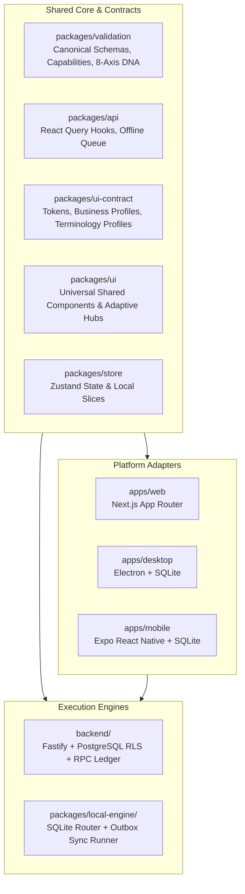
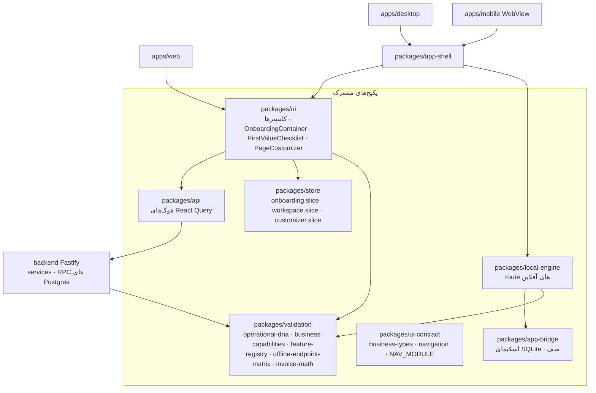
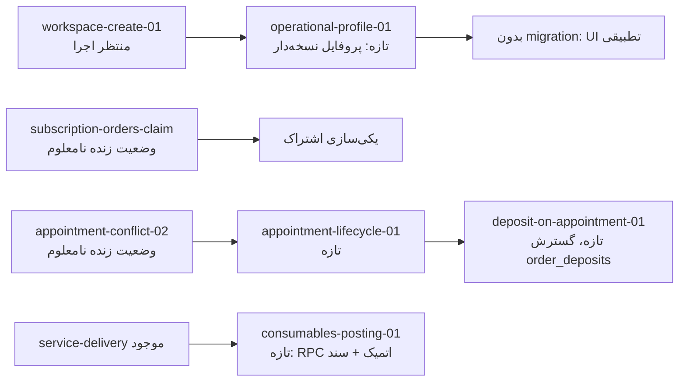

# HISABCHE V54.0-HIGH: UNIVERSAL BUSINESS OPERATING SYSTEM

## Architectural Blueprint & Shared Core Design

**Repository Root:** `C:\Users\hamed\Desktop\hisabche`  
**Status:** PHASE 5.0 READ-ONLY AUDIT & ARCHITECTURE DESIGN  
**Date:** 2026-11-04

---

## 1. Architectural Mission & Core Invariant

The mission of **Hisabche V54.0** is to evolve the platform from an inventory-and-retail-centric application into a **Universal Adaptive Business Operating System** serving diverse business archetypes (Retail Store, Nail Tech, Beauty Salon, Language Teacher, Training Institute, Repair Workshop, Freelancer, Professional Services, Wholesale, Manufacturing, and Hybrid Businesses).

### Non-Negotiable Core Principle

> **ONE BUSINESS DOMAIN · ONE CANONICAL DATA MODEL · ONE FINANCIAL RULESET · ONE CAPABILITY RESOLUTION MODEL · MULTIPLE PLATFORM ADAPTERS.**

### Prohibited Anti-Patterns

1. **No Industry Conditionals in Domain Logic:**
   Financial and transactional calculations must **never** check `if (industry === 'NAIL_TECH')` or `if (industry === 'TEACHER')`.
2. **No Parallel Domain Engines:**
   There must never be a second appointment engine, second accounting ledger, second invoice calculator, or second sync engine.
3. **No Float Arithmetic:**
   All monetary amounts are strictly maintained as **Integer Minor Units** across all paths.

---

## 2. The Eight Operational Axes (Business DNA)

Rather than hardcoded industry monoliths, each business workspace resolves its operational behavior through 8 composable axes defined in `packages/validation/src/schemas/operational-dna.ts`:

1. **AXIS 1: Offering Model**
   - `PHYSICAL_GOODS` | `TIME_SERVICE` | `PACKAGE_SESSION` | `DELIVERABLE_SERVICE` | `MIXED_OFFERING`
2. **AXIS 2: Intake & Delivery**
   - `COUNTER_POS` | `APPOINTMENT_BOOKING` | `CLASS_ATTENDANCE` | `JOB_TICKET` | `PROJECT_DELIVERY` | `WALK_IN` | `MIXED_INTAKE`
3. **AXIS 3: Inventory Behavior**
   - `NONE` | `RETAIL_STOCK` | `SERVICE_CONSUMABLES` | `SPARE_PARTS` | `RAW_MATERIALS` | `FINISHED_GOODS` | `HYBRID_INVENTORY`
4. **AXIS 4: Billing & Settlement**
   - `IMMEDIATE_SETTLEMENT` | `DEPOSIT_PREPAYMENT` | `PACKAGE_CREDITS` | `INSTALLMENT_RECEIVABLES` | `CUSTOMER_CREDIT` | `SUBSCRIPTION_BILLING` | `MIXED_SETTLEMENT`
5. **AXIS 5: Workforce Model**
   - `SOLO_OWNER` | `COMMISSION_PROVIDERS` | `HOURLY_STAFF` | `SALARIED_STAFF` | `SHIFT_BASED_STAFF` | `MIXED_WORKFORCE`
6. **AXIS 6: Customer / Party Profile**
   - `STANDARD_PARTY` | `CLIENT_CARE_PROFILE` | `STUDENT_PROFILE` | `BUSINESS_ACCOUNT` | `SERVICE_ASSET_PROFILE` | `MIXED_PROFILE`
7. **AXIS 7: Operational Topology**
   - `SINGLE_LOCATION` | `MULTI_BRANCH` | `MOBILE_SERVICE` | `RESOURCE_CAPACITY` | `SEAT_OR_ROOM_BASED` | `WAREHOUSE_NETWORK`
8. **AXIS 8: Terminology & Presentation**
   - Derived layout, label mappings, navigation hubs, and dashboard cards.

---

## 3. Reference Archetype Workflows

### 3.1 Nail Technician / Beauty Salon (Reference Scenario)

- **Configuration:** `TIME_SERVICE + PHYSICAL_GOODS`, `APPOINTMENT_BOOKING + WALK_IN`, `SERVICE_CONSUMABLES + RETAIL_STOCK`, `DEPOSIT_PREPAYMENT + IMMEDIATE_SETTLEMENT`, `CLIENT_CARE_PROFILE`.
- **Step-by-Step Financial & Operational Flow:**
  1. **Booking:** Client books a 1,500 AFN gel nail extension. Resource capacity (nail station/technician) is locked.
  2. **Deposit Receipt (Prepayment):**
     - Receipt of 300 AFN deposit.
     - Journal Posting:
       - `Dr Cash / Bank`: 300 AFN
       - `Cr Customer Advances (Liability)`: 300 AFN
     - Deposit is strictly recognized as a liability, **never revenue** (`order-deposit.service.ts`).
  3. **Check-In & Service Delivery:** Appointment moves to `CHECKED_IN` -> `COMPLETED`.
  4. **Consumable Consumption:**
     - Consumed materials (gel polish, tips, sanitizers) tracked via `service_consumables`.
     - Inventory reduction using FIFO/AVCO cost layers.
     - Journal Posting: `Dr Consumable Expense / COGS`, `Cr Inventory Asset`.
  5. **Invoicing & Deposit Clearance:**
     - Invoice generated for 1,500 AFN.
     - Deposit of 300 AFN applied:
       - `Dr Customer Advances`: 300 AFN
       - `Dr Cash / Bank (Remaining)`: 1,200 AFN
       - `Cr Service Revenue`: 1,500 AFN
     - Liability cleared; net cash collected is 1,200 AFN; total revenue booked is 1,500 AFN.

### 3.2 Language Teacher / Training Institute

- **Configuration:** `PACKAGE_SESSION`, `CLASS_ATTENDANCE`, `PACKAGE_CREDITS`, `STUDENT_PROFILE`.
- **Flow:** Student purchases a 10-session package (10,000 AFN). Booked as deferred revenue (`Customer Advances`). Each attendance decrements package balance by 1 credit and recognizes 1,000 AFN earned revenue.

### 3.3 General Service & Repair Workshop

- **Configuration:** `DELIVERABLE_SERVICE + PHYSICAL_GOODS`, `JOB_TICKET`, `SPARE_PARTS`, `DEPOSIT_PREPAYMENT`, `SERVICE_ASSET_PROFILE`.
- **Flow:** Customer drops off vehicle/phone. Asset profile and defect logged on Job Ticket. Parts reserved from inventory. Deposit taken on intake. Final settlement consumes spare parts and bills labor hours.

---

## 4. Multi-Platform Shared Parity Architecture

| Capability Layer      | Online Backend (`backend/`)                  | Offline Local Engine (`packages/local-engine/`) | Desktop (`apps/desktop/`) & Mobile (`apps/mobile/`) |
| :-------------------- | :------------------------------------------- | :---------------------------------------------- | :-------------------------------------------------- |
| **Persistence**       | PostgreSQL 16 + RLS                          | SQLite (56 local tables)                        | SQLite via `better-sqlite3` / `expo-sqlite`         |
| **Tenancy Boundary**  | `workspace_id` via `requireWorkspaceContext` | `workspace_id` in local schema tables           | Bound to active workspace session                   |
| **Financial Posting** | `ledger.postDocument` RPC                    | Local provisional ledger posting                | Replayed through outbox sync                        |
| **Appointments**      | `AppointmentService` + conflict check        | **MISSING (To be added in V54.1)**              | UI mounted in WebView / App Shell                   |
| **Order Deposits**    | `order_deposit_apply` RPC                    | `routes/order-deposits.ts`                      | Local SQLite outbox transaction                     |
| **Adaptive UI**       | N/A (Headless Fastify REST API)              | Local HTTP dispatcher                           | Universal `packages/ui` hubs                        |

---

## ممیزی Phase 5.0 — ۷ نوامبر ۲۰۲۶ (بازبینی با کد)

> این بخش جای بخش‌های طراحیِ بالا را نمی‌گیرد؛ می‌گوید **امروز در کد چه هست**. هر جا بالاتر چیزی ادعا شده و این‌جا خلافش آمده، این بخش ملاک است.
> فقط خواندن کد؛ هیچ تغییر V54 در این دور. پیشرفت: [V54-IMPLEMENTATION-PROGRESS.md](V54-IMPLEMENTATION-PROGRESS.md).

### A. نقشه‌ی معماری موجود

### B. پکیج‌های مشترک و مالک هر مسئولیت

| مسئولیت                                           | مالک فعلی                                                                                                                           | فایل                                                                                              |
| ------------------------------------------------- | ----------------------------------------------------------------------------------------------------------------------------------- | ------------------------------------------------------------------------------------------------- |
| اسکیمای ۸ محور DNA + preset + resolver            | `packages/validation`                                                                                                               | `src/schemas/operational-dna.ts:18-345`                                                           |
| فهرست قابلیت‌های کسب‌وکار و `resolveCapabilities` | `packages/validation`                                                                                                               | `src/schemas/business-capabilities.ts:81,391`                                                     |
| مجوز و نسخه‌ی اشتراک (entitlement)                | `packages/validation` → `backend/src/services/entitlement.service.ts` و `packages/ui/src/lib/capability/use-action-availability.ts` | `feature-registry.ts`                                                                             |
| آفلاین بودن هر endpoint                           | `packages/validation`                                                                                                               | `src/schemas/offline-endpoint-matrix.ts` (۱۹۱ available / ۳۱۰ online_required / ۱۵ not_supported) |
| مجوز کاربر (permission)                           | `backend/src/services/authorization/authorization.domain.ts:50` (`CAPABILITIES`) + `requireCapability`                              | —                                                                                                 |
| فهرست صنف‌ها برای onboarding                      | `packages/ui-contract/src/business-types.ts`                                                                                        | —                                                                                                 |
| پروفایل کسب‌وکار روی سرور                         | `backend/src/services/workspace-profile.ts`                                                                                         | ستون `workspaces.business_types`                                                                  |
| نمای شخصی (پنهان/نمایش منو و تب)                  | `packages/ui/src/lib/page-look.ts` (`usePageLook`) + `global-page-customizer.tsx`                                                   | فقط روی دستگاه                                                                                    |

**خطر موتور دوم:** دو ثبت قابلیت هم‌نام وجود دارد — `CAPABILITIES` در `authorization.domain.ts` (مجوز کاربر) و `CAPABILITIES` در `business-capabilities.ts` (قابلیت کسب‌وکار). مفهوم‌ها درست جدا هستند (همان «Capability ≠ Permission» شما) ولی نام یکی است؛ پیش از 5.2 باید نام قابلیت کسب‌وکار روشن شود.

### C. ماتریس هم‌ارزی آنلاین/آفلاین/پلتفرم برای عملیات V54

| عملیات              | بک‌اند                            | موتور محلی                                         | وب                                  | ویندوز/اندروید (UI) |
| ------------------- | --------------------------------- | -------------------------------------------------- | ----------------------------------- | ------------------- |
| ثبت DNA/پروفایل     | فقط `business_types`              | —                                                  | onboarding (محلی)                   | onboarding (محلی)   |
| نوبت                | list/create                       | ❌ (`online_required`)                             | ❌ UI                               | ❌ UI               |
| جلسه‌ی خدمت         | ✅ (`service-delivery.routes.ts`) | ✅ (`local-engine/src/routes/service-delivery.ts`) | ✅ `service-delivery-container.tsx` | ✅                  |
| بسته‌ی اعتباری      | ✅                                | ✅                                                 | از فاکتور                           | از فاکتور           |
| بیعانه (سفارش)      | ✅ با سند                         | ✅ (`order-deposits.ts`)                           | ❌ UI                               | ❌ UI               |
| مصرف مواد           | جزئی، بی‌سند                      | ؟ (route محلی همان جلسه)                           | ❌ UI                               | ❌ UI               |
| سفارش اشتراک / ادعا | ✅                                | ❌ (`online_required`، درست)                       | ❌ UI                               | ❌ UI               |

### D. اشتراک تا workspace — یافته‌ها

- **دو مسیر موازی خرید:** `subscription-upgrade.service.ts` (صفحه‌ی `/billing` از آن استفاده می‌کند؛ ادمین تأیید می‌کند) و `subscription-order.service.ts` (مسیر A/B، توکن ادعا) که **هیچ UI ای صدایش نمی‌زند**. طبق قاعده‌ی «یک ماشین وضعیت» باید یکی شوند.
- توکن ادعا درست طراحی شده: `randomBytes(32)`، ذخیره‌ی SHA-256، انقضای ۲۴ ساعته (`subscription-order.service.ts:58-101`).
- **تأیید پرداخت از درگاه وجود ندارد**؛ `POST /api/billing/orders/:id/verify-payment` فقط برای مدیر پلتفرم است. «بازگشت کلاینت = اثبات پرداخت» رخ نمی‌دهد (خوب) ولی پرداخت خودکار هم نیست.
- Trial هنگام اولین خواندن billing ساخته می‌شود و ۷ روز ثابت است (`billing.service.ts:126,300`).
- workspace در ثبت‌نام ساخته می‌شود؛ در شاخه‌ی همین ممیزی اتمیک شد (`workspace_create_with_owner`، `docs/workspace-create-01-migration.sql` — منتظر اجرا).
- OTP/تأیید ایمیل وجود ندارد (`auth.routes.ts:360` `email_confirm: true`) ⇒ گام ۸ مسیر A («پس از تأیید هویت، اتصال اشتراک») امروز ناممکن است.

### E. پیشنهاد اسکیمای DNA (گسترش همان فایل، نه فایل دوم)

۷ محور اول در `operational-dna.ts` هست. پیشنهاد:

1. افزودن `workspaceId`، `version` (هست)، `updatedBy`، `updatedAt` و جدول تاریخچه‌ی append-only روی سرور: `workspace_operational_profiles` (migration تازه).
2. محور ۸ را از `terminology` تکی به `presentation: { terminologyProfile, navigationProfile, dashboardProfile }` گسترش دهید — **کلیدهای i18n**، نه متن.
3. `archetypeHint` فقط برای onboarding/تحلیل بماند؛ هیچ سرویس مالی آن را نخواند (امروز هم نمی‌خواند — `grep` روی `backend/src/services` صفر شرط صنفی پیدا کرد).
4. `resolveDnaCapabilities` را به `resolveCapabilities` موجود بسپارید (یک resolver)، و entitlement را مثل امروز جدا نگه دارید.

### F. مرز Capability / Entitlement / Permission

| بررسی                          | امروز                                          | کجا                                                                                   |
| ------------------------------ | ---------------------------------------------- | ------------------------------------------------------------------------------------- |
| Capability (پیکربندی کسب‌وکار) | **اجرا نمی‌شود** — نه در API، نه در موتور محلی | resolver فقط در UI چک‌لیست                                                            |
| Entitlement (اشتراک)           | ✅                                             | `entitlement.service.ts`، `useSubscriptionLocked`، سرور نوشتن منقضی را رد می‌کند      |
| Permission (کاربر)             | ✅ ولی ناقص                                    | `requireCapability`؛ `POST /api/invoices` و نوبت (`invoice.create`) بدون مجوز اختصاصی |

### G. چهار workflow مرجع — پوشش امروز

| Archetype              | امروز کار می‌کند                                          | گم                                                                                               |
| ---------------------- | --------------------------------------------------------- | ------------------------------------------------------------------------------------------------ |
| GOODS_RETAIL           | فروش، خرید (فاکتور خرید)، انبار، بها، مرجوعی، صندوق، دفتر | UI سفارش خرید                                                                                    |
| NAIL_TECH_BEAUTY       | جلسه‌ی خدمت، فاکتور، پرداخت                               | صنف «ناخن/سالن زیبایی» در فهرست نیست؛ UI نوبت؛ بیعانه‌ی نوبت؛ مصرف مواد با سند؛ کمیسیون؛ یادآوری |
| LANGUAGE_TEACHER       | بسته‌ی اعتباری و جلسه، حضور کارمند                        | حضور شاگرد، پروفایل شاگرد                                                                        |
| GENERAL_SERVICE_REPAIR | جلسه‌ی خدمت، گارانتی (یک مصرف‌کننده)                      | تیکت تعمیر با وضعیت، دارایی مشتری (`useVehicles` بی‌مصرف‌کننده)                                  |
| MIXED_BUSINESS         | همه‌ی هسته‌ها مشترک‌اند                                   | DNA چندمحوری روی سرور                                                                            |

### H. جریان مالی ناخن‌کار (۱۵۰۰ افغانی، بیعانه ۳۰۰) — امروز

| گام                    | ممکن؟          | چرا                                                                                       |
| ---------------------- | -------------- | ----------------------------------------------------------------------------------------- |
| ۱ نوبت                 | فقط با API     | UI نیست؛ چک تداخل هست                                                                     |
| ۲ بیعانه ۳۰۰           | ❌ برای نوبت   | `order-deposit` به **سفارش فروش** بسته است؛ سند `Dr نقد / Cr customer_advances` آماده است |
| ۳ check-in             | ❌             | وضعیت نیست                                                                                |
| ۴ انجام خدمت           | ✅ جلسه‌ی خدمت | پیوند به نوبت نیست                                                                        |
| ۵ فاکتور با کسر بیعانه | ❌ مستقیم      | «اعمال بیعانه» روی سفارش هست (`/orders/:x/deposits/:x/apply`)، روی فاکتورِ مستقل نه       |
| ۶ تسویه ۱۲۰۰           | ✅ پرداخت      | —                                                                                         |
| ۷ مواد مصرفی           | ⚠️             | حرکت انبار و لایه‌ی بها بله؛ سند دفتر نه؛ غیراتمیک                                        |
| ۸ CRM/یادآوری          | جزئی           | یادداشت مشتری هست؛ یادآوری ۲۱ روزه نیست                                                   |
| ۹ گزارش‌ها             | جزئی           | درآمد/مانده بله؛ مانده‌ی بیعانه و هزینه‌ی مواد گزارش جدا ندارند                           |

### I. فهرست کمبودها (به ترتیب وابستگی)

1. تأیید ایمیل/OTP (پیش‌نیاز اتصال امن اشتراک).
2. یکی‌کردن دو مسیر خرید اشتراک + UI خرید.
3. ذخیره‌ی سروری، نسخه‌دار و append-only پروفایل DNA.
4. onboarding با سؤال تطبیقی و پیشرفت سروری (cross-device).
5. اجرای capability در API و موتور محلی.
6. چرخه‌ی وضعیت نوبت + UI + route محلی (pending).
7. بیعانه‌ی متصل به نوبت/مشتری (گسترش `order-deposit`، نه موتور دوم).
8. مصرف مواد اتمیک با سند دفتر و کلید یکتایی.
9. منو/داشبورد/واژگان از DNA.
10. آزمون E2E هر archetype.

### J. وابستگی migration ها

### K. ریسک امنیت و یکپارچگی

| ریسک                                          | شدت                  | شاهد                                                                |
| --------------------------------------------- | -------------------- | ------------------------------------------------------------------- |
| مصرف مواد غیراتمیک، بی‌سند، بی‌کلید یکتایی    | بالا                 | `service-delivery.service.ts:308-340`                               |
| نبود تأیید ایمیل ⇒ اتصال اشتراک به ایمیل جعلی | بالا                 | `auth.routes.ts:360`                                                |
| دو موتور خرید اشتراک                          | متوسط                | `subscription-upgrade.service.ts` / `subscription-order.service.ts` |
| DNA فقط روی دستگاه ⇒ دو دستگاه، دو محیط       | متوسط                | `onboarding.slice.ts`                                               |
| تداخل نوبت آفلاین                             | — (هنوز آفلاین نیست) | ماتریس آفلاین                                                       |
| capability فقط در UI                          | متوسط                | بخش F                                                               |

### L. برنامه‌ی آزمون

هر قاعده‌ی دیتابیس: `*.pg.test.ts` (دو بار اجرای migration، VERIFY، رد با نام، هم‌زمانی). هر عملیات آفلاین: آزمون موتور محلی + `offline-endpoint-matrix` + آزمون sync تکراری. هر archetype: یک سناریوی کامل در `financial-flows-e2e.test.ts`. **مسدودکننده‌ی فعلی:** باینری embedded-postgres روی این دستگاه نیست؛ بیلد ویندوز/اندروید به دلیل قفل فایل موقت esbuild.

### M. ترتیب پیشنهادی

5.1-الف تأیید ایمیل → 5.1-ب یکی‌سازی اشتراک → 5.2 پروفایل سروری نسخه‌دار → 5.3 onboarding تطبیقی → 5.5 چرخه‌ی نوبت → 5.4 بیعانه‌ی نوبت و مواد اتمیک → 5.6 UI تطبیقی (همراه دکمه‌ی تنظیمات «صفحه‌ها و تب‌ها») → 5.7 → 5.8 → 5.9.

### N. تصمیم‌های شما

1. ارائه‌دهنده‌ی OTP: ایمیل (Resend موجود) یا پیامک (هیچ ارائه‌دهنده‌ای در کد نیست)؟
2. کدام مسیر اشتراک بماند: `subscription-upgrade` یا `subscription-order`؟ درگاه پرداخت کدام؟
3. مدت Trial ثابت ۷ روز بماند یا از ادمین تنظیم شود؟
4. بیعانه‌ی نوبت: گسترش `order_deposits` با `appointment_id`، یا ساخت سفارش فروش برای هر نوبت؟
5. سند مصرف مواد: بدهکار «هزینه‌ی مواد» یا «بهای تمام‌شده‌ی خدمات»؟ زمان: لحظه‌ی خدمت یا فاکتور؟
6. صنف «ناخن/سالن زیبایی» به `business-types.ts` اضافه شود؟ (امروز نزدیک‌ترین: `barber`.)
7. کمیسیون ارائه‌دهنده‌ی خدمت: درصد خدمت یا ثابت؟ به حقوق وصل شود؟
8. منوی پیش‌فرض از DNA: فقط **پیشنهاد** اولیه (کاربر بعد با دکمه‌ی تنظیمات تغییر دهد) یا قفل؟

### O. شاهد

همه‌ی مسیرهای بالا در کامیت `28154aca` خوانده شد؛ اعداد ماتریس آفلاین با شمارش ردیف‌های `'METHOD /path'`؛ «صفر مصرف‌کننده» با `grep -rlw <hook> packages apps` بدون `node_modules`/`__tests__`.
