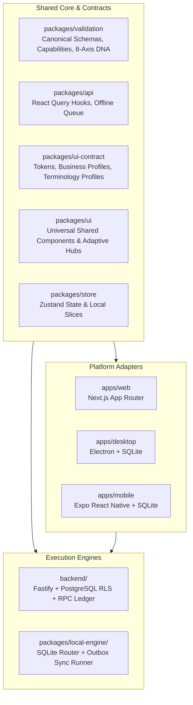

# HISABCHE V54.0-HIGH: UNIVERSAL BUSINESS OPERATING SYSTEM

## Architectural Blueprint & Shared Core Design

**Repository Root:** `C:\Users\hamed\Desktop\hisabche`  
**Status:** PHASE 5.0 READ-ONLY AUDIT & ARCHITECTURE DESIGN  
**Date:** 2026-11-04

---

## 1. Architectural Mission & Core Invariant

The mission of **Hisabche V54.0** is to evolve the platform from an inventory-and-retail-centric application into a **Universal Adaptive Business Operating System** serving diverse business archetypes (Retail Store, Nail Tech, Beauty Salon, Language Teacher, Training Institute, Repair Workshop, Freelancer, Professional Services, Wholesale, Manufacturing, and Hybrid Businesses).

### Non-Negotiable Core Principle

> **ONE BUSINESS DOMAIN · ONE CANONICAL DATA MODEL · ONE FINANCIAL RULESET · ONE CAPABILITY RESOLUTION MODEL · MULTIPLE PLATFORM ADAPTERS.**

### Prohibited Anti-Patterns

1. **No Industry Conditionals in Domain Logic:**
   Financial and transactional calculations must **never** check `if (industry === 'NAIL_TECH')` or `if (industry === 'TEACHER')`.
2. **No Parallel Domain Engines:**
   There must never be a second appointment engine, second accounting ledger, second invoice calculator, or second sync engine.
3. **No Float Arithmetic:**
   All monetary amounts are strictly maintained as **Integer Minor Units** across all paths.

---

## 2. The Eight Operational Axes (Business DNA)

Rather than hardcoded industry monoliths, each business workspace resolves its operational behavior through 8 composable axes defined in `packages/validation/src/schemas/operational-dna.ts`:

1. **AXIS 1: Offering Model**
   - `PHYSICAL_GOODS` | `TIME_SERVICE` | `PACKAGE_SESSION` | `DELIVERABLE_SERVICE` | `MIXED_OFFERING`
2. **AXIS 2: Intake & Delivery**
   - `COUNTER_POS` | `APPOINTMENT_BOOKING` | `CLASS_ATTENDANCE` | `JOB_TICKET` | `PROJECT_DELIVERY` | `WALK_IN` | `MIXED_INTAKE`
3. **AXIS 3: Inventory Behavior**
   - `NONE` | `RETAIL_STOCK` | `SERVICE_CONSUMABLES` | `SPARE_PARTS` | `RAW_MATERIALS` | `FINISHED_GOODS` | `HYBRID_INVENTORY`
4. **AXIS 4: Billing & Settlement**
   - `IMMEDIATE_SETTLEMENT` | `DEPOSIT_PREPAYMENT` | `PACKAGE_CREDITS` | `INSTALLMENT_RECEIVABLES` | `CUSTOMER_CREDIT` | `SUBSCRIPTION_BILLING` | `MIXED_SETTLEMENT`
5. **AXIS 5: Workforce Model**
   - `SOLO_OWNER` | `COMMISSION_PROVIDERS` | `HOURLY_STAFF` | `SALARIED_STAFF` | `SHIFT_BASED_STAFF` | `MIXED_WORKFORCE`
6. **AXIS 6: Customer / Party Profile**
   - `STANDARD_PARTY` | `CLIENT_CARE_PROFILE` | `STUDENT_PROFILE` | `BUSINESS_ACCOUNT` | `SERVICE_ASSET_PROFILE` | `MIXED_PROFILE`
7. **AXIS 7: Operational Topology**
   - `SINGLE_LOCATION` | `MULTI_BRANCH` | `MOBILE_SERVICE` | `RESOURCE_CAPACITY` | `SEAT_OR_ROOM_BASED` | `WAREHOUSE_NETWORK`
8. **AXIS 8: Terminology & Presentation**
   - Derived layout, label mappings, navigation hubs, and dashboard cards.

---

## 3. Reference Archetype Workflows

### 3.1 Nail Technician / Beauty Salon (Reference Scenario)

- **Configuration:** `TIME_SERVICE + PHYSICAL_GOODS`, `APPOINTMENT_BOOKING + WALK_IN`, `SERVICE_CONSUMABLES + RETAIL_STOCK`, `DEPOSIT_PREPAYMENT + IMMEDIATE_SETTLEMENT`, `CLIENT_CARE_PROFILE`.
- **Step-by-Step Financial & Operational Flow:**
  1. **Booking:** Client books a 1,500 AFN gel nail extension. Resource capacity (nail station/technician) is locked.
  2. **Deposit Receipt (Prepayment):**
     - Receipt of 300 AFN deposit.
     - Journal Posting:
       - `Dr Cash / Bank`: 300 AFN
       - `Cr Customer Advances (Liability)`: 300 AFN
     - Deposit is strictly recognized as a liability, **never revenue** (`order-deposit.service.ts`).
  3. **Check-In & Service Delivery:** Appointment moves to `CHECKED_IN` -> `COMPLETED`.
  4. **Consumable Consumption:**
     - Consumed materials (gel polish, tips, sanitizers) tracked via `service_consumables`.
     - Inventory reduction using FIFO/AVCO cost layers.
     - Journal Posting: `Dr Consumable Expense / COGS`, `Cr Inventory Asset`.
  5. **Invoicing & Deposit Clearance:**
     - Invoice generated for 1,500 AFN.
     - Deposit of 300 AFN applied:
       - `Dr Customer Advances`: 300 AFN
       - `Dr Cash / Bank (Remaining)`: 1,200 AFN
       - `Cr Service Revenue`: 1,500 AFN
     - Liability cleared; net cash collected is 1,200 AFN; total revenue booked is 1,500 AFN.

### 3.2 Language Teacher / Training Institute

- **Configuration:** `PACKAGE_SESSION`, `CLASS_ATTENDANCE`, `PACKAGE_CREDITS`, `STUDENT_PROFILE`.
- **Flow:** Student purchases a 10-session package (10,000 AFN). Booked as deferred revenue (`Customer Advances`). Each attendance decrements package balance by 1 credit and recognizes 1,000 AFN earned revenue.

### 3.3 General Service & Repair Workshop

- **Configuration:** `DELIVERABLE_SERVICE + PHYSICAL_GOODS`, `JOB_TICKET`, `SPARE_PARTS`, `DEPOSIT_PREPAYMENT`, `SERVICE_ASSET_PROFILE`.
- **Flow:** Customer drops off vehicle/phone. Asset profile and defect logged on Job Ticket. Parts reserved from inventory. Deposit taken on intake. Final settlement consumes spare parts and bills labor hours.

---

## 4. Multi-Platform Shared Parity Architecture

| Capability Layer      | Online Backend (`backend/`)                  | Offline Local Engine (`packages/local-engine/`) | Desktop (`apps/desktop/`) & Mobile (`apps/mobile/`) |
| :-------------------- | :------------------------------------------- | :---------------------------------------------- | :-------------------------------------------------- |
| **Persistence**       | PostgreSQL 16 + RLS                          | SQLite (56 local tables)                        | SQLite via `better-sqlite3` / `expo-sqlite`         |
| **Tenancy Boundary**  | `workspace_id` via `requireWorkspaceContext` | `workspace_id` in local schema tables           | Bound to active workspace session                   |
| **Financial Posting** | `ledger.postDocument` RPC                    | Local provisional ledger posting                | Replayed through outbox sync                        |
| **Appointments**      | `AppointmentService` + conflict check        | **MISSING (To be added in V54.1)**              | UI mounted in WebView / App Shell                   |
| **Order Deposits**    | `order_deposit_apply` RPC                    | `routes/order-deposits.ts`                      | Local SQLite outbox transaction                     |
| **Adaptive UI**       | N/A (Headless Fastify REST API)              | Local HTTP dispatcher                           | Universal `packages/ui` hubs                        |
