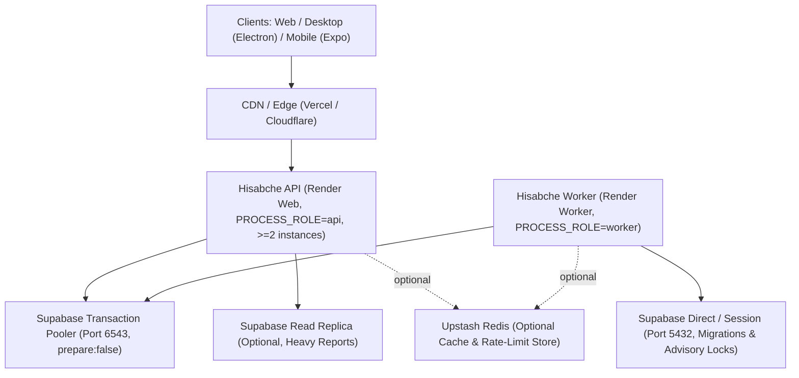

# Hisabche Infrastructure Overview (V61 Survivable Architecture)

## خلاصه اجرایی برای مالک سیستم (Persian Owner Summary)

معماری زیرساخت حسابچه بر پایه اصل **«یک نویسنده، خوانش چندمسیره، تخریب تدریجی و بدون نقطه شکست پنهان»** طراحی شده است:

1. **جداسازی نقش‌ها (`PROCESS_ROLE`)**: سرویس‌های وب (`api`) و پردازش‌های پس‌زمینه (`worker`) از هم جدا هستند تا کران‌ها، سینک‌های سنگین و یادآورها تنها در یک فرایند `worker` با قفل دیتابیسی (`pg_try_advisory_lock`) اجرا شوند و در مقیاس‌پذیری افقی API (`numInstances >= 2`) تکرار نشوند.
2. **مسیریابی دیتابیس (Primary vs Replica)**: تمام نوشتن‌ها و خوانش‌های حساس مالی به Primary می‌روند؛ گزارش‌های سنگین تحلیلی می‌توانند به Read Replica هدایت شوند و در صورت تاخیر بیش از حد رپلیکا (`REPLICA_MAX_LAG_MS`) به‌صورت خودکار به Primary برگردند.
3. **حفاظت در برابر فشار و قطعی (`pressure.ts`, `service-mode.ts`, `breaker.ts`)**: اگر حلقه رویداد (Event Loop) یا حافظه از آستانه عبور کند، سرور با کد `503` و هدر `Retry-After` بار اضافی را رد می‌کند (`SERVICE_OVERLOADED`). اگر Primary موقتاً قابل نوشتن نباشد، سیستم وارد حالت `read_only` می‌شود (`SERVICE_READ_ONLY`) تا داده‌های مالی فاسد نشوند.
4. **ریدیس اختیاری است**: در صورت نبود یا قطعی Redis، کش به حافظه محلی (`Bounded LRU`) و قفل‌ها/صف‌ها به PostgreSQL منتقل می‌شوند و سیستم متوقف نمی‌شود.
5. **نگهداری و بازیابی**: اسکریپت‌های آزمون فشار (`k6`)، ماتریس قفل‌های دیتابیس (`LOCK-ORDER.md`)، و راهنماهای عملیاتی (`docs/runbooks/`) برای تمرین Failover، حالت فقط-خواندنی و بازیابی ماهانه Sandbox آماده هستند.

---

## C4 Context & Container Diagram

## Core Principles

1. **One Writer per Mutating Aggregate:** All money and stock mutations execute inside Postgres RPCs or explicit transactions following `LOCK-ORDER.md`.
2. **Pooler-Safe Queries:** Application queries run over Supavisor transaction mode (`prepare: false`) with bounded timeouts (`docs/role-timeouts-01-migration.sql`).
3. **Graceful Degradation:** Optional dependencies (Redis, Read Replica, external payment/SMS gateways) degrade to safe fallbacks or explicit `BLOCKED` states without taking down core POS/accounting.
4. **Honest Observability:** `/metrics` exposes RED metrics, `eventLoopDelayMs`, heap/RSS usage, `serviceMode`, and `inflight` requests.

## Index

- [01-TOPOLOGY.md](./01-TOPOLOGY.md) — Process roles, network co-location, pooler vs direct connections
- [02-FAILURE-MODES.md](./02-FAILURE-MODES.md) — FMEA matrix and automated/manual mitigations
- [03-SLO.md](./03-SLO.md) — Service Level Objectives and error budgets
- [04-CAPACITY.md](./04-CAPACITY.md) — Connection math, memory ceilings, and scaling triggers
- [LOCK-ORDER.md](./LOCK-ORDER.md) — Canonical row/table lock acquisition order
- [adr/](./adr/ADR-0001-one-writer.md) — Architecture Decision Records (`ADR-0001` .. `ADR-0005`)
