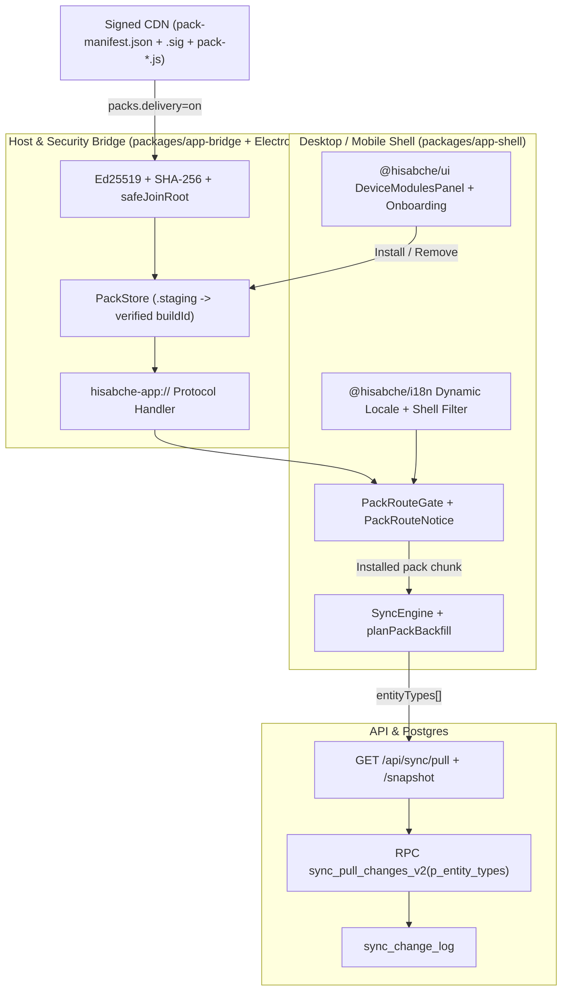

# معماری بسته‌های قابلیت (Feature Packs) و کاهش بار اولیه — V62

## خلاصه اجرایی (فارسی)

در نسخه V62، معماری بارگذاری برنامه دسکتاپ و موبایل بدون تکه-تکه کردن پایگاه‌داده یا تغییر منطق حسابداری، به ۷ بسته ماژولار (`core` + ۶ بسته اختیاری: `operations`، `manufacturing`، `workforce`، `approvals`، `intelligence`، `marketplace`) تقسیم شده است. هدف اصلی، کاهش شدید حجم جاوااسکریپت اولیه، بارگذاری تک‌زبان (`fa` / `af` / `en`) در پوسته‌های دسکتاپ/موبایل با حذف ۵ فضای‌نام مخصوص وب، و محدود کردن همگام‌سازی شبکه (`sync_pull_changes_v2`) به موجودیت‌های نصب‌شده روی هر دستگاه است.

برای ایمنی کامل، پرچم‌های تحویل از راه دور به صورت پیش‌فرض خاموش هستند (`packs.delivery=off`، `packs.installer=full`)، هیچ تغییر مخربی در اسکیمای SQLite رخ نمی‌دهد و با حذف یک بسته فقط کد رابط کاربری پاک می‌شود و داده‌های مشتری دست‌نخورده باقی می‌ماند.

---

## 1. Architecture Overview (English)

Hisabche V62 introduces modular feature packs across five coordinated layers:

1. **Canonical Registry (`packages/validation`):**
   - `FEATURE_PACKS` (`packages/validation/src/schemas/feature-packs.ts`) derives all pack metadata, engine memberships, dependencies, route prefixes, nav groups, and sync entity sets from `ENGINES` (`packages/validation/src/schemas/business-capabilities.ts`).
2. **Build & Bundle Splitting (`packages/app-shell`, `apps/mobile`, `packages/ui`, `packages/api`, `packages/i18n`):**
   - Accurate `"sideEffects"` manifests unlock Rollup tree-shaking, barrel imports in shell bootstrap files are replaced by deep imports, `@hisabche/i18n` splits locales dynamically (`loadMessages(lang, { shellOnly: true })`), and `apps/mobile/vite.shell.config.mjs` removes `singleFile: true`.
   - `scripts/packs/emit-pack-map.mjs` emits `packages/app-shell/pack-map.generated.json` consumed by `packages/app-shell/vite.shell.mjs` (`manualChunks` + `build.manifest: true`).
3. **Module-Scoped Network Sync (`backend`, `docs/sync-scope-01-migration.sql`, `packages/app-shell`):**
   - `sync_pull_changes_v2(p_entity_types text[] DEFAULT NULL, ...)` filters `sync_change_log` on Postgres while preserving v1 (`42883`/`PGRST202` fallback). `planPackBackfill` (`packages/validation/src/schemas/sync-backfill.ts`) cleanly backfills newly installed packs from cursor `0 -> C` (or snapshot when behind commit horizon).
4. **Verified Delivery & Protocol Host (`packages/app-bridge`, `apps/desktop`):**
   - `PackStore` verifies Ed25519 detached signatures (`verifyManifestEd25519`) and SHA-256 hashes inside `.staging/<buildId>/` before atomic promotion. Behind `packs.delivery=on`, Electron registers `hisabche-app://` serving bundled assets first and verified `PackStore` files second.
5. **UX & Operations (`packages/ui`, `packages/app-shell`, `scripts/packs/`):**
   - Onboarding composition shows estimated pack KB sizes; Settings (`Modules on this device`) manages installed/available/downloading/failed states; missing routes show distinct notices (`not_installed` / `not_in_plan` / `not_allowed`) with zero network queries fired for gated packs.

## 2. C4 Container / Component Diagram

## 3. Measured Bundle Report (`scripts/packs/report.mjs`)

Measured from `.esbuild-tmp/desktop-shell` and `.esbuild-tmp/mobile-shell` (`singleFile: false`):

- **Desktop & Mobile `index.html`:** `1,253 B` (before on mobile `singleFile: true`: `7,313,539 B`)
- **Total JS across all chunks:** `40` files, `7,249,324 B` raw / `1,992,104 B` gzip (before on stale 8 Nov desktop build: `49` files, `12,397,279 B` raw)
- **`coreEntry` JS:** `387,885 B` raw / `117,816 B` gzip (before on stale desktop build: `9,352,893 B` raw)
- **Shared chunks (`30` files):** `758,151 B` raw / `204,040 B` gzip

| Bucket / Chunk Group | Raw Bytes   | Gzip-9 Bytes | +10% Budget (`bundle-budgets.json`) |
| -------------------- | ----------- | ------------ | ----------------------------------- |
| `coreEntry`          | `387,885`   | `117,816`    | `129,598`                           |
| `pack-approvals`     | `34,904`    | `10,819`     | `11,901`                            |
| `pack-marketplace`   | `35,919`    | `10,687`     | `11,756`                            |
| `pack-manufacturing` | `179,250`   | `46,331`     | `50,965`                            |
| `pack-workforce`     | `270,923`   | `73,882`     | `81,271`                            |
| `pack-operations`    | `1,707,219` | `452,423`    | `497,666`                           |
| `pack-intelligence`  | `1,934,604` | `526,144`    | `578,759`                           |
| `locale-en`          | `502,694`   | `167,303`    | —                                   |
| `locale-af`          | `713,566`   | `191,495`    | —                                   |
| `locale-fa`          | `724,209`   | `191,164`    | —                                   |

## 4. Failure Modes & Mitigations

| Failure Mode                      | Trigger                                                     | System Behavior & Guard                                                                                                                                                                                                                                      | User Recovery                                                                              |
| --------------------------------- | ----------------------------------------------------------- | ------------------------------------------------------------------------------------------------------------------------------------------------------------------------------------------------------------------------------------------------------------ | ------------------------------------------------------------------------------------------ |
| **Download fails**                | Network drop or partial HTTP body while fetching pack chunk | `PackStore` writes strictly into `packs/.staging/<buildId>/`; `cleanupInterruptedStaging()` removes incomplete staging dirs; `installed.json` untouched; core + existing packs keep running                                                                  | Status shows `failed`; user clicks **Retry** in Settings -> Modules on this device         |
| **Bad signature / hash mismatch** | Corrupt chunk, MITM modification, or unsigned manifest      | `verifyManifestEd25519` or `verifyFileSha256` fails inside staging; files are never promoted to `packs/<buildId>/` and `resolvePackProtocolFile` refuses any unverified path                                                                                 | Download rejected silently/safely with `failed` status; app remains on verified build      |
| **CDN down**                      | CDN origin timeout or HTTP 5xx                              | Manifest fetch aborts cleanly without mutating already-installed packs; `full` installer bundles all chunks locally; core features continue 100% offline                                                                                                     | Previously installed packs keep working; new pack install can be retried once CDN recovers |
| **Pack withdrawn**                | Signed manifest sets `withdrawn: true` on a buggy pack      | `plan.ts` blocks downloading/installing withdrawn packs (`RUNBOOK-withdraw-a-pack.md`); `PackStore` retains `previousBuildId`; routes show clear unavailable notice                                                                                          | Affected pack routes show non-destructive notice; customer SQLite/cloud data untouched     |
| **Offline first open**            | Cold start with no network on first launch                  | Bundled `core` (and all bundled chunks when `packs.installer=full`) loads from local assets/protocol with active single locale cached in core/bundled assets; routes for uninstalled packs render `PackRouteNotice` cleanly without firing React Query calls | User works immediately in core capabilities; optional packs install when back online       |
