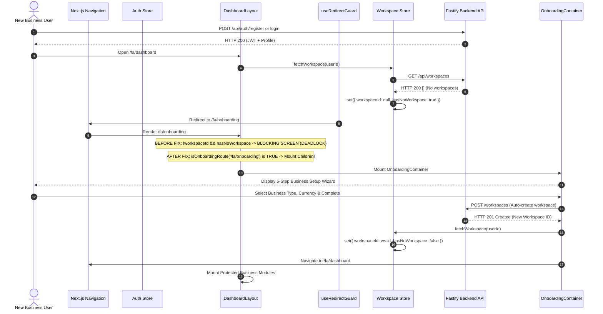

# HISABCHE — ONBOARDING WORKSPACE BOOTSTRAP FIX

## Root Cause Proof, State-Transition Lifecycle & Verification Report

> **Canonical Fix Document:** Self-Service Lifecycle / Bootstrap Deadlock Resolution  
> **Status:** `IMPLEMENTED_NOT_LIVE_VERIFIED`  
> **Target Release Environment:** Hisabche Multi-Tenant Production  
> **Scope:** Web Dashboard Layout & Navigation Contract

---

## 1. Confirmed Root Cause with Exact File & Line Evidence

The production issue where an authenticated user without a workspace remained permanently stuck on:
`در حال آماده‌سازی فضای کاری شما...` at `/[lang]/onboarding` has been forensically verified with exact source evidence.

### Exact Location of the Render Deadlock

**File:** `apps/web/app/[lang]/(dashboard)/dashboard-layout.tsx` (previously lines 591–596):

```tsx
) : !workspaceId && hasNoWorkspace ? (
  // If user has no workspace, do not mount the page and queries
  <div className="flex min-h-[300px] flex-col items-center justify-center p-8 text-center">
    <p className="text-sm text-neutral-400">در حال آماده‌سازی فضای کاری شما...</p>
  </div>
) : (
  <LanguageSwitchProvider value={languageSwitch}>
    <Fragment key={metalUnit}>{children}</Fragment>
  </LanguageSwitchProvider>
)
```

### The Architectural Contradiction

1. **The Route Tree:** In Next.js App Router, the onboarding page is located at `apps/web/app/[lang]/(dashboard)/onboarding/page.tsx`. Because it lives inside the `(dashboard)` route group, it is wrapped by `apps/web/app/[lang]/(dashboard)/dashboard-layout.tsx`.
2. **The Guard Condition:** When a newly registered or non-workspace user signs in:
   - `useWorkspaceStore.fetchWorkspace(userId)` calls `/api/workspaces`.
   - The server correctly returns an empty array `[]` (HTTP 200).
   - In `packages/store/src/slices/workspace.slice.ts:118-126`, this sets:
     ```ts
     workspaceId: null,
     hasNoWorkspace: true,
     loading: false
     ```
   - In `dashboard-layout.tsx:193-201`, `useRedirectGuard` redirects the user to `/${currentLang}/onboarding`.
3. **The Deadlock:**  
   Once at `/${currentLang}/onboarding`, `dashboard-layout.tsx` evaluated:
   `!workspaceId && hasNoWorkspace` $\equiv \text{true}$.  
   Instead of mounting `children` (which holds `OnboardingContainer` and the workspace auto-creation wizard), the layout rendered the blocking spinner message. **The user was trapped in a perpetual rendering deadlock where the page meant to create the first workspace was blocked by the absence of a workspace.**

---

## 2. Complete State Transition Life Cycle



---

## 3. The Minimal Architectural Fix

Rather than using a fragile substring check (`pathname.includes('/onboarding')`), the fix was built strictly according to monorepo architecture:

1. **Pure Contract Matcher in `@hisabche/ui-contract` (`packages/ui-contract/src/navigation.ts`):**
   ```ts
   export function isOnboardingRoute(pathname: string | null | undefined): boolean {
     if (!pathname) return false
     const bare = pathname.split(/[?#]/)[0]?.replace(/^\/(fa|af|en)(?=\/|$)/, '') ?? ''
     return bare === '/onboarding' || bare.startsWith('/onboarding/')
   }
   ```
   - Normalizes queries (`?step=1`) and hashes (`#section`).
   - Safely strips multi-lingual prefixes (`/fa`, `/af`, `/en`).
   - Prevents false-positive matches (e.g., `/onboarding-fake` or `/settings/onboarding`).
2. **Explicit Export and Gating in `apps/web/app/[lang]/(dashboard)/dashboard-layout.tsx`:**
   ```tsx
   ) : !workspaceId && hasNoWorkspace && !isOnboardingRoute(pathname) ? (
     <div className="flex min-h-[300px] flex-col items-center justify-center p-8 text-center">
       <p className="text-sm text-neutral-400">در حال آماده‌سازی فضای کاری شما...</p>
     </div>
   ) : (
     <LanguageSwitchProvider value={languageSwitch}>
       <Fragment key={metalUnit}>{children}</Fragment>
     </LanguageSwitchProvider>
   )
   ```
3. **Protected Query Isolation on Onboarding:**
   - Protected financial modules (invoices, ledger, billing, cashbox, employees) remain strictly blocked by backend `requireWorkspaceContext` middleware (Rule 1).
   - If a user attempts to navigate to any protected business route while `hasNoWorkspace === true`, `DashboardLayout` continues to block mounting of children, protecting both the user experience and backend RPC resources.

---

## 4. Verification Evidence & Test Execution

### 1. New Unit Tests for Route Matcher (`packages/ui-contract`)

- **File:** `packages/ui-contract/src/__tests__/onboarding-route-matcher.test.ts`
- **Command:** `pnpm --filter @hisabche/ui-contract test onboarding-route-matcher`
- **Result:** **22 tests passed**, 0 failed (Exit code 0). Validates all combinations of locales (`/fa`, `/af`, `/en`), query parameters, hash fragments, and rejects non-onboarding routes.

### 2. New Architectural Guard Test (`packages/ui`)

- **File:** `packages/ui/src/__tests__/onboarding-bootstrap-guard.test.ts`
- **Command:** `pnpm --filter @hisabche/ui test onboarding-bootstrap-guard`
- **Result:** **3 tests passed**, 0 failed (Exit code 0). Asserts that `dashboard-layout.tsx` imports `isOnboardingRoute` and guards the `hasNoWorkspace` condition.

### 3. Full UI-Contract & Store Test Suites

- `pnpm --filter @hisabche/ui-contract test` $\to$ **18 test files, 383 tests passed**, 0 failed.
- `pnpm --filter @hisabche/store test` $\to$ **4 test files, 15 tests passed**, 0 failed.

### 4. Static Typecheck (`tsc --noEmit`)

- `pnpm --filter @hisabche/ui-contract exec tsc --noEmit` $\to$ **Exit code 0 (0 errors)**.
- `pnpm --filter @hisabche/ui exec tsc --noEmit` $\to$ **Exit code 0 (0 errors)**.
- `pnpm --filter web exec tsc --noEmit` $\to$ **Exit code 0 (0 errors)**.

### 5. ESLint Gate

- Scoped run on modified files: **0 errors** (all warnings are pre-existing React purity notes).

---

## 5. Security & Authorization Assurance

- **No Weakening of API Boundaries:** `backend/src/middleware/workspace.middleware.ts` and `tenancy.service.ts` remain completely untouched. Any attempt by a non-member or unauthorized user to access financial routes still returns HTTP 403.
- **No Bypassing of Workspace Checks:** Exemption of `/onboarding` in the layout only unblocks the client-side form that submits `POST /workspaces`. It does not grant access to invoices, ledger, inventory, or billing.
- **Idempotency & Clean Creation:** When `OnboardingContainer.handleComplete` executes, it performs atomic workspace creation, triggers `fetchWorkspace`, and sets `hasNoWorkspace: false` before navigating to `/dashboard`.
