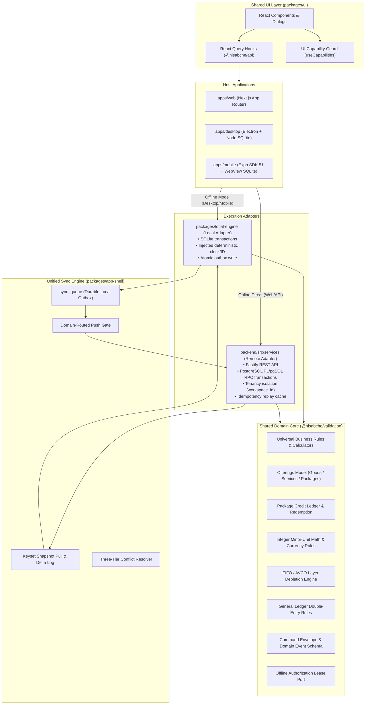

# 02 — TARGET ARCHITECTURE & PLATFORM TOPOLOGY

**Document Version**: 1.0.0  
**Status**: APPROVED SPECIFICATION  
**Location**: `docs/architecture/universal-business-core/02-TARGET-ARCHITECTURE.md`

---

## 1. System Architecture Diagram

---

## 2. Platform Topology & Runtime Matrix

| Platform            | Host Environment                        | Local Database Driver                   | Business Logic Execution                                                   | Offline Support Level                                                    |
| :------------------ | :-------------------------------------- | :-------------------------------------- | :------------------------------------------------------------------------- | :----------------------------------------------------------------------- |
| **Web**             | Modern Browsers (Next.js)               | In-Memory / IndexedDB cache             | Remote Adapter (Fastify + PostgreSQL) with client validation               | Online Primary (`ONLINE_FULL`); graceful degradation on momentary drops  |
| **Windows Desktop** | Electron 31 (Node.js)                   | `better-sqlite3` native compiled SQLite | Local Adapter (`@hisabche/local-engine`) directly in Electron main/preload | Full Offline (`OFFLINE_FULL`) with peer SQLite engine and durable outbox |
| **Android**         | Expo SDK 51 (React Native 0.74 WebView) | SQLite via Native Bridge                | Local Adapter in WebView or background worker                              | Full Offline (`OFFLINE_FULL`) matching desktop local schema              |

---

## 3. Strict Architectural Contracts

1. **Deterministic Execution Contract**:
   The shared domain core is 100% pure TypeScript. It never accesses `Date.now()`, `Math.random()`, `window`, `process.env`, HTTP APIs, or file systems. All time, random identifiers, and database connections are explicitly injected by the executing adapter.
2. **Atomic Local Mutation Contract**:
   When an operation executes offline:
   $$\text{Local Entity Mutation} + \text{Local Balance/Stock Effect} + \text{Outbox Row Insert} \in \text{Single Local Transaction}$$
   A crash at any instant will either rollback all three effects or commit all three effects.
3. **Server Re-validation Contract**:
   The server **NEVER** trusts monetary totals, tax calculations, discounts, or stock adjustments computed by edge devices. When an outbox row is received at the domain endpoint, the server re-runs the identical core rules against authoritative PostgreSQL state.
