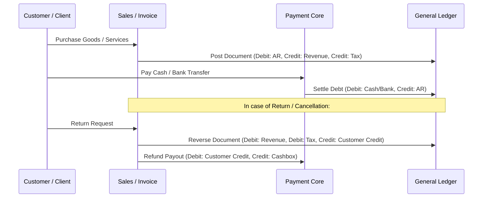

# 07 — UNIVERSAL FINANCIAL MODEL & INTEGER MINOR-UNIT MATH

**Document Version**: 1.0.0  
**Status**: APPROVED SPECIFICATION  
**Location**: `docs/architecture/universal-business-core/07-FINANCIAL-MODEL.md`

---

## 1. Immutable Financial Invariants

1. **Integer Minor Units Rule (No Floating-Point Math)**:
   Every monetary amount across database columns, domain entities, wire payloads, and ledger calculations is stored strictly as an **integer in minor units** (`bigint` or integer `number` up to $9 \times 10^{15}$).
   $$\text{Minor Amount} = \text{round}(\text{Major Amount} \times 10^{\text{fractionDigits}})$$
2. **Strict Multi-Currency Isolation**:
   Monetary values in different currencies are never added or aggregated together. Financial reports group balances by currency:
   $$\text{Balance}(\text{Workspace}) = \sum_{c \in \text{Currencies}} \text{Balance}_c$$
3. **Derived Commercial Math**:
   The server derives all invoice totals directly from line items and never trusts client-sent totals:
   $$\text{Line Net} = (\text{Quantity} \times \text{UnitPriceMinor}) - \text{DiscountMinor}$$
   $$\text{Invoice Subtotal} = \sum \text{Line Net}$$
   $$\text{Invoice Tax} = \sum \text{Line Tax}$$
   $$\text{Grand Total} = \text{Invoice Subtotal} + \text{Invoice Tax}$$
4. **Unknown Is Not Zero**:
   If a cost, price, or valuation cannot be read or is missing, it is explicitly `null` (`CostStatus = 'cost_unknown'`), never masked as `0`.

---

## 2. Multi-Currency Rules & Supported Precision

| Currency Code           | Minor Unit Name | Fraction Digits | Multiplier | Supported in Base? |
| :---------------------- | :-------------- | :-------------- | :--------- | :----------------- |
| `AFN` (Afghan Afghani)  | Pol             | 2               | 100        | Primary            |
| `IRR` (Iranian Rial)    | Rial            | 0               | 1          | Primary            |
| `USD` (US Dollar)       | Cent            | 2               | 100        | Supported          |
| `EUR` (Euro)            | Cent            | 2               | 100        | Supported          |
| `AED` (UAE Dirham)      | Fils            | 2               | 100        | Supported          |
| `PKR` (Pakistani Rupee) | Paisa           | 2               | 100        | Supported          |

---

## 3. Financial Event Flow & Reversals

