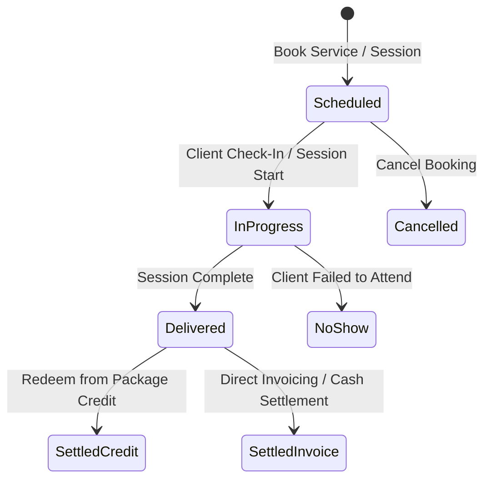

# 09 — SERVICE DELIVERY & PRACTITIONER EXECUTION SPECIFICATION

**Document Version**: 1.0.0  
**Status**: APPROVED SPECIFICATION  
**Location**: `docs/architecture/universal-business-core/09-SERVICE-DELIVERY.md`

<!-- target-vocabulary -->

> **Vocabulary note (M0, 1 Nov 2026):** commands, events, tables and function names in this document that do not
> exist in the repository are **target** names of a design, not claims about current code.
> `node scripts/audit/verify-spec-references.mjs` keeps checking every file path here.

---

## 1. Service Delivery Lifecycle



---

## 2. Service Delivery Session Schema

```typescript
export interface ServiceDeliverySession {
  readonly id: string
  readonly workspaceId: string
  readonly customerId: string // Student / Client / Patient ID
  readonly serviceOfferingId: string // The service delivered
  readonly practitionerId?: string | undefined // Teacher / Doctor / Technician
  readonly branchId?: string | undefined
  readonly sessionDate: string // YYYY-MM-DD
  readonly startTime: string // HH:mm
  readonly endTime: string // HH:mm
  readonly durationMinutes: number
  readonly status: 'scheduled' | 'in_progress' | 'delivered' | 'cancelled' | 'no_show'
  readonly settlementMethod: 'package_credit' | 'invoice' | 'complementary'
  readonly packageCreditId?: string | undefined // If settled via prepaid package
  readonly invoiceId?: string | undefined // If billed directly
  readonly clientNotes?: string | undefined
  readonly internalNotes?: string | undefined
  readonly createdAt: string
  readonly updatedAt: string
}
```

---

## 3. Offline Execution Contract

1. **Autonomous Offline Class/Session Recording**:
   A tutor, instructor, or practitioner without an internet connection can start, deliver, and complete sessions on their mobile/desktop device.
2. **Deterministic Settlement Choice**:
   - If the client possesses active local package credits, the local engine automatically deducts 1 credit and links `packageCreditId`.
   - If zero credits exist, the session is marked `settlementMethod: 'invoice'`, and an unbilled service line is staged in local drafts.
3. **Queue Enqueue**:
   The delivery event is queued in `sync_queue` with entity `'service_delivery_session'` and pushed via domain routes.
