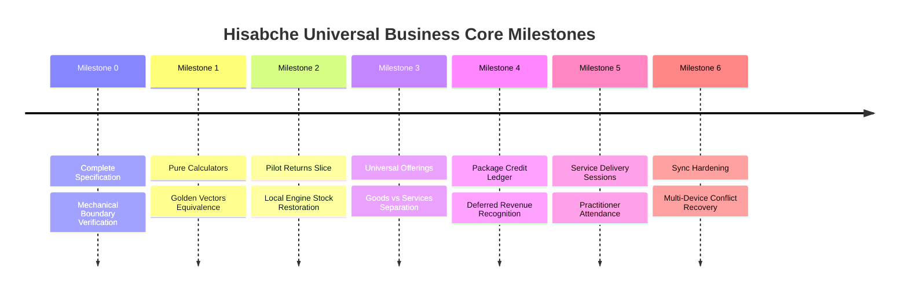

# 20 — HIGH-LEVEL BUSINESS MILESTONES

**Document Version**: 1.0.0  
**Status**: APPROVED SPECIFICATION  
**Location**: `docs/architecture/universal-business-core/20-MILESTONES.md`

---

## Roadmap Overview

---

## Milestone Descriptions & Exit Criteria

1. **Milestone 0: Specification & Groundwork (CURRENT)**:
   - Deliver complete 25-part architectural specification.
   - Establish mechanical boundary tests (`architecture-boundaries.test.ts`).
   - Zero product code modifications during specification phase.
   - _Exit Gate_: Specification approved by owner.
2. **Milestone 1: Pure Calculators & Parity Harness**:
   - Centralize currency math, tax calculations, and discount rules in shared core.
   - 20/20 golden vector tests green across Node, Backend, and Desktop.
3. **Milestone 2: Pilot Slice — Returns & Refunds**:
   - Universal return document math, deductions, and offline stock restoration.
   - _Status_: **PASSED** (Wired in local-engine with 3/3 tests, backend 38/38 tests).
4. **Milestone 3: Universal Offerings & Commercial Invoicing**:
   - Generalize `product` to `offering` (`goods`, `service`, `package`).
   - Wire local-engine and backend invoice creation to polymorphic offering rules.
5. **Milestone 4: Package Credit Ledger & Service Delivery**:
   - Implement prepaid package accounts, credit issuance, and session redemption.
   - Connect redemption to unearned revenue ledger journals.
6. **Milestone 5: Unified Sync Engine Hardening & Offline Leases**:
   - Implement cryptographic offline lease validation for cash refunds.
   - Full recovery and three-tier conflict resolution under network disconnects.
