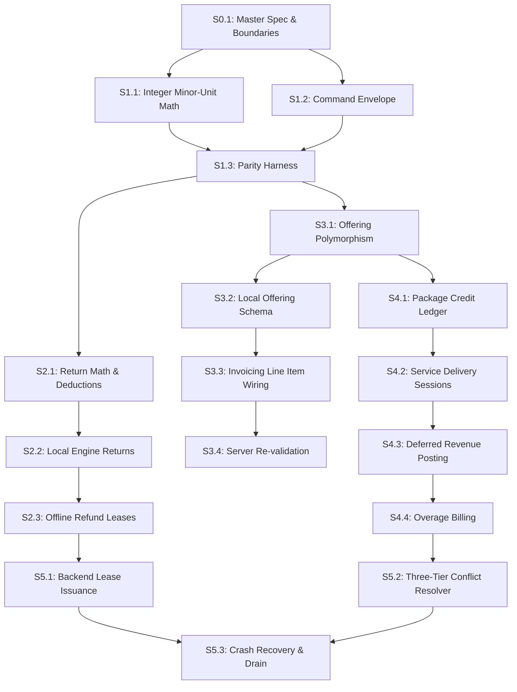

# 22 — SLICE DEPENDENCY GRAPH & EXECUTION ORDER

**Document Version**: 1.0.0  
**Status**: APPROVED SPECIFICATION  
**Location**: `docs/architecture/universal-business-core/22-DEPENDENCY-GRAPH.md`

---

## 1. Visual Execution Graph

---

## 2. Dependency Matrix (Blocked By / Unlocks)

| Slice ID | Title                       | Blocked By | Unlocks       |
| :------- | :-------------------------- | :--------- | :------------ |
| **S0.1** | Spec & Boundaries           | None       | S1.1, S1.2    |
| **S1.1** | Integer Minor-Unit Math     | S0.1       | S1.3          |
| **S1.2** | Command Envelope            | S0.1       | S1.3          |
| **S1.3** | Parity Harness              | S1.1, S1.2 | S2.1, S3.1    |
| **S2.1** | Return Document Calculation | S1.3       | S2.2          |
| **S2.2** | Local Engine Returns Wiring | S2.1       | S2.3          |
| **S2.3** | Offline Refund Leases       | S2.2       | S5.1          |
| **S3.1** | Offering Polymorphism       | S1.3       | S3.2, S4.1    |
| **S3.2** | Local Offering Schema       | S3.1       | S3.3          |
| **S3.3** | Invoicing Line Wiring       | S3.2       | S3.4          |
| **S3.4** | Server Re-validation        | S3.3       | S5.2          |
| **S4.1** | Package Credit Ledger       | S3.1       | S4.2          |
| **S4.2** | Service Delivery Sessions   | S4.1       | S4.3          |
| **S4.3** | Deferred Revenue Posting    | S4.2       | S4.4          |
| **S4.4** | Overage Billing             | S4.3       | S5.2          |
| **S5.1** | Backend Lease Issuance      | S2.3       | S5.3          |
| **S5.2** | Conflict Resolver           | S3.4, S4.4 | S5.3          |
| **S5.3** | Crash Recovery & Drain      | S5.1, S5.2 | M6 Completion |
