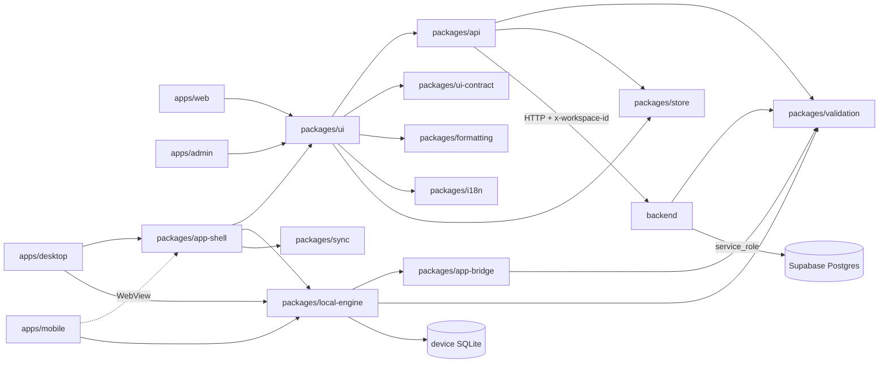

# Hisabche — Dependency Map

Audit date 2026-11-08, commit `b546d5df`. Read-only.

## 1. Package graph (FACT, from imports and package.json)

## 2. Dependency matrix (rows import columns; FACT unless marked)

| ↓ imports →           | ui  | api | validation | ui-contract | formatting | store | app-shell | local-engine | app-bridge | sync | backend |
| --------------------- | :-: | :-: | :--------: | :---------: | :--------: | :---: | :-------: | :----------: | :--------: | :--: | :-----: |
| apps/web              |  ✓  |  ✓  |     ✓      |      ✓      |     ✓      |   ✓   |           |              |            |      |         |
| apps/admin            |  ✓  |  ✓  |     ✓      |             |     ✓      |       |           |              |            |      |         |
| apps/desktop          |     |     |            |             |            |       |     ✓     |      ✓       |     ✓      |      |         |
| apps/mobile           |     |     |     ✓      |             |            |       | (WebView) |      ✓       |     ✓      |      |         |
| packages/app-shell    |  ✓  |  ✓  |     ✓      |      ✓      |            |   ✓   |     —     |      ✓       |     ✓      |  ✓   |         |
| packages/ui           |  —  |  ✓  |     ✓      |      ✓      |     ✓      |   ✓   |           |              |            |      |         |
| packages/api          |  ✗  |  —  |     ✓      |      ✓      |            |   ✓   |           |              |            |      |         |
| packages/local-engine |     |     |     ✓      |             |            |       |           |      —       |     ✓      |      |         |
| backend               |  ✗  |  ✗  |     ✓      |             |     ✓      |       |           |              |            |      |    —    |

✗ = checked: `grep -rln "from '@hisabche/ui'" packages/api/src packages/validation/src backend/src` returned nothing → no upward import found. Matrix cells for apps are INFERENCE from package.json dependencies, not per-file greps.

## 3. End-to-end traces (FACT)

### 3.1 Create sale invoice (online)

`InvoicePreviewContainer` (`packages/ui/src/components/ui/invoice-builder/containers/invoice-preview-container.tsx`) → `useCreateInvoice` (`packages/api/src/hooks/invoices.ts:299`) → `submitInvoice` (`invoices.ts:238`; online `apiClient.post('/invoices', …, Idempotency-Key)` at `:283-286`; offline `localRequest('POST','/invoices')` at `:273`) → axios client adds `x-workspace-id` (`packages/api/src/lib/client.ts:232,464`) → global auth hook (`backend/src/index.ts:353`) → `POST /api/invoices` with `authenticate, requireWorkspaceContext, requireCapability('invoice.create'), requireEntitlement('invoice.create'), resolveBranchContext` (`backend/src/routes/invoice.routes.ts:151-160`) → expired-subscription lock inside `requireWorkspaceContext` (`backend/src/middleware/workspace.middleware.ts:117`) → `InvoiceService.create` (`backend/src/services/invoice.service.ts:820`) → RPC `get_next_invoice_number` (`:4143`), `assert_customer_credit` (`:1569`), `invoice_write_document` (`:2669`, defined `docs/invoice-write-document-migration.sql`) → tax → shelving/costing → ledger post (`:1380-1398`).

### 3.2 Offline write → server

Device UI → `localRequest` → `packages/local-engine/src/routes/invoices.ts` (temporary number `:562-575`) → device `sync_queue` (`packages/app-bridge/src/local-schema.ts:680-696`, carries `user_id`/`workspace_id`) → routing by financial effect (`packages/app-bridge/src/push-routing.ts:39-44`: invoice, invoice_item, transaction, inventory_movement go to domain routes) → `sync-engine.ts` (`packages/app-shell/src/features/sync/sync-engine.ts:992` for `/sync/push`) → `POST /api/sync/push` (`backend/src/routes/sync.routes.ts:108`, `authenticate, requireWorkspaceContext`) → `syncService.push` with column allow-list (`backend/src/services/sync.service.ts:132-160`), domain-only refusal (`:462,684`), per-mutation capability check `holds()` (`:673`), optimistic version guard (`:101,754,792`).

### 3.3 Trial balance read

`useTrialBalance` (`packages/api/src/hooks/accounting.ts:296`) → `GET /api/accounting/...` (`backend/src/routes/accounting.routes.ts`, `report.financial.read` style guards) → `services/accounting/` repository/domain.

### 3.4 Subscription purchase (register-first)

No client caller found for `/api/billing/orders*` (script below). Server: `routes/billing.routes.ts:911` → `subscriptionOrderService.createOrder` → admin `verify-payment` (`:948`, `platformAdminGuard`) → `provision` (`:1015`) → `provisionFromOrder` (`services/subscription-order.service.ts:226-262`) → RPC. Status: API_ONLY.

## 4. Unwired routes (FACT, tool output)

`node scripts/audit-unwired-routes.mjs` (exit 0): **857 routes · 661 client path strings · 122 with no caller.** Grouped highlights: orders (7), transport (7), project members/time entries (7), permission user-role routes (6), offline-licence & device routes in billing (16), cloud-migration (5), events (5), audit (6), HR departments + legacy attendance (6), snapshots (3), OData (1), email-OTP (3).
Caveat (INFERENCE): the tool matches literal path strings; public token routes, the updater feed and `/api/sync/stream` are called by URL construction or by external clients, so they are false positives.

## 5. Cycles

- FACT: guard `backend/src/__tests__/no-service-import-cycles.test.ts` exists and the backend suite passed (382 files, exit 0, this session).
- NOT checked: a whole-monorepo cycle scan (no `madge`/graph tool was run). Status for UI-package cycles: IMPLEMENTED_NOT_LIVE_VERIFIED via `no-self-barrel-import.test.ts` (in the green UI suite).

## 6. Duplicate rules (FACT)

| Rule                             | Copy A                                                                                                   | Copy B                                                         | Status                                   |
| -------------------------------- | -------------------------------------------------------------------------------------------------------- | -------------------------------------------------------------- | ---------------------------------------- |
| Accounting service               | `backend/src/services/accounting.service.ts` (unwired, `unwired-capability.test.ts:449`)                 | `backend/src/services/accounting/`                             | duplicate kept                           |
| Outbound webhooks                | `backend/src/services/webhook.service.ts` (unwired, `:463`)                                              | `backend/src/services/developer/developer.service.ts:221`      | duplicate kept                           |
| Checkout / plan payment          | `backend/src/services/checkout.service.ts` (unwired, `:456`)                                             | wallet `routes/wallet.routes.ts:139` + subscription orders     | three roads, one live                    |
| Appointments vs service sessions | `routes/appointment.routes.ts:18`                                                                        | `routes/service-delivery.routes.ts:23`                         | parallel engine (CLAUDE.md: do not wire) |
| Subscription lookup              | `getCurrentSubscription` falls back to the **acting user's** row (`services/billing.service.ts:265-272`) | `getWorkspaceAccess` resolves via workspace/owner (`:366-389`) | two rules for one fact — see SaaS audit  |

## 7. Authorization bypass candidates (FACT, verified by reading)

| Route                                             | Guard                                                                                                                                                                   | Issue                                                                                          |
| ------------------------------------------------- | ----------------------------------------------------------------------------------------------------------------------------------------------------------------------- | ---------------------------------------------------------------------------------------------- |
| `POST/PUT/PATCH/DELETE /api/products/:id/images*` | `[authenticate, requireWorkspaceContext]` only (`backend/src/routes/product-images.routes.ts:27`), no role check in `services/product-images/product-images.service.ts` | any member, including a custom role that hides products, can add/reorder/delete product images |
| `GET/PATCH /api/v1/notifications*`                | `authenticate` only; service filters only by `user_id` (`backend/src/services/notification.service.ts:78`)                                                              | user-scoped across workspaces; a removed member keeps seeing that workspace's notifications    |

Full list and severities: `HISABCHE-MULTITENANCY-SECURITY-AUDIT.md`.
