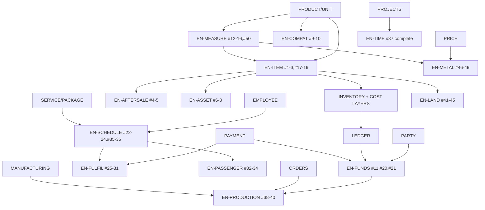

# UNIVERSAL CAPABILITY GRAPH — وابستگی، وابسته‌ها و تعارض

> بررسی شد: رجیستری موجودی که وابستگی را نگه دارد **وجود ندارد**. `packages/validation/src/schemas/business-capabilities.ts` فقط ۱۳ کلید + وضعیت + فهرست مسیر شاهد دارد (بدون وابستگی و تعارض)، و `feature-registry.ts` قابلیت‌های **پلن/اجرا** را می‌شناسد، نه وابستگی کسب‌وکار. این سند گراف پیشنهادی را توصیف می‌کند؛ چیزی پیاده نشد.

## 1. اولیه‌ها (Primitives) و موتورها

اولیه‌ی موجود و معتبر (یک منبع حقیقت): `PARTY`، `PRODUCT/OFFERING`، `UNIT`، `PRICE`، `LEDGER`، `PAYMENT`، `INVENTORY (quantity + cost layers)`، `DOCUMENT (invoice)`، `AUDIT`، `OUTBOX/SYNC`، `PERMISSION`.

## 2. گراف (سمت چپ به سمت راست = وابستگی)



## 3. جدول وابستگی

| موتور         | وابسته به                    | وابسته‌ها                           | تعارض                                                                                | اولیه‌های لازم           | وابستگی حسابداری     | وابستگی موجودی                  | وابستگی مجوز    | وابستگی آفلاین              |
| ------------- | ---------------------------- | ----------------------------------- | ------------------------------------------------------------------------------------ | ------------------------ | -------------------- | ------------------------------- | --------------- | --------------------------- |
| EN-MEASURE    | PRODUCT, UNIT                | EN-ITEM (رول)، EN-METAL، قیمت‌گذاری | دو مدل واحد (واحد تک‌محوری فعلی `unit-conversion.domain.ts` باید مشتق شود، نه موازی) | quantity+unit+dimensions | قیمت خط              | مبنای بها                       | capability تازه | قاعده‌ی مشترک TS/SQL/SQLite |
| EN-ITEM       | PRODUCT, INVENTORY, INVOICE  | AFTERSALE, ASSET, LAND, METAL       | `pack-barcode.domain.ts` ↔ `product_barcodes`                                        | variant/serial/lot       | —                    | لایه‌ی بها باید دنبال lot بیاید | capability تازه | local-first                 |
| EN-AFTERSALE  | ITEM(serial), INVOICE        | تعمیر                               | —                                                                                    | warranty                 | هزینه‌ی ادعا         | قطعه‌ی مصرفی                    | تازه            | local-first                 |
| EN-ASSET      | ITEM(serial), COSTING        | —                                   | `vehicles.domain.ts` ↔ لایه‌ی بها                                                    | unit attribute           | افزودن بها           | سن موجودی                       | تازه            | شاید آنلاین                 |
| EN-COMPAT     | PRODUCT                      | —                                   | —                                                                                    | fitment                  | —                    | —                               | تازه            | local                       |
| EN-FUNDS      | PAYMENT, LEDGER, PARTY       | PRODUCTION، FULFIL                  | سقف اعتبار فقط-UI                                                                    | deposit, credit exposure | بدهی/دارایی/دریافتنی | —                               | تازه            | الزام: رد/اجازه از سرور     |
| EN-SCHEDULE   | SERVICE, EMPLOYEE            | FULFIL, PASSENGER                   | `hasAppointmentConflict` ↔ قید DB                                                    | slot, resource           | —                    | —                               | تازه            | local-first برای تایید      |
| EN-FULFIL     | SCHEDULE, PAYMENT            | —                                   | دو خانواده‌ی مسیر در `transport.routes.ts`                                           | delivery, driver         | COD، تسویه‌ی راننده  | حرکت انبار                      | تازه            | آفلاین برای راننده          |
| EN-PRODUCTION | MANUFACTURING, ORDERS, FUNDS | —                                   | تصمیم WIP                                                                            | work order               | WIP/سربار            | مصرف مواد                       | موجود           | تصمیم مالک                  |
| EN-METAL      | MEASURE, PRICE, ITEM         | —                                   | `gold-jewellery.domain.ts` ↔ pricing                                                 | purity attr, market rate | دریافت فلز مشتری     | لایه‌ی بها                      | تازه            | local-first                 |
| EN-LAND       | ITEM(lot), costing           | —                                   | —                                                                                    | plot, cycle              | بها بر محصول         | دسته‌ی برداشت                   | تازه            | آنلاین                      |
| EN-PASSENGER  | SCHEDULE                     | —                                   | —                                                                                    | seat, leg                | کرایه                | صندلی                           | تازه            | آنلاین                      |
| EN-TIME       | PROJECTS                     | —                                   | —                                                                                    | time entry               | فاکتور عادی          | —                               | موجود           | آنلاین                      |

## 4. مسیر بحرانی

`EN-MEASURE → EN-ITEM (اتصال واریانت/lot به خط فاکتور و موجودی) → EN-FUNDS (سپرده/اعتبار از ledger) → EN-SCHEDULE → EN-FULFIL`. `EN-METAL` فقط بعد از `EN-MEASURE` (وزن/عیار) و pricing.
دلیل: واریانت/serial بی‌اتصال، خرده‌فروشی‌های پرتقاضا را مسدود می‌کند (کالا، کفش، موبایل)، زمان‌بندی پیش‌نیاز ارسال و مسافر است، و فلز گران‌بها بدون قیمت ابعادی/وزنی ممکن نیست.

## 5. نگاشت صنف‌ها به گراف

هر صنف ترکیبی از همین گره‌هاست؛ جدول کامل ۵۰ صنف: `INDUSTRY-CAPABILITY-MATRIX.md`. نمونه‌ها:

```
TEACHER      = SERVICE + EN-SCHEDULE + PKG_SERVICE + PAYMENT + RECEIVABLE
CARPET       = GOODS + INVENTORY + EN-MEASURE + (EN-ITEM roll lot)
GOLD_RETAIL  = GOODS + INVENTORY + EN-MEASURE + EN-METAL + EN-ITEM(serial)
FUEL_STATION = GOODS(bulk) + EN-MEASURE(volume) + INVENTORY (tank model: absent)
```
