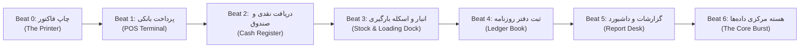
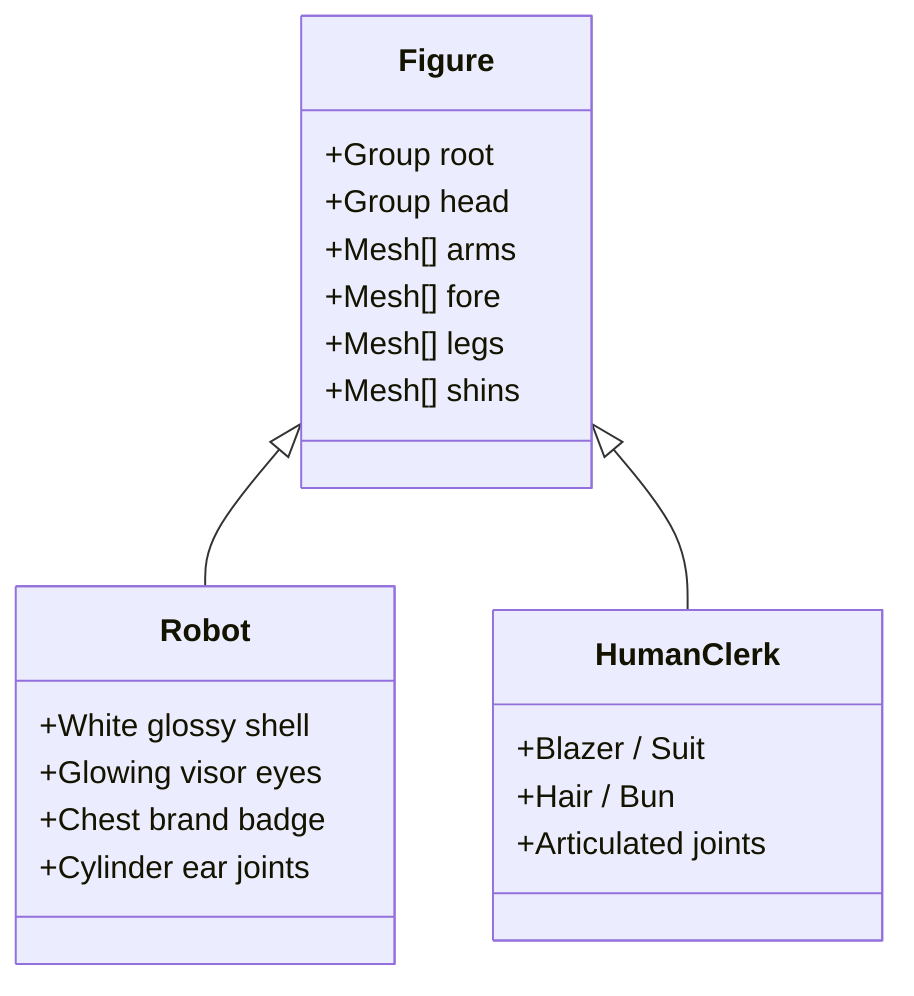

# مستند جامع معماری و مهندسی سه‌بعدی لندینگ‌پیج حسابچه (3D Journey Engine)

این سند مرجع کامل فنی، هندسی، انیمیشنی و محاسباتی صحنه سه‌بعدی لندینگ‌پیج حسابچه است که با تکنولوژی **Three.js** و در قالب یک سفر تعاملی اسکرول‌محور (Scroll-Driven Journey) پیاده‌سازی شده است.

---

## ۱. نمای کلی و معماری فنی سیستم (System Architecture)

موتور سه‌بعدی لندینگ، فرایند پردازش یک فاکتور فروش را در قالب یک سالن مدرن فروشگاهی/سازمانی شبیه‌سازی می‌کند. در این سفر، فاکتور از پرینتر خارج شده، توسط یک ربات هوشمند حمل می‌شود، از میان گیت‌های تردد شیشه‌ای عبور می‌کند، وارد ۵ ایستگاه عملیاتی (پرداخت، صندوق، انبار، دفتر روزنامه، گزارشات) می‌شود و در نهایت وارد هسته مرکزی یکپارچه‌ساز داده‌ها (The Core) شده و منفجر می‌گردد.



### اصول مهندسی پایه

1. **جداسازی کامل از رندر ری‌اکت (Zero React in Animation Loop):**
   حلقه رندر ۶۰ فریم بر ثانیه مستقیماً در لایه بومی Three.js و متدهای انیمیشن اجرا می‌شود؛ هیچ رندر ری‌اکتی با تغییر اسکرول تریگر نمی‌شود تا شاخص‌های حیاتی وب (Core Web Vitals) مانند INP و TBT در بالاترین سطح بمانند.
2. **لود تنبل و هوشمند (Idle Dynamic Import):**
   پکیج Three.js (~150KB) در زمان بارگذاری اولیه صفحه دانلود نمی‌شود. کامپوننت `scene-canvas.tsx` با استفاده از `requestIdleCallback` یا پس از اولین تعامل کاربر، فایل `scene.ts` و `runtime.ts` را بارگذاری می‌کند.
3. **پشتیبانی کامل از جهت خواندن (RTL / LTR Symmetry):**
   سالن بر اساس جهت صفحه قرینه می‌شود (`flow = -1` در زبان‌های فارسی و دری، و `flow = 1` در انگلیسی). تمام زوایای دوربین، محل قرارگیری ایستگاه‌ها، اسکله بارگیری و گیت‌ها بدون هیچ کلاس یا مختصات فیزیکی سخت‌کد شده به صورت متقارن معکوس می‌شوند.
4. **تنظیم خودکار کیفیت و توان سخت‌افزاری:**
   - نسبت پیکسل (Pixel Ratio): در موبایل و سیستم‌های ضعیف روی حداکثر $1.75$ و در دسکتاپ‌های قوی روی $2.0$ تنظیم می‌شود.
   - سایه‌ها و بازتاب محیطی: سایه‌های نرم PCF و نگاشت محیطی `RoomEnvironment` فقط در سیستم‌های دسکتاپ با بیش از ۴ هسته فعال می‌شوند.

---

## ۲. هدایت و حرکت‌های سینمایی دوربین (Camera Choreography)

دوربین در قالب یک پرسپکتیو استاندارد با میدان دید تطبیقی عمل می‌کند:

- **میدان دید (FOV):** در حالت افقی (دسکتاپ) برابر با $45^\circ$ و در حالت عمودی (موبایل و تبلت) برابر با $58^\circ$ است تا اجزای صحنه در کادرهای باریک بیرون نزنند.
- **محدوده‌های دید:** `near = 0.3` و `far = 200` متر.

### پنج پلان تالیف‌شده برای ایستگاه‌ها (Authored Shots)

هر ایستگاه یک نوع حرکت منحصر‌به‌فرد دارد تا تجربه اسکرول خسته‌کننده نباشد:

| ایستگاه / مرحله           | نوع حرکت (Move)  | زاویه افقی (Yaw) | زاویه عمودی (Pitch) | فاصله پیش‌فرض (Distance) | رفتار حرکتی                                                                             |
| :------------------------ | :--------------- | :--------------: | :-----------------: | :----------------------: | :-------------------------------------------------------------------------------------- |
| **Beat 0: چاپ فاکتور**    | `craneDown`      |   $+10^\circ$    |     $+6^\circ$      |          $9.0$m          | دوربین از زاویه بالا ($15^\circ$) مانند جرثقیل پایین آمده و روی خروج فاکتور قفل می‌شود. |
| **Beat 1: پایانه پرداخت** | `trackSide`      |   $+34^\circ$    |     $+3^\circ$      |          $9.5$m          | حرکت موازی در کنار جاده با چرخش ملایم به سمت دستگاه پوز و کیپد.                         |
| **Beat 2: صندوق فروش**    | `lowPush`        |   $+18^\circ$    |     $-3^\circ$      |          $9.0$m          | زاویه دید رو به بالا (Low Angle) با حرکت فشاری به جلو به سمت کشوی بازشده پول.           |
| **Beat 3: قفسه و انبار**  | `arc`            |   $+30^\circ$    |     $+2^\circ$      |         $10.0$m          | چرخش قوسی ۲۵ درجه‌ای؛ در فاز ثبت، دوربین به سمت درگاه و ون بارگیری پن می‌کند.           |
| **Beat 4: دفتر روزنامه**  | `craneDown`      |   $+26^\circ$    |     $+4^\circ$      |          $9.5$m          | چرخش زاویه‌دار از بالا به پایین به سمت صفحات باز دفتر روزنامه دوطرفه.                   |
| **Beat 5: میز گزارشات**   | `pullBackReveal` |   $+12^\circ$    |      $0^\circ$      |          $9.5$m          | عقب‌نشینی آرام دوربین هم‌زمان با رشد میله‌های نمودار ستونی.                             |
| **Beat 6: هسته مرکزی**    | `pushIn`         |    $0^\circ$     |    $-0.4^\circ$     |     $15.0 \to 11.5$m     | نزدیک شدن مستقیم و متمرکز تا زمان وقوع انفجار ذرات و هاله نورانی.                       |

### الگوریتم‌های انطباق کادر و ایمنی (Framing & Occlusion Guard)

- **منطقه امن متنی (`journeyState.free`):** دوربین موقعیت خود را با فضای خالی صفحه (بخشی که زیر عنوان یا منوی بالا پنهان نشده) از طریق `camera.setViewOffset` تنظیم می‌کند تا سوژه دقیقاً در مرکز دید کاربر باشد نه مرکز مطلق مانیتور.
- **مرزهای فیزیکی سالن:** دوربین هرگز از دیوارهای کناری (`reachX = halfWidth - 1.2`)، سقف (`H_CLEAR = 9.3m`) یا دیوار ورودی خارج نمی‌شود.
- **کوچک‌سازی هوشمند فاکتور (Anti-Occlusion Shrink):** ۱۰ بار در ثانیه بررسی می‌شود که آیا فاکتور در کادر دوربین، جلوی تابلوی اطلاعاتی را پوشانده است یا خیر. اگر بیش از ۱۰٪ تابلو پوشانده شود، ابعاد فاکتور به ۶۰٪ کاهش می‌یابد تا اعداد تابلو کاملاً خوانا بمانند.

---

## ۳. معماری سالن: کف، سقف، دیوارها و سازه (Hall Architecture)

ابعاد سالن به گونه‌ای مهندسی شده که کل فرآیند را در خود جای دهد:

- **ارتفاع سالن:** $10.5$ متر.
- **طول سالن:** حدود $145$ متر (از مختصات $Z = +21.5$ در ورودی تا $Z = -124$ در انتهای سالن).
- **عرض سالن:** بین $24$ تا $28$ متر بسته به نسخه موبایل یا دسکتاپ.

```
       [دیوار انتهایی: تابلوی بزرگ حسابچه]
                     │
            [هسته داده‌ها (Core)]
                     │
        ┌────────────┴────────────┐
        │  [ایستگاه ۵: گزارشات]   │
        │                         │
        │  [ایستگاه ۴: روزنامه]   │
        │                         │ ── [درگاه اسکله بارگیری]
        │  [ایستگاه ۳: انبار]     │ ── [جاده بیرون و ون حمل بار]
        │                         │
        │  [ایستگاه ۲: صندوق]     │
        │                         │
        │  [ایستگاه ۱: پرداخت]    │
        └────────────┬────────────┘
                     │
            [پرینتر فاکتور (Beat 0)]
                     │
       [دیوار ابتدایی: پنجره آسمان غروب]
```

### جزئیات کف‌پوش (Floor)

- جنس سرامیک صیقلی با زبری $0.3$ و متالیک $0.18$.
- بافت سفارشی بوم کنواس ($512 \times 512$ پیکسل) با الگوی کاشی‌های بزرگ، بندکشی‌های تیره و تغییرات رنگی طبیعی تصادفی برای از بین بردن یکنواختی.
- نوار راهنمای نئونی وسط کف به عرض $22$ سانتی‌متر که در تمام طول سالن از میان گیت‌ها عبور می‌کند.
- لکه نور نرم کانونی ($11 \times 11$ متر) با درخشش ملایم در کف زیر ایستگاه فعال.

### جزئیات سقف (Ceiling)

- سقف اصلی با پوشش سازه‌ای مات خاکستری تیره.
- تیرهای بتنی/فولادی عرضی ($0.6 \times 0.45$ متر) هر ۹ متر در طول سقف.
- پنل‌های روشنایی طولی مستطیلی ($0.7 \times 2.6$ متر) در دو ردیف موازی با فاصله ۲.۷ متر از مرکز جاده که نور سفید شفاف ساطع می‌کنند.

### جزئیات دیوارها، ستون‌ها و فضاسازی اداری

- **ستون‌های سازه‌ای:** ستون‌های مربعی $0.7 \times 0.7$ متری در فواصل منظم ۹ متری در دو طرف سالن.
- **تابلوهای دیواری اصناف (Business Signs):** یک اطلس تکسچر یکپارچه شامل آیکون‌ها و اسامی بیش از ۲۴ صنف (سوپرمارکت، قنادی، پوشاک، کارگاه تولیدی، پخش مویرگی و...) که روی تابلوهای دیواری در ارتفاع ۶.۳ متری نصب شده‌اند.
- **میزهای اداری حاشیه:** در امتداد دیوارهای سالن، میزهای اداری با پایه‌های فلزی، مانیتورهای فعال که ارقام و جداول را نمایش می‌دهند و صندلی‌ها تعبیه شده‌اند.
- **پنجره‌ها و اسکله بارگیری:** در دیوار پشتی و همچنین دهانه بارگیری، منظره آسمان گرگ‌ومیش با طیف گرادیان برند تا طلایی گرم خودنمایی می‌کند.
- **تابلوی غول‌پیکر برند (Name Board):** روی دیوار انتهایی پشت هسته، تابلوی عظیم $1024 \times 340$ پیکسلی با نام رسمی حسابچه و کادر نئونی درخشان قرار دارد.

---

## ۴. کاراکترها و آدمک‌ها (Characters & Mannequins)

تمام کاراکترها به صورت procedural و با هندسه اختصاصی بدون نیاز به دانلود کاراکترهای سنگین خارجی ساخته شده‌اند:



### ۱. ربات متصدی حمل فاکتور (The Agent)

- **ساختار بدنه:** اسکلت سفید شفاف با مفاصل تیره، زانوها و آرنج‌های مفصل‌دار، سینه با نشان رنگی برند، و سری با ویزور تیره و دو چشم گرد درخشان ال‌ای‌دی.
- **مکانیک راه رفتن (Kinematics):**
  - نوسان پاها و بازوها بر اساس سرعت با فرمول سینوسی (`Math.sin(time * 9)`).
  - خم شدن زانو هنگام بازگشت پا برای شبیه‌سازی دقیق راه رفتن مکانیکی.
  - چرخش کامل هنگام بازگشت به عقب (ربات هرگز مون‌واک نمی‌کند، بلکه ۱۸۰ درجه دور می‌زند).
- **وضعیت حمل سند (Carry Pose):** بالا آمدن هر دو ساعد در زاویه کنترل‌شده و نگه داشتن فاکتور در فاصله $0.58$ متری در جلوی سینه.

### ۲. متصدیان ایستگاه‌ها (Station Clerks)

- در هر ۵ ایستگاه، یک کارمند اختصاصی پشت کانتر روی صندلی اداری با زاویه خمیدگی طبیعی زانوها و پاها روی زمین مستقر است.
- **هوش تعاملی:**
  - به محض عبور ربات از گیت ایستگاه، متصدی تایپ کردن را متوقف کرده و سرش را به سمت ربات می‌چرخاند (`lookAt`).
  - در زمان ثبت و صدور فاکتور، دست خود را بالا آورده و به فاکتور اشاره می‌کند.
  - یک نشانگر مخروطی وارونه درخشان بالای سر کارمند فعال پدیدار می‌شود که موقعیت مکانی حباب گفت‌وگو (Speech Bubble) در صفحه را مشخص می‌کند.

### ۳. جمعیت و همکاران سالن (Office Crowd)

- در طول سالن، گروه‌های دونفره شامل کارمندان آقا و خانم در کنار میزها قرار دارند (یکی نشسته پشت مانیتور و در حال تایپ، دیگری ایستاده در حال گفتگو و تکان دادن دست و سر).
- کارمندانی که در طول سالن در حال قدم زدن هستند و پس از طی مسافتی مسیر خود را برعکس می‌کنند.

---

## ۵. جزئیات ۵ ایستگاه کاری و مکانیسم‌ها (The 5 Workstations)

### ایستگاه ۰: پرینتر اولیه (The Printer)

- بدنه با گوشه‌های گرد و متریال دودی، اسلات خروجی فاکتور در بالا، رول کاغذ چرخان فلزی.
- چراغ ال‌ای‌دی کناری که حین پرینت با فرکانس سریع به رنگ نارنجی/برند چشمک می‌زند و پس از خروج کامل فاکتور، به سبز پایدار تبدیل می‌شود.

### ایستگاه ۱: پایانه پرداخت (POS Payment Terminal)

- کیوسک پرداخت زاویه‌دار نصب‌شده روی پایه استیل، شامل کی‌پد ۱۲ دکمه‌ای برجسته، هد کارت‌خوان و نمایشگر ال‌ای‌دی.
- کارت بانکی متحرک روی بدنه که هم‌زمان با ورود فاکتور به درون شیار، فرآیند کشیدن کارت را شبیه‌سازی می‌کند.

### ایستگاه ۲: صندوق فروشگاهی (Cash Register)

- کیبورد شیب‌دار حسابداری و نمایشگر مشتری روی میله عمودی.
- **کشوی پول متحرک (Cash Drawer):** با رسیدن فاکتور، کشوی زیرین به سمت جلو باز شده و ۴ ردیف محفظه حاوی سکه‌های فلزی طلایی و دسته‌های اسکناس سبز داخل آن نمایان می‌شوند.

### ایستگاه ۳: قفسه انبار و اسکله بارگیری (Stock Rack & Logistics Yard)

- سازه قفسه‌بندی فلزی ۳ طبقه با کارتن‌های بسته‌بندی شده. کارتن مرکزی هم‌زمان با فروش برداشته می‌شود.
- **اسکله بارگیری زنده بیرونی (The Loading Dock):**
  - بالابر هیدرولیکی که کارتن را از ارتفاع طبقه پایین می‌آورد.
  - جاده آسفالت با خط‌کشی‌های سفید که از دیوار سالن به بیرون امتداد دارد.
  - ون باری با اتاق سفید، کابین برند و چرخ‌های گردان.
  - گیت راه‌بند ایمنی راه‌راه قرمز و سفید که با حرکت ون بالا می‌رود.
  - ذرات دود اگزوز که با حرکت ون به جلو، متناسب با زمان در فضا محو می‌شوند.

### ایستگاه ۴: دفتر روزنامه و حسابداری دوطرفه (Ledger Desk)

- تریبون با زاویه شیب‌دار ارگونومیک و کتاب باز دفتر روزنامه با جلد ضخیم و نوار نشانه‌گذار ابریشمی.
- صفحات کتاب که ساختار حسابداری دوبل (ستون بدهکار و بستانکار) را با ارقام تراز نمایش می‌دهند.

### ایستگاه ۵: میز گزارشات و هوش تجاری (Report Desk)

- نمایشگر مانیتور عریض افقی روی پایه مرکزی همراه با کیبورد اداری.
- نمودار میله‌ای چندستونه که با ورود فاکتور، ستون‌های رنگی آن پله‌پله بالا می‌آیند تا تکمیل تحلیل سود و فروش را نشان دهند.

### تابلوهای اطلاعاتی هر ایستگاه (Overhead Status Boards)

- هر ایستگاه مجهز به یک تابلوی عریض $3.92 \times 2.5$ متری در ارتفاع ۵ متری است که ارقام، کالاها، قیمت و جزئیات همان فاکتور را نمایش می‌دهد.
- تابلوها روی کنواس $512 \times 320$ در حافظه نقاشی می‌شوند و وضعیت‌های چهارگانه (`idle`, `next`, `working`, `done`) را با رنگ‌های سیستم طراحی نمایش می‌دهند.

---

## ۶. فاکتور زنده، گیت‌های شیشه‌ای و هسته پایانی

### فاکتور متحرک (The Living Invoice Sheet)

- صفحه کاغذ واقعی در ابعاد $1.5 \times 2.06$ متر با تکسچر کنواس بسیار باکیفیت شامل لوگوی حسابچه، عنوان، تاریخ، مشخصات خریدار، جدول اقلام و ستون‌های مالی.
- **برش مقطعی فیزیکی (Clipping Plane):** به کمک صفحه برش اختصاصی موتور گرافیکی (`localClippingEnabled = true`)، فاکتور هنگام ورود به دهانه دستگاه‌ها هرگز در فضا کوچک نمی‌شود، بلکه دقیقاً در خط دهانه ماشین به داخل فرومی‌رود.
- با عبور از هر ایستگاه، مهرهای سبز دایره‌ای تایید در زیر فاکتور چاپ می‌شوند.

### گیت‌های شیشه‌ای بین استیشن‌ها (Glass Transit Gates)

- در فاصله بین هر دو ایستگاه، دو پایه کناری با چراغ هشدار و دو لنگه درب شیشه‌ای مات تعبیه شده است.
- درب‌ها هنگام نزدیک شدن ربات باز شده و رنگ چراغ از کهربایی به سبز تبدیل می‌شود و پس از عبور دوباره بسته می‌شوند.

### شبیه‌سازی وضعیت آفلاین (Offline Sync Simulation)

- در مسیر رسیدن به ایستگاه انبار، اتصال شبکه قطع می‌شود: نور سالن ۴۵٪ کاهش یافته و تم رنگی به کهربایی هشدار تغییر می‌کند.
- تمام دستگاه‌ها و ربات بدون وقفه به کار خود به صورت محلی ادامه می‌دهند.
- با بازگشت ارتباط، یک پرده نورانی سبز رنگ در کل سالن موج می‌زند و سالن مجدداً روشن و متصل می‌شود.

### هسته پایانی و انفجار داده‌ها (The Core Burst)

- در انتهای سالن، هسته مرکزی متشکل از یک هسته کریستالی تپنده، قفس ژئودزیک سیمی و ۳ رینگ ژیروسکوپی چرخان در ۳ محور فضایی قرار دارد.
- با ورود فاکتور به هسته در Beat 6، هسته به اوج درخشش رسیده و بیش از ۴۰۰ ذره نوری (Sparks) به اطراف پرتاب می‌شوند و صحنه محو شده و هاله ملایمی در پشت کارت پایانی لندینگ باقی می‌ماند.

---

## ۷. جدول خلاصه فازها و ماشین حالت (Journey State Phases)

در هر ایستگاه، پیشرفت اسکرول از ۰ تا ۱ به فازهای زیر تقسیم می‌شود:

| بازه محلی اسکرول | نام فاز (Phase) | وضعیت فاکتور و ربات                                               | وضعیت گیت و متصدی                                                   |
| :--------------: | :-------------- | :---------------------------------------------------------------- | :------------------------------------------------------------------ |
| **0.00 تا 0.22** | `approaching`   | ربات فاکتور را در دست گرفته و به سمت گیت حرکت می‌کند.             | گیت بسته و چراغ کهربایی است؛ متصدی در حال تایپ است.                 |
| **0.22 تا 0.46** | `gate-opening`  | ربات از میان گیت رد می‌شود.                                       | لنگه‌های شیشه‌ای گیت باز می‌شوند و چراغ سبز می‌شود.                 |
| **0.46 تا 0.50** | `arrived`       | ربات کنار ماشین مستقر شده و فاکتور را بالای دهانه می‌برد.         | متصدی سر خود را به سمت ربات می‌چرخاند.                              |
| **0.50 تا 0.68** | `handoff`       | فاکتور درون شیار ماشین فرو می‌رود و برش می‌خورد.                  | تابلو شروع به پر کردن ردیف‌های ارقام می‌کند.                        |
| **0.68 تا 0.80** | `speaking`      | فاکتور مهر خورده و از شیار ماشین خارج می‌شود.                     | تابلوی بالاسر تیک سبز می‌خورد؛ متصدی دست تکان می‌دهد و صحبت می‌کند. |
| **0.80 تا 1.00** | `leaving`       | ربات فاکتور را برمی‌دارد و برای رفتن به ایستگاه بعد آماده می‌شود. | گیت قبلی بسته می‌شود و گیت بعدی در انتظار قرار می‌گیرد.             |
