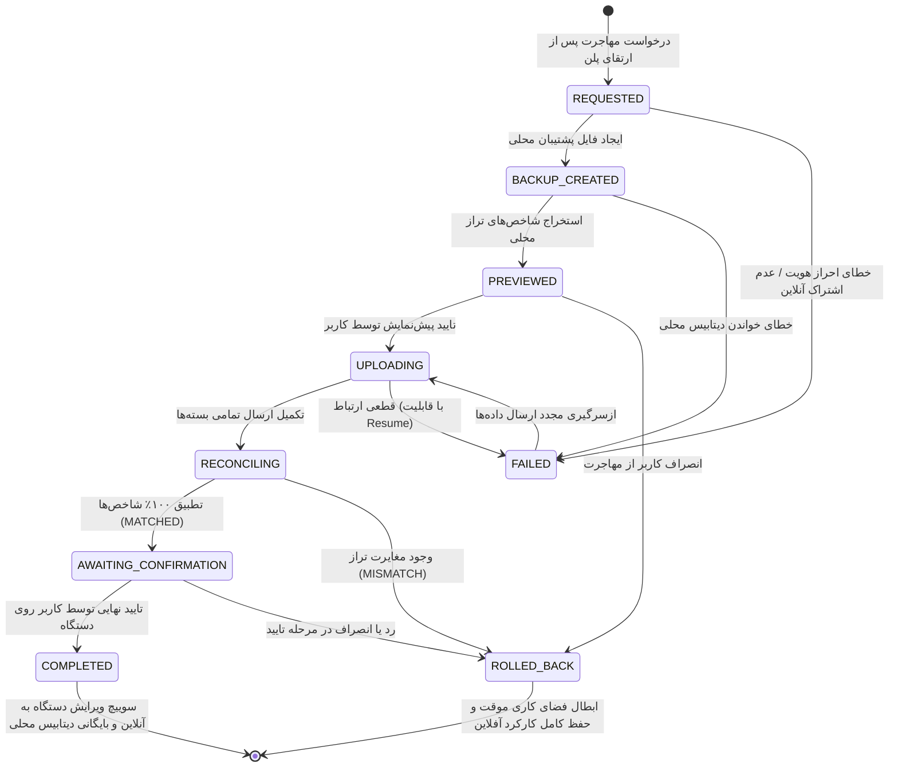

# قرارداد فنی و معماری مهاجرت ابری (M0.b — Contract & Invariants)

# Offline → Cloud Safe Migration Contract (M0 — Specification & Invariants)

> **سند مرجع:** فاز ۸ مستندات آفلاین (`docs/offline/OFFLINE-EDITION-PROMPT.md` §Phase 8)  
> **دستورالعمل اجرایی:** `docs/offline/migration/AGENT-M-PROMPT.md` §M0.b  
> **مالکیت کد و پیاده‌سازی:** ایجنت M  
> **هدف:** انتقال امن، برگشت‌پذیر، قابل ازسرگیری (Resumable) و اعتبارسنجی‌شده‌ی داده‌های یک کسب‌وکار از پایگاه داده محلی SQLite به پایگاه داده ابری Supabase/PostgreSQL حسابچه پس از خرید اشتراک آنلاین.

---

## ۱. اصول اساسی و خطوط قرمز (Non-Negotiable Invariants)

۱. **دستگاه تا زمان اثبات صحت سرور آفلاین می‌ماند (The Device Stays Offline Until the Server is Proven Right):**

- هیچ گامی ویرایش دستگاه را تغییر نمی‌دهد، داده‌های محلی را حذف نمی‌کند و دسترسی آفلاین را مسدود نمی‌سازد.
- سوییچ به نسخه ابری تنها پس از تطبیق ۱۰۰٪ تمامی سنجه‌ها (`reconciliation: MATCHED`) و تایید نهایی کاربر (`AWAITING_CONFIRMATION → COMPLETED`) انجام می‌شود.
- در صورت هرگونه خطا، شکست یا مغایرت حتی ۱ افغانی/ریال (`MISMATCH` یا `FAILED`)، دستگاه با حفظ تمام اطلاعات در حالت آفلاین به کار خود ادامه می‌دهد.

۲. **تطبیق بر پایه بازخوانی دیتابیس پستگرس است، نه نتایج فراخوانی (Reconciliation Reads Postgres, Not Call Results):**

- شمارش فراخوانی‌های موفق در حافظه اثبات هیچ چیز نیست.
- سرور مستقیماً جداول پایگاه داده ابری را مجدداً کوئری زده و مانده‌ها، موجودی انبار، اسناد دفتر کل و سود و زیان را سطر به سطر بازخوانی و با مانیفست دستگاه مقایسه می‌کند.

۳. **تفکیک دو شماره و عدم تداخل (Two Numbers, Never Confused):**

- شماره محلی (`local_number` یا آنچه روی فاکتور کاغذی چاپ شده) و شماره رسمی ابری سرور (`invoice_number`) دو فیلد کاملاً مجزا هستند.
- شماره محلی در فیلد `reference` فاکتور ابری ذخیره و در جدول نگاشت نمایه می‌شود تا اسناد چاپ‌شده قبلی همواره در سرچ سیستم قابل بازیابی باشند. سرور توالی رسمی خود را بدون خطر تصادم تولید می‌کند.

۴. **تکرارپذیری امن در سطح پایگاه داده (Re-running is Safe at Database Level):**

- کلیدهای تکرارناپذیری مستقیماً از شناسه پایگاه محلی مشتق می‌شوند: `cmig-<entity>-<hash(licence_id, local_id)>`.
- قطع ارتباط در هر لحظه، قطعی برق، بستن نرم‌افزار یا خطای سرور با یک اجرای مجدد دقیقاً از آخرین رکورد ادامه یافته و رکوردهای قبلی بدون ایجاد سند تکراری پاسخ داده می‌شوند.

۵. **عبور الزامی کلیه آثار مالی از سرویس‌های رسمی دامنه (Every Financial Effect Through Its Existing Service):**

- مشتری → `CustomerService.create`
- کالا و موجودی اول دوره → `ProductService.create` / `recordOpeningStock`
- فاکتور خرید و فروش → `InvoiceService.create`
- پرداخت و تخصیص → `PaymentsService.recordPayment`
- لغو فاکتور → `InvoiceService.update({ status: 'cancelled' })` (با اجرای `reverseEffects`)
- انتقال کالا → `WarehouseService.transferStock`
- بهای تمام‌شده و تنظیمات انبار → `CostingService.setSettings`
- ثبت مستقیم در جداول تجاری یا درج مستقیم در `journal_lines` اکیداً ممنوع است.

۶. **فضای کاری جدید، ایزوله و اختصاصی (Fresh Cloud Workspace Only):**

- داده‌های محلی صرفاً وارد یک فضای کاری جدید ابری با مالکیت حساب لایسنس می‌شوند.
- دسترسی کاربر با مقدار صریح `has_access = true` در جدول `workspace_members` ثبت می‌شود.
- ارز پایه و منطقه زمانی از پایگاه محلی دستگاه خوانده و ثبت می‌گردد.
- ادغام داده‌ها در یک فضای کاری ابری موجود که دارای تراکنش است اکیداً ممنوع است.

---

## ۲. ماشین حالت مهاجرت (Migration State Machine)

فرآیند مهاجرت از مراحل صریح و قطعی زیر پیروی می‌کند:



### ماتریس جامع گذار حالت‌ها (State Transitions Matrix):

| وضعیت جاری                           | وضعیت بعدی              | عامل تحریک (`Trigger`)                                    | داده ذخیره‌شده در سیستم                                                                   | آنچه دستگاه به کاربر نمایش می‌دهد                                                                          |
| ------------------------------------ | ----------------------- | --------------------------------------------------------- | ----------------------------------------------------------------------------------------- | ---------------------------------------------------------------------------------------------------------- |
| `[*] `                               | `REQUESTED`             | کاربر در صفحه ارتقا یا تنظیمات دکمه مهاجرت را کلیک می‌کند | ایجاد رکورد در `cloud_migration_jobs` با وضعیت `REQUESTED` و زمان شروع                    | نمایش لودر اعتبارسنجی لایسنس و اشتراک آنلاین                                                               |
| `REQUESTED`                          | `BACKUP_CREATED`        | سیستم کلاینت (لوکال انجین)                                | ایجاد نسخه کپی کامل SQLite در پوشه پشتیبان به همراه محاسبه چک‌سام SHA-256                 | پیام: «نسخه پشتیبان محلی با موفقیت ایجاد شد.»                                                              |
| `BACKUP_CREATED`                     | `PREVIEWED`             | سیستم کلاینت                                              | مانیفست پیش‌نمایش شامل تعداد فاکتورها، مانده‌ها به تفکیک ارز، تراز آزمایشی و موجودی انبار | جدول خلاصه ارقام جهت مقایسه و دکمه «شروع انتقال به ابر»                                                    |
| `PREVIEWED`                          | `UPLOADING`             | کاربر با کلیک روی دکمه تایید                              | ثبت شناسه بسته در حال ارسال و به‌روزرسانی وضعیت در `cloud_migration_jobs`                 | نوار پیشرفت ارسال بسته‌ها: «در حال ارسال فاکتورها و اسناد (بسته X از Y)...»                                |
| `UPLOADING`                          | `FAILED`                | قطعی اینترنت / تایم‌اوت / خطای ۵۰۰                        | ثبت کد خطا (`MIGRATION_INTERRUPTED`) و آخرین بسته موفق در دیتابیس                         | پیام: «ارتباط با سرور قطع شد. داده‌های شما محفوظ است. دکمه تلاش مجدد را بزنید.»                            |
| `FAILED`                             | `UPLOADING`             | کاربر یا سیستم با کلیک روی تلاش مجدد                      | فعال‌سازی مجدد اجاره جاب (`claimRun`) و ادامه از آخرین ردیف جدول نگاشت                    | ادامه نوار پیشرفت از همان درصد قبلی بدون شروع از اول                                                       |
| `UPLOADING`                          | `RECONCILING`           | سرور پس از دریافت آخرین بسته                              | ثبت زمان اتمام آپلود و شروع فرآیند کوئری‌گیری از پایگاه داده ابری                         | نمایش نشانگر: «در حال تطبیق هوشمند ترازهای مالی و موجودی انبار...»                                         |
| `RECONCILING`                        | `AWAITING_CONFIRMATION` | سرور در صورت تطبیق ۱۰۰٪ ارقام (`MATCHED`)                 | ثبت نتیجه مقایسه تمام شاخص‌ها (`diff = 0`) در `cloud_migration_reconciliations`           | جدول تطبیق موفقیت‌آمیز ارقام به همراه دکمه برجسته «اتصال نهایی به حسابچه ابری»                             |
| `RECONCILING`                        | `ROLLED_BACK`           | سرور در صورت وجود هرگونه مغایرت (`MISMATCH`)              | ثبت جزئیات مغایرت و ردیف‌های نامنطبق در جدول لاگ ادمین                                    | هشدار قرمز: «مغایرت در ارقام مشاهده شد. اطلاعات ابری باطل شد و دستگاه شما کاملاً آفلاین و فعال باقی ماند.» |
| `AWAITING_CONFIRMATION`              | `COMPLETED`             | کاربر با کلیک روی تایید نهایی                             | فعال‌سازی دائم فضای ابری، تغییر نوع اشتراک در سرویس صورت‌حساب، تغییر نشانگر ویرایش دستگاه | پیام تبریک: «اطلاعات شما با موفقیت به ابر منتقل شد. نرم‌افزار به نسخه ابری متصل است.»                      |
| `PREVIEWED / AWAITING / RECONCILING` | `ROLLED_BACK`           | انصراف کاربر یا مغایرت سرور                               | تغییر وضعیت فضای کاری ابری به بایگانی/غیرفعال (`is_active = false`)                       | بازگشت به محیط عادی نرم‌افزار آفلاین بدون هیچ تغییر در اسناد                                               |

---

## ۳. ترتیب زمانی و منطقی بازسازی اطلاعات (Chronological Recreation Order)

جهت جلوگیری از وابستگی‌های حلقوی، ثبت کالای بدون انبار یا فروش بدون موجودی، بازسازی با رعایت تقدم زمانی قطعی انجام می‌شود:

```
۱. فضای کاری و اعضا (Workspace & Members)
   └── ایجاد با نام محلی، تنظیم ارز پایه (baseCurrencyOf) و منطقه زمانی، درج مالک با has_access: true

۲. سرفصل‌های حسابداری (Chart of Accounts)
   └── ایجاد یا انطباق سرفصل‌های کل و معین دفتر کل

۳. واحدهای سنجش کالا (Product Units)
   └── تعریف واحدها (عدد، کیلوگرم، کارتن، متر و ...)

۴. انبارها و قفسه‌ها (Warehouses & Shelves)
   └── ایجاد انبارهای فیزیکی و قفسه‌بندی‌ها

۵. طرف‌حساب‌ها (Customers & Suppliers)
   └── ثبت مشتریان و تامین‌کنندگان با شماره تماس و نقش رسمی؛ نگاشت شناسه‌ها در cloud_migration_map

۶. کالاها و موجودی اول دوره (Products & Opening Stock)
   └── کالاها ثبت شده؛ در صورت داشتن قیمت خرید، لایه‌های بهای تمام‌شده (Cost Layer) ایجاد می‌شوند؛ در صورت عدم وجود قیمت، هزینه نامعلوم (Unknown) باقی می‌ماند و هرگز صفر نمی‌شود

۷. نرخ‌های برابری ارز (Exchange Rates)
   └── ثبت نرخ‌های تاریخی در جدول نرخ تسعیر

۸. فاکتورها به ترتیب زمان صدور (Invoices in Strict Chronological Order)
   ├── الف) فاکتورهای خرید (Purchases): اولویت بالاتر در هر روز برای تشکیل لایه‌های موجودی و بهای تمام‌شده
   └── ب) فاکتورهای فروش (Sales): مصرف موجودی انبار بر اساس روش قیمت‌گذاری و ثبت سند درآمد و بدهکاران در دفتر کل

۹. دریافت‌ها و پرداخت‌ها (Payments & Allocations)
   └── ثبت مبالغ نقدی/بانکی و تخصیص مستقیم به فاکتورهای متناظر بر پایه شناسه‌های نگاشت‌شده

۱۰. انتقالات بین‌انباری (Warehouse Transfers)
    └── جابجایی کالاها در تاریخ دقیق وقوع با کلید تکرارناپذیری

۱۱. لغو فاکتورها (Cancellations)
    └── اعمال ابطال فاکتورهای لغوشده از طریق اکشن رسمی cancel و تولید اسناد معکوس reverseEffects

۱۲. اسناد دستی دفتر کل (Manual Journal Entries)
    └── در صورت وجود اسناد دستی، ثبت در دفتر کل با حفظ ردیف‌های بدهکار و بستانکار
```

---

## ۴. تصمیمات معماری و استدلال‌های فنی (Key Design Decisions & Justifications)

### ۱. تصمیم شماره‌گذاری فاکتورها (Invoice Numbering & Rule 3)

- **تصمیم:** تخصیص شماره رسمی ابری با فرمت سیستمی (`INV-XXXXXX`) توسط سرور، و ذخیره شماره چاپ‌شده محلی در ستون `reference` به همراه ثبت در جدول نمایه `cloud_migration_map`.
- **استدلال:** در نسخه محلی، ممکن است کاربر فاکتورهایی با فرمت‌های دستی، تکراری بین شعبه‌ها یا پیش‌شماره‌های سفارشی داشته باشد که تلاش برای گنجاندن آن‌ها در توالی عددی دیتابیس ابری موجب شکست قید یکتایی (`UNIQUE constraint`) سرور می‌شود. با ذخیره شماره محلی در فیلد `reference`، تاریخچه کاغذی در جستجوها فوراً پیدا می‌شود و زنجیره عددی سرور نیز بدون آسیب ادامه می‌یابد.

### ۲. انجماد نرخ‌های تسعیر ارز (Frozen Historical Rates)

- **تصمیم:** هر فاکتور ارزی دقیقاً نرخ تسعیر تاریخی ذخیره‌شده روی دستگاه را در ستون `exchange_rate` حمل می‌کند و نرخ روز نادیده گرفته می‌شود.
- **استدلال:** تغییر نرخ تسعیر یک فاکتور خرید یا فروش متعلق به گذشته، سود و زیان تسعیر ارز، ارزش موجودی انبار و تراز دفتر کل را به کلی مخدوش می‌سازد. نرخ‌های تاریخی باید بدون تغییر منجمد شوند.

### ۳. بازسازی لایه‌های بهای تمام‌شده (Costing Method Rebuild)

- **تصمیم:** لایه‌های بهای تمام‌شده بر اساس تنظیمات فضای کاری (FIFO یا AVCO) و به ترتیب دقیق زمان وقوع بازسازی می‌شوند.
- **اصل تخطی‌ناپذیر «نامعلوم صفر نیست» (Unknown is not Zero):** اگر کالایی در پایگاه محلی فاقد قیمت خرید بوده و با هزینه نامعلوم فروخته شده است، در سرور نیز وضعیت بهای تمام‌شده `unknown` و سود آن `null` باقی می‌ماند. هرگز نباید به صفر تبدیل شود.

### ۴. معنای ابطال و برگشت به عقب (Meaning of ROLLED_BACK)

- **در سرور (On the Server):** فضای کاری موقتی که برای مهاجرت ایجاد شده بود، به عنوان فضای کاری ناموفق بازنشسته (`retired / is_active = false`) می‌شود. هیچ‌گاه از دستور مخرب `DELETE` برای حذف سطر به سطر رکوردهای مالی استفاده نمی‌شود (قانون شماره ۴ آگنت‌ها).
- **روی دستگاه (On the Device):** هیچ تغییری رخ نمی‌دهد؛ دستگاه همچنان پایگاه داده محلی خود را خوانده و بدون یک ثانیه توقف در حالت آفلاین به فعالیت ادامه می‌دهد.

---

## ۵. جدول نگاشت شناسه‌ها (`cloud_migration_map`)

برای تضمین عدم تکرار و برقراری ارتباط بین شناسه‌های محلی و ابری، ساختار زیر در مایگریشن پایگاه داده ایجاد می‌شود:

```sql
CREATE TABLE IF NOT EXISTS public.cloud_migration_map (
    id UUID PRIMARY KEY DEFAULT gen_random_uuid(),
    workspace_id UUID NOT NULL REFERENCES public.workspaces(id) ON DELETE CASCADE,
    migration_job_id UUID NOT NULL,
    entity_type TEXT NOT NULL,
    local_id TEXT NOT NULL,
    cloud_id UUID NOT NULL,
    created_at TIMESTAMPTZ NOT NULL DEFAULT now(),
    CONSTRAINT uq_migration_entity_local UNIQUE (workspace_id, entity_type, local_id)
);
CREATE INDEX IF NOT EXISTS idx_migration_map_lookup ON public.cloud_migration_map(workspace_id, entity_type, local_id);
```

---

## ۶. پرسش‌های شفاف‌سازی از کارفرما (Open Questions for Owner)

جهت قفل نهایی و اجرای گام‌های کدنویسی، تصمیمات زیر به عنوان پیش‌فرض در نظر گرفته شده‌اند:

1. **نام فضای کاری جدید در ابر:** نام فضای کاری جدید دقیقاً برابر با نام بیزینس در پایگاه داده محلی تنظیم می‌شود.
2. **مشتریان با نام‌های مشابه:** هر مشتری با شناسه یکتای محلی خود ثبت شده و تکراری بودن نام مانع ثبت رکورد مجزا نمی‌شود.
3. **نگهداری پایگاه داده محلی:** فایل پایگاه داده محلی روی دستگاه به صورت نامحدود و در وضعیت فقط-خواندنی به عنوان بایگانی ایمن حفظ می‌شود.

---

> **پایان گام M0:** بررسی کدها (`00-SURVEY.md`) و قرارداد فنی معماری (`00-CONTRACT.md`) تدوین گردید و هیچ کد محصولی نوشته نشد. سیستم آماده دریافت دستور `ادامه` جهت آغاز گام M1 می‌باشد.
