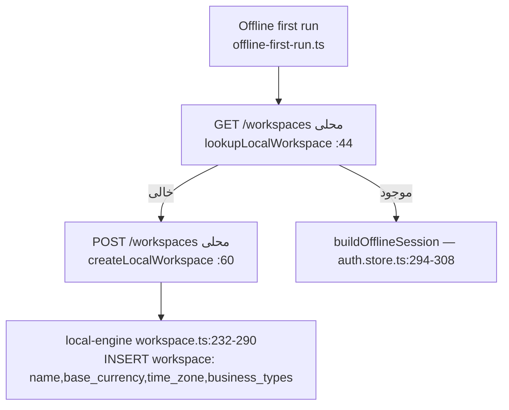

# 01 — ONBOARDING FLOW

commit: `05f749a2` · date: 2026-11-01 · وضعیت‌ها: VERIFIED_SOURCE ×9، PARTIAL ×2، NOT_VERIFIED ×2
مرتبط: [02-BUSINESS-CATEGORY-MATRIX](02-BUSINESS-CATEGORY-MATRIX.md) · [12-OFFLINE-SYNC-FLOW](12-OFFLINE-SYNC-FLOW.md) · [20-ANSWERS](20-ANSWERS-TO-THE-FOUR-QUESTIONS.md)

## ۱. زنجیرهٔ اول‌بار (آنلاین / وب)

```mermaid
flowchart TD
  A[Landing] --> B[POST /api/auth/signup\nauth.routes.ts:344]
  B --> C[profiles upsert\nauth.routes.ts:364]
  C --> D[signInWithPassword → session]
  D --> E[Dashboard layout guard\ndashboard-layout.tsx:171]
  E -->|useOnboardingStore.isCompleted=false| F[/onboarding\nOnboardingContainer]
  F --> G[Step0 Welcome → 1 BusinessType → 2 StoreSize → 3 Currency → 4 Complete]
  G --> H[PATCH /api/auth/profile\nauth.routes.ts:726]
  H --> I[profiles.business_types/store_size/business_note/onboarding_completed_at\nprofile-write.ts:49]
  G --> J[POST base-currency → workspaces.base_currency\nonboarding-container.tsx:171]
  I --> K[push /dashboard]
```

| #   | گام                                                                                                                                        | منبع                                                                                                                                                                                                                                     | وضعیت                                                                                                        |
| --- | ------------------------------------------------------------------------------------------------------------------------------------------ | ---------------------------------------------------------------------------------------------------------------------------------------------------------------------------------------------------------------------------------------- | ------------------------------------------------------------------------------------------------------------ |
| 1   | ثبت‌نام: `supabase.auth.admin.createUser` با `email_confirm: true`                                                                         | `backend/src/routes/auth.routes.ts:344-352`                                                                                                                                                                                              | VERIFIED_SOURCE                                                                                              |
| 2   | ردیف `profiles` با upsert (id, full_name, business_name)                                                                                   | `auth.routes.ts:364-371`                                                                                                                                                                                                                 | VERIFIED_SOURCE                                                                                              |
| 3   | ورود خودکار و برگرداندن توکن                                                                                                               | `auth.routes.ts:374-392`                                                                                                                                                                                                                 | VERIFIED_SOURCE                                                                                              |
| 4   | **ساخت اولین workspace برای کاربر آنلاین**                                                                                                 | `POST /api/workspaces` → `workspace.service.ts:133` وجود دارد، ولی هیچ فراخوانندهٔ کلاینتی پیدا نشد (`useCreateWorkspace` فقط export شده؛ جست‌وجو در `apps/`، `packages/ui`، `packages/app-shell`). تریگر ساخت در `docs/*.sql` پیدا نشد. | **NOT_VERIFIED** — ممکن است تریگر/کار دیگری روی دیتابیس زنده باشد که در ریپو نیست                            |
| 5   | گیت ریدایرکت به `/onboarding` فقط از `useOnboardingStore.isCompleted` (localStorage)                                                       | `apps/web/app/[lang]/(dashboard)/dashboard-layout.tsx:171-195`                                                                                                                                                                           | VERIFIED_SOURCE                                                                                              |
| 6   | `user.onboardingCompleted` از سرور خوانده می‌شود (`auth.routes.ts:261`) ولی **هیچ خواننده‌ای** برای ست‌کردن `isCompleted` در ریپو پیدا نشد | grep `useOnboardingStore`/`onboardingCompleted`                                                                                                                                                                                          | PARTIAL — پیامد محتمل: ورود روی مرورگر دیگر دوباره ویزارد را نشان می‌دهد (سورس نشان می‌دهد؛ اجرای زنده نشده) |
| 7   | ویزارد پنج‌مرحله‌ای (`step` 0..4)                                                                                                          | `onboarding-page.tsx:562-594`، store `onboarding.slice.ts:72-76`                                                                                                                                                                         | VERIFIED_SOURCE                                                                                              |
| 8   | انتخاب نوع کسب‌وکار (یک یا چند id، جداشده با کاما)                                                                                         | `onboarding-container.tsx:91-97`                                                                                                                                                                                                         | VERIFIED_SOURCE                                                                                              |
| 9   | ذخیره: `updateProfile({onboardingCompleted, businessTypes, storeSize?, businessNote?})`                                                    | `onboarding-container.tsx:99-104`                                                                                                                                                                                                        | VERIFIED_SOURCE                                                                                              |
| 10  | سرور: تغییر `businessTypes` فقط برای **owner** (`INDUSTRY_OWNER_ONLY`)                                                                     | `auth.routes.ts:765-776`                                                                                                                                                                                                                 | VERIFIED_SOURCE                                                                                              |
| 11  | `UPDATE` ردیف profile (نه upsert جزئی) و fallback فقط روی `42703/PGRST204`                                                                 | `backend/src/services/profile-write.ts:49-84`                                                                                                                                                                                            | VERIFIED_SOURCE                                                                                              |
| 12  | ارز دفاتر: `useSetBaseCurrency` → `workspaces.base_currency`؛ `BASE_CURRENCY_LOCKED` اگر سند مالی هست                                      | `onboarding-container.tsx:146-184`                                                                                                                                                                                                       | VERIFIED_SOURCE                                                                                              |

⚠️ **ستون ذخیره‌ی دسته در آنلاین = `profiles.business_types` (سطح کاربر)**، نه workspace، در حالی که کامنت کد می‌گوید «تصمیم workspace است» (`auth.routes.ts:760-764`). این با آفلاین فرق دارد (بخش ۲).

## ۲. زنجیرهٔ اول‌بار (آفلاین — Windows/Android)



| گام                                                                                                      | منبع                                                                  | وضعیت           |
| -------------------------------------------------------------------------------------------------------- | --------------------------------------------------------------------- | --------------- |
| خواندن خطادار: خطا throw می‌شود، «خالی» نیست                                                             | `offline-first-run.ts:40-47`                                          | VERIFIED_SOURCE |
| ساخت workspace روی دستگاه: نام، ارز دفاتر، منطقهٔ زمانی (پیش‌فرض ندارد)                                  | `offline-first-run.ts:58-66`                                          | VERIFIED_SOURCE |
| ذخیرهٔ دسته: ستون `workspace.business_types` به‌صورت رشتهٔ comma-separated + `business_types_updated_at` | `packages/local-engine/src/routes/workspace.ts:19-20,163-193,281-290` | VERIFIED_SOURCE |
| نشست آفلاین بدون رمز: `buildOfflineSession(ws)`                                                          | `packages/app-shell/src/features/auth/auth.store.ts:294-308`          | VERIFIED_SOURCE |
| هویت درخواست محلی باید کاربر را نام ببرد (`x-user-id`)، بدون fallback «اولین ردیف»                       | `packages/local-engine/src/context.ts` (rewritten)                    | VERIFIED_SOURCE |

## ۳. اختلاف آنلاین/آفلاین در onboarding

| موضوع                     | آنلاین                                   | آفلاین                                                      |
| ------------------------- | ---------------------------------------- | ----------------------------------------------------------- |
| محل ذخیره دسته            | `profiles.business_types` (آرایه، کاربر) | `workspace.business_types` (رشته، workspace)                |
| چه کسی می‌تواند تغییر دهد | owner (`auth.routes.ts:765`)             | `PATCH /workspaces` محلی (گارد نقش: در همین فایل بررسی نشد) |
| ساخت workspace            | **NOT_VERIFIED**                         | صریح در `offline-first-run.ts`                              |
| ارز                       | `workspaces.base_currency` از طریق API   | `POST /workspaces` با `baseCurrency`                        |

## ۴. نکات باز

- REQUIRES_PRODUCT_DECISION: دستهٔ کسب‌وکار باید روی کاربر باشد یا workspace؟ (آنلاین کاربر، آفلاین workspace.)
- NOT_VERIFIED: ساخت اولین workspace برای کاربر آنلاینِ تازه.
- NOT_VERIFIED: اجرای زندهٔ ویزارد روی workspace آزمایشی (workspace تست تأییدشده در دسترس نبود).
- مرجع: `docs/onboarding-server-state-migration.sql` ستون‌های پروفایل را اضافه می‌کند (اجرای آن روی دیتابیس زنده: PENDING HUMAN CONFIRMATION).
