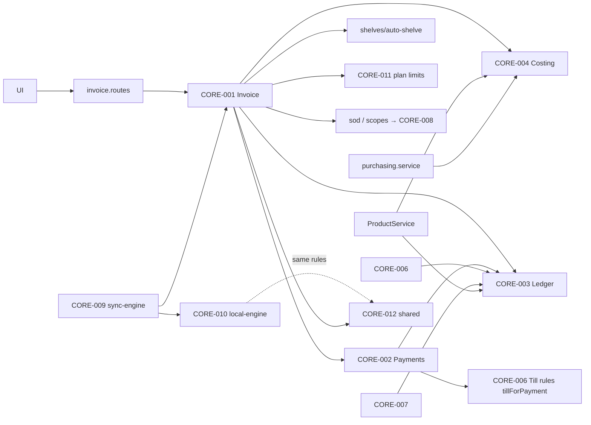

# 04 — CORE DEPENDENCY GRAPH (از فراخوانی‌های واقعی)

commit: `05f749a2` · date: 2026-11-01 · وضعیت: VERIFIED_SOURCE ×9 core، PARTIAL ×3
مرتبط: [03](03-SCREEN-TO-CORE-MAP.md) · [09](09-ACCOUNTING-LEDGER-FLOW.md)

معیار «core»: مالکیت داده + اختیار نوشتن + قاعدهٔ قابل‌استفادهٔ مجدد + فراخواننده‌های واقعی (grep بدون تست). فقط مواردی که هر چهار را دارند فهرست شده‌اند.

| CORE                             | مالک (فایل)                                                                                                                    | جدول‌های تحت مالکیت                                                        | اختیار نوشتن                                                              | فراخوانندگان واقعی (grep)                                                                                                                                    |
| -------------------------------- | ------------------------------------------------------------------------------------------------------------------------------ | -------------------------------------------------------------------------- | ------------------------------------------------------------------------- | ------------------------------------------------------------------------------------------------------------------------------------------------------------ |
| CORE-001 Invoice                 | `backend/src/services/invoice.service.ts`                                                                                      | invoices, invoice_items(+details), invoice_tax_lines, invoice_installments | RPC `invoice_write_document`؛ لغو/حذف `reverseEffects`                    | `routes/invoice.routes.ts`, `services/cloud-migration/cloud-migration.service.ts` (`invoiceService.create(`) ؛ ورود فایل/اتوماسیون/جریمه طبق CLAUDE.md       |
| CORE-002 Payments                | `services/payments/payments.service.ts`                                                                                        | payments, payment_allocations                                              | `recordPayment`/`cancelPayment`                                           | `routes/payments.routes.ts`, `routes/transaction.routes.ts`, `invoice.service.ts`, `billing.service.ts`, `referral.service.ts`, `cloud-migration.service.ts` |
| CORE-003 Ledger                  | `services/accounting/accounting.service.ts` (+ `ledger.port.ts`)                                                               | journal_entries, journal_lines, accounts                                   | `postDocument`/`reverseDocument`، تابع PG `accounting_post_journal_entry` | postDocument: invoice, payments, pos, human-resources, product, assets, currency؛ reverseDocument: invoice, payments                                         |
| CORE-004 Costing                 | `services/inventory-costing/*` (`costing`)                                                                                     | cost_layers, cost_consumptions                                             | `recordReceipt`, `applyCosting`, `releaseDocument`                        | `invoice.service.ts`, `product.service.ts`, `purchasing.service.ts`                                                                                          |
| CORE-005 Stock                   | `product.service.ts`, `warehouse.service.ts`, RPC‌های انبار                                                                    | stock_movements, product_stock, products.quantity (projection)             | درج حرکت + تریگر projection                                               | invoice (RPC)، product.update، purchasing.receiveGoods، transferStock                                                                                        |
| CORE-006 Till                    | `services/pos/pos.service.ts`                                                                                                  | pos_sessions, pos_orders, pos_cash_movements                               | `closeSession` شرطی بر status                                             | routes POS؛ `payments` (tillForPayment)                                                                                                                      |
| CORE-007 HR/Payroll              | `human-resources.service.ts`                                                                                                   | employees, payrolls, leaves                                                | `bookPayroll`                                                             | `human-resources.routes.ts`، automation                                                                                                                      |
| CORE-008 Authorization           | `services/authorization/authorization.domain.ts` + `middleware/authorize.middleware.ts`                                        | roles/permission matrix                                                    | `holds`, `requireCapability`                                              | ۲۵۹ استفاده در ۶۳ route + sync.service                                                                                                                       |
| CORE-009 Sync                    | سرور: `sync.service.ts`/`sync.routes.ts`؛ کلاینت: `app-shell/.../sync-engine.ts` + `app-bridge` (`push-routing`, `push-order`) | sync cursor/change log، outbox محلی                                        | push/pull                                                                 | app-shell providers, mobile `sync-runner`                                                                                                                    |
| CORE-010 Local engine            | `packages/local-engine` (۴۲ فایل route، ~۲۰۲ ثبت route)                                                                        | SQLite محلی                                                                | تراکنش `db.transaction`                                                   | desktop/mobile (via app-bridge)                                                                                                                              |
| CORE-011 Plan limits/Entitlement | `plan-limits.service.ts`, `plan-limit-defaults.ts`, `validation/.../entitlement-resolver.ts`                                   | subscriptions, plan_limit_settings                                         | `assertWithinLimit`, `resolveEntitlement`                                 | `invoice.service.ts:908` و دیگران                                                                                                                            |
| CORE-012 Shared rules            | `@hisabche/validation`                                                                                                         | — (فقط توابع خالص)                                                         | —                                                                         | `invoiceLedgerLines`, `paymentPosting`, `payrollLines`, `sessionPostingLines`, `buildProfitReport`, `resolveBusinessProfile` — سرور و local-engine هر دو     |

یادداشت‌ها

- ریسک چرخهٔ ماژول: code-intel ۳ چرخهٔ فایل گزارش کرده؛ جزئیات نخوانده شد (NOT_VERIFIED).
- `ledger.reverseDocument` فقط از دو core صدا زده می‌شود؛ بقیهٔ اسناد (POS، حقوق، PO) برگشت برنامه‌ریزی‌شدهٔ مشابه ندارند (گزارش‌شده در 09).
