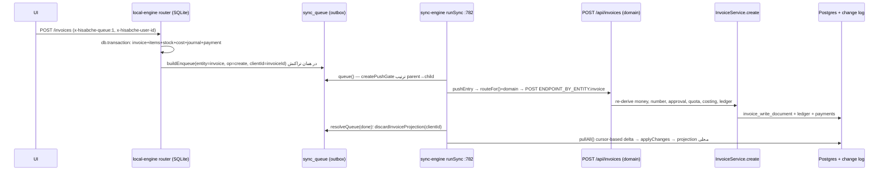

# 12 — OFFLINE & SYNC FLOW (FLOW-020 … FLOW-026)

commit: `05f749a2` · date: 2026-11-01 · وضعیت: VERIFIED_SOURCE ×6، PARTIAL ×2، NOT_VERIFIED ×2
مرتبط: [05](05-SALES-INVOICE-FLOW.md) · [13](13-PERMISSION-FLOW.md) · ماتریس: `packages/validation/src/schemas/offline-endpoint-matrix.ts`

## ۱. دو نسخهٔ آفلاین (مهم)

`getAppEdition()` دو حالت دارد؛ `runSync` در نسخهٔ `offline` فوراً برمی‌گردد (`packages/app-shell/src/features/sync/sync-engine.ts:783`). یعنی:

- **Offline edition**: دادهٔ محلی SQLite، بدون sync به سرور. ارتقا به ابر = مسیر `cloud-migration` (backend/src/services/cloud-migration) که فقط ۸ بخش را منتقل می‌کند (طبق `docs/qa/BUG-DISCOVERY-100-DECISIONS-APPLIED.fa.md`: تنظیمات انبار، انبار، کالا، موجودی، مشتری، فاکتور، پرداخت، حرکت انبار) — NOT_VERIFIED در این فاز (فایل‌ها خوانده نشدند).
- **Cloud edition (آنلاین با صف آفلاین)**: همان موتور محلی + outbox + sync.

## ۲. مسیر یک mutation (فاکتور) از دستگاه تا دفتر کل سرور

| مرحله            | رفتار                                                                                                                                                                                                                                                                                                                                                                                                                         | منبع                                                                    |
| ---------------- | ----------------------------------------------------------------------------------------------------------------------------------------------------------------------------------------------------------------------------------------------------------------------------------------------------------------------------------------------------------------------------------------------------------------------------- | ----------------------------------------------------------------------- |
| ۱ محلی           | تراکنش واحد شامل ردیف outbox؛ بدون هدر `x-hisabche-queue` هیچ صفی ساخته نمی‌شود (pull هرگز چیزی به سرور برنمی‌گرداند)                                                                                                                                                                                                                                                                                                         | `local-engine/src/routes/invoices.ts:486-489,885-895`                   |
| ۲ هویت           | هر ردیف صف مالک دارد (`userId`,`workspaceId`)؛ فقط حساب سازنده می‌فرستد؛ ردیف بی‌مالک منتظر می‌ماند                                                                                                                                                                                                                                                                                                                           | `sync-engine.ts:817-824`                                                |
| ۳ ترتیب          | `createPushGate`: ورودی تا create مرجعش فرستاده نشده منتظر می‌ماند (نه fail)؛ وابستگی که دائماً شکست خورده → ورودی `REJECTED: BLOCKED_BY_DEPENDENCY:<id>`                                                                                                                                                                                                                                                                     | `packages/app-bridge/src/push-order.ts:59-98`, `sync-engine.ts:826-841` |
| ۴ انتخاب جاده    | `routeFor`: `invoice`, `invoice_item`, `transaction`, `inventory_movement` ⇒ همیشه **domain**؛ create/delete همیشه domain؛ update فقط برای `customer/product/employee` بدون فیلد مالی ⇒ **versioned** (`POST /api/sync/push`)                                                                                                                                                                                                 | `app-bridge/src/push-routing.ts:41-115`                                 |
| ۵ نگاشت endpoint | `ENDPOINT_BY_ENTITY`: invoice→/invoices، customer→/customers، product→/products، transaction→/transactions، payment→/payments، inventory_movement→/stock-transfers، price_list، promotion، account→/accounting/accounts، journal_entry→/accounting/journal؛ موارد ویژه: `invoice_returns`→`/invoices/:id/returns`، `pos_cash_movement`، `pos_session close`، `journal_entry reverse`، `payment delete`→`/payments/:id/cancel` | `sync-engine.ts:556-569,600-684`                                        |
| ۶ idempotency    | هر ردیف یک کلید (همان `clientId`)؛ سرور با `client_request_id` بازپخش را پاسخ می‌دهد                                                                                                                                                                                                                                                                                                                                          | `sync-engine.ts:715` (کامنت)، `invoice.service.ts:811`                  |
| ۷ شکست           | `status 4xx` (جز 408/429) ⇒ دائمی (`REJECTED: ` prefix) و منتظر انسان؛ `INVOICE_REFERENCE_MISSING` ⇒ قابل‌تکرار؛ سایر ⇒ retry تا `MAX_ATTEMPTS = 5`                                                                                                                                                                                                                                                                           | `sync-engine.ts:51,571-573,874-887`                                     |
| ۸ reconnect      | `resetTransientFailuresOnReconnect` شمارندهٔ شکست‌های موقت را صفر می‌کند، رد‌شده‌ها ثابت می‌مانند                                                                                                                                                                                                                                                                                                                             | `sync-engine.ts:795-811,921`                                            |
| ۹ پس از موفقیت   | ردیف `done`؛ برای create فاکتور، projection موقت (شماره `OFF-…`) پاک می‌شود تا دو فاکتور نمایش داده نشود                                                                                                                                                                                                                                                                                                                      | `sync-engine.ts:847-854`                                                |
| ۱۰ pull          | `pullAll` با cursor، `DELTA_ENTITIES = essential(product,customer,warehouse,product_stock)+background(invoice,branch,exchange_rate)`؛ cursor فقط پس از commit صفحه؛ stream SSE برای بیدارکردن                                                                                                                                                                                                                                 | `sync-engine.ts:87-101,436-534`                                         |
| ۱۱ محل معکوس     | `POST /api/sync/push` (versioned): per-entity capability از `SYNC_WRITE_CAPABILITY`؛ `delete` را نمی‌پذیرد؛ conflict ⇒ 409 + `/conflicts`                                                                                                                                                                                                                                                                                     | `backend/src/services/sync.service.ts:353-366,571-582`                  |

### Conflict و temp-id

- نسخه‌دار: `expectedVersion` ⇒ سرور 409 و ردیف conflict (`pushVersioned`, `sync-engine.ts:706-749`). بدون آن last-write-wins.
- شناسه: client-generated UUID (`invoiceId = raw.id || generateUuid()`, `invoices.ts:595`) ⇒ نگاشت temp→server نیاز نیست جز **شمارهٔ فاکتور** که موقت است و با شماره رسمی سرور جایگزین می‌شود.

## ۳. مقایسهٔ کنار هم آنلاین و آفلاین (فاکتور)

|                                       | آنلاین مستقیم         | آفلاین → sync                                                                   |
| ------------------------------------- | --------------------- | ------------------------------------------------------------------------------- |
| منبع قانون پول                        | `computeInvoiceMoney` | `sumInvoiceLines` + `computeItemTotal` (قاعدهٔ مشترک `@hisabche/validation`)    |
| ledger lines                          | `invoiceLedgerLines`  | همان تابع (`local invoices.ts:774`)                                             |
| معکوس‌سازی دفتر                       | سند جدید معکوس        | `status='reversed'` (محلی) — پس از sync سرور دوباره می‌سازد                     |
| approval / سقف پلن / till / flag منفی | فعال                  | محلی ندارد؛ هنگام sync توسط سرور اعمال می‌شود و می‌تواند **رد** کند (۴xx دائمی) |
| شمارهٔ فاکتور                         | رسمی                  | موقت `OFF-…`                                                                    |
| permission                            | HTTP guard            | محلی: `requireCapability` فقط روی برخی routeها؛ سرور هنگام sync دوباره می‌سنجد  |

## ۴. آنچه route-محلی‌ای ندارد (تصمیم آگاهانه)

ماتریس ۴۹۵ ردیف: `available` 175 · `online_required` 305 · `not_supported` 15 (شمارش با regex روی فایل ماتریس). گارد: `offline-matrix-guard.test.ts` (رجیستری ⇔ route محلی). UI از `useActionAvailability`/`<OfflineGate>` می‌پرسد. نمونه‌های `online_required`: حذف مشتری، کلیدهای توسعه‌دهنده، نقش‌ها، تصاویر کالا (فایل ماتریس سطر 36-67).

## ۵. نکات PARTIAL/NOT_VERIFIED

- NOT_VERIFIED: ترتیب دقیق mutation نوع‌های `payment`/`transaction` نسبت به `invoice` برای فاکتور پرداخت‌شده آفلاین (در آفلاین payment در همان create لحاظ می‌شود، ولی `payment` جدا هم در صف می‌تواند باشد) — دوباره‌ثبتی احتمالی بررسی نشد.
- NOT_VERIFIED: رفتار cloud-migration برای خرید/حقوق/قسط/شمارش/بودجه (طبق گزارش DECISIONS-APPLIED پیاده نشده: `NOT_IMPLEMENTED` به‌روایت آن سند).
- PARTIAL: مسیر آفلاین برگشت (`invoice-returns.ts` در local-engine) خوانده نشد؛ فقط push آن (`sync-engine.ts:600`) تأیید شد.
