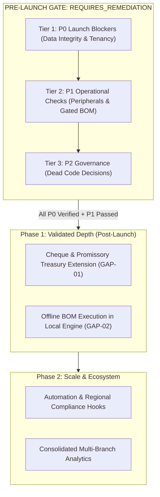

# HISABCHE — FINAL STRATEGIC ROADMAP & PRE-LAUNCH GATE

**Auditor:** Independent Red-Team Lead Product Intelligence Architect  
**Evaluation Date:** 2026-10-27  
**Gate Status:** `REQUIRES_REMEDIATION`

This roadmap outlines the verified pre-launch gate and post-launch phases based strictly on codebase reality and data integrity requirements.

---

---

## 1. Pre-Launch Gate Structure (Tiered)

Current Status: `REQUIRES_REMEDIATION`  
_The following items must be verified before opening commercial customer access._

### Tier 1: P0 Launch Blockers (Critical Data Integrity & Tenancy)

| Requirement                                   | Code & Evidence Paths                                                                                                                                                                                                                | Verification Status             | Exact Open Condition / Remediation                                                                                                                  |
| :-------------------------------------------- | :----------------------------------------------------------------------------------------------------------------------------------------------------------------------------------------------------------------------------------- | :------------------------------ | :-------------------------------------------------------------------------------------------------------------------------------------------------- |
| **1. Sync Integrity & Concurrency**           | `backend/src/services/sync.service.ts:593-612` `packages/app-shell/src/features/sync/__tests__/sync-scenarios.test.ts` `apps/mobile/src/__tests__/sync-scenarios.test.ts` `backend/src/__tests__/sync-scenarios.pg.test.ts` | `IMPLEMENTED_NOT_LIVE_VERIFIED` | Atomic update check fixed. Client suites pass. Real database concurrency suite Scenarios A–H (`sync-scenarios.pg.test.ts`) must be run on Linux CI. |
| **2. Tenant Isolation & Authz**               | `docs/audit/UNIVERSAL-CORE-AUDIT-FINAL.md` §2–3 `backend/src/__tests__/project-members-tenancy.test.ts` `backend/src/__tests__/workflow-tenancy-isolation.test.ts`                                                             | `REQUIRES_REMEDIATION`          | Multi-token cross-workspace HTTP negative penetration tests must verify that no workspace token can read/write another tenant's rows.               |
| **3. Accounting & Tax Integrity**             | `backend/src/services/tax/tax.domain.ts` `docs/audit/UNIVERSAL-CORE-GAP-LEDGER.md` (N-37)                                                                                                                                         | `NEEDS_OWNER_DECISION`          | N-37 tax-return vs ledger tie-out remains `NOT_IMPLEMENTED` pending owner accounting policy decision.                                               |
| **4. Inventory & Costing Rigor**              | `backend/src/services/inventory-costing` `backend/src/__tests__/inventory-avco-01.pg.test.ts`                                                                                                                                     | `IMPLEMENTED_NOT_LIVE_VERIFIED` | AVCO layer consumption logic verified in unit tests; needs real PG run on Linux.                                                                    |
| **5. Database Migrations Applied & Verified** | `docs/universal-core-migration.sql` `docs/invoice-return-01-migration.sql` `docs/sync-commit-horizon-migration.sql`                                                                                                            | `PENDING_OWNER_EXECUTION`       | Owner must apply migrations in exact order to live Supabase and run the corresponding `docs/VERIFY-*.sql` files.                                    |
| **6. Real Database Test Suite (81 files)**    | `backend/src/__tests__/*.pg.test.ts`                                                                                                                                                                                                 | `BLOCKED_EXTERNAL`              | 81 PostgreSQL integration suites cannot bind raw sockets on this Windows account (error 1314). Must be executed on Linux CI.                        |
| **7. Backup & Restore Drill**                 | `scripts/dr-restore-drill.mjs`                                                                                                                                                                                                       | `PENDING_EXECUTION`             | Complete a real cold snapshot restore drill verifying that all 56 tables and sequences recover cleanly.                                             |
| **8. Secrets & Credential Rotation**          | `backend/src/index.ts`                                                                                                                                                                                                               | `PENDING_OWNER_EXECUTION`       | Rotate development Supabase service keys, JWT secrets, and database credentials before public exposure.                                             |

---

### Tier 2: P1 Operational Checks (Required for Store Deployment)

| Check                         | Target Subsystem                                     | Status                          | Verification Requirement                                                                                                  |
| :---------------------------- | :--------------------------------------------------- | :------------------------------ | :------------------------------------------------------------------------------------------------------------------------ |
| **Thermal Receipt Printing**  | `apps/desktop/electron/main/services/printing.ts`    | `NEEDS_PHYSICAL_VERIFICATION`   | Physically test raw ESC/POS printing and 24V cash drawer kick on USB/network thermal printers (Epson, Bixolon, Xprinter). |
| **Offline Recipe BOM**        | `docs/product-intelligence/OFFLINE-BOM-PLAN.md`      | `GATED_BY_SYNC_INTEGRITY`       | Plan prepared (Part C). Implementation gated until P0 sync integrity suite passes on real Postgres.                       |
| **Operational Sync UX**       | `packages/app-shell/src/features/sync/sync-page.tsx` | `IMPLEMENTED_NOT_LIVE_VERIFIED` | Verify that network disconnect banners and conflict review dialogs present clear merchant guidance.                       |
| **Telemetry & Error Logging** | `backend/src/routes/audit.routes.ts`                 | `IMPLEMENTED`                   | Verify logging of sync outbox rejection spikes.                                                                           |

---

### Tier 3: P2 Governance & Dead-Code Decisions (`NEEDS_OWNER_DECISION`)

| Target File                                                   | Current Code Reality                                                                                    | Decision Options                                                                                               | Rule Citation       |
| :------------------------------------------------------------ | :------------------------------------------------------------------------------------------------------ | :------------------------------------------------------------------------------------------------------------- | :------------------ |
| `backend/src/services/warehouse/transfer.service.ts`          | Registered `WRITTEN_NOT_WIRED` (`unwired-capability.test.ts:435-439`). Has no `ship`/`receive` methods. | **Option A:** Wire into existing warehouse routes. **Option B:** Delete file to uphold zero dead code rule. | CLAUDE.md §0.6, §14 |
| `backend/src/services/reporting/scheduled-reports.service.ts` | Registered `WRITTEN_NOT_WIRED` (`unwired-capability.test.ts:476-481`). Has zero callers.                | **Option A:** Wire into reports hub. **Option B:** Delete dead code.                                        | CLAUDE.md §0.6, §14 |
| Cheque Treasury Scope (GAP-01)                                | No cheque tables in database.                                                                           | Validate merchant requirements (record-only vs Sayad vs endorsement vs full dual-entry ledger) before coding.  | Market Validation   |

---

## 2. Post-Gate Phases (Sequential)

### Phase 1: High-Value Domain Depth (Weeks 4–7)

1. **Offline Recipe BOM in Local Engine (`GAP-02`):**
   - Execute smallest-scope plan from `docs/product-intelligence/OFFLINE-BOM-PLAN.md`.
   - Add local routes in `packages/local-engine`, local tables in `packages/app-bridge`, and flip matrix rows.
2. **Cheque / Promissory Note Treasury Extension (`GAP-01`):**
   - Post-validation implementation based on verified merchant interview findings.

### Phase 2: Regional Trade Deepening & Scale (Weeks 8–12)

1. Multi-branch consolidated inventory analytics.
2. Enhanced bank statement format parsers (CSV dialect auto-detection).
