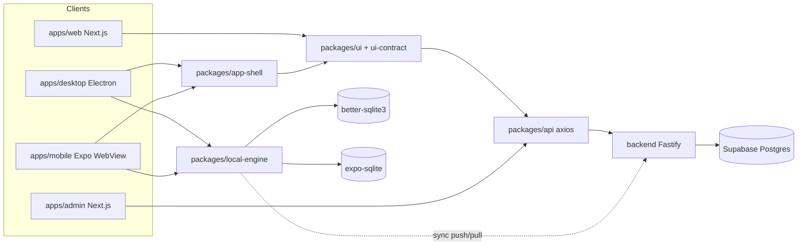
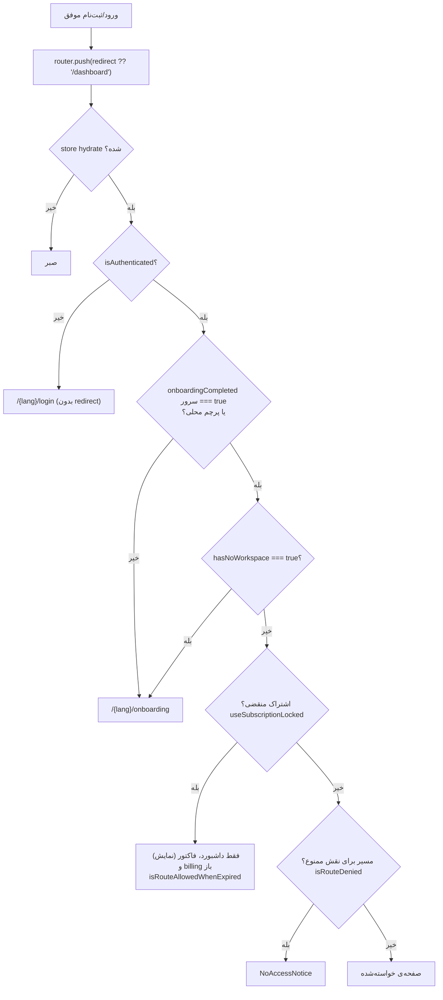
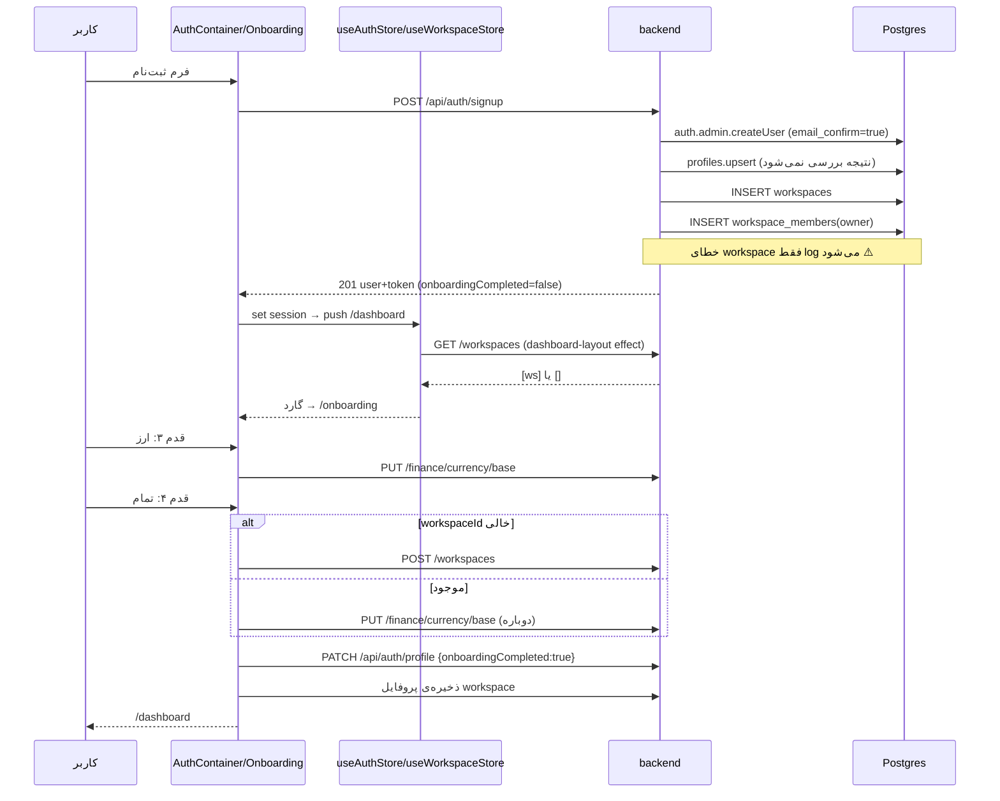
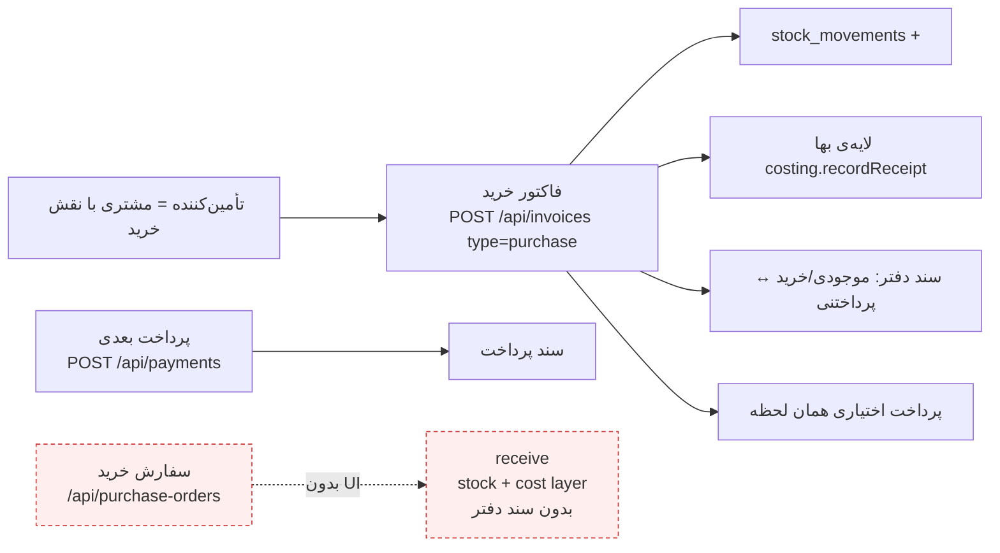
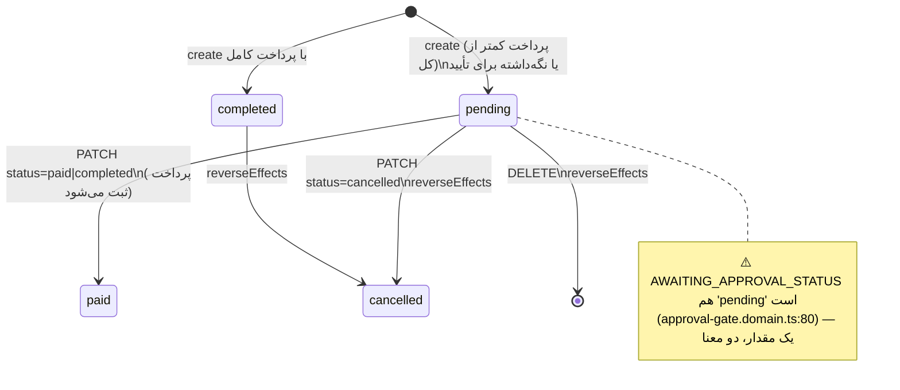
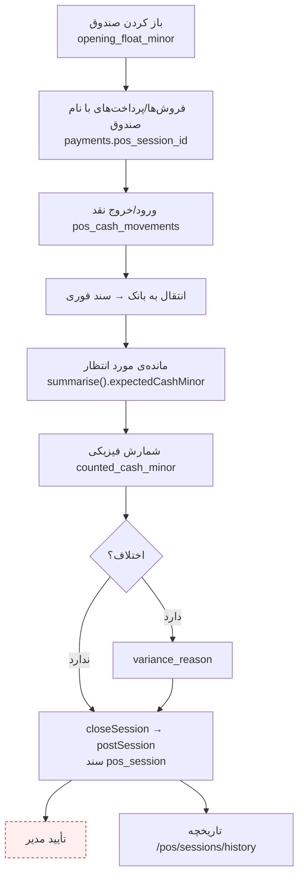
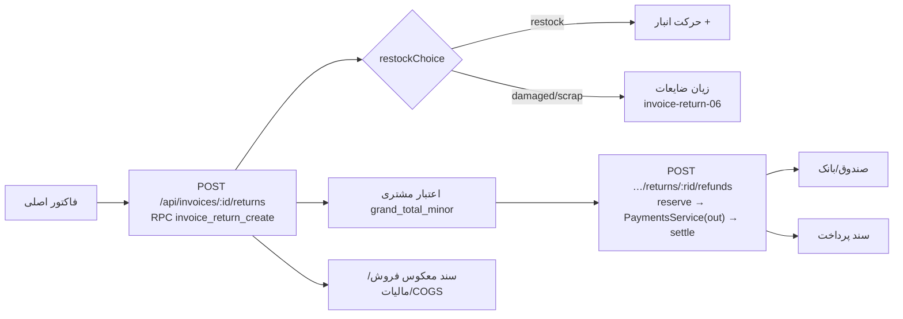
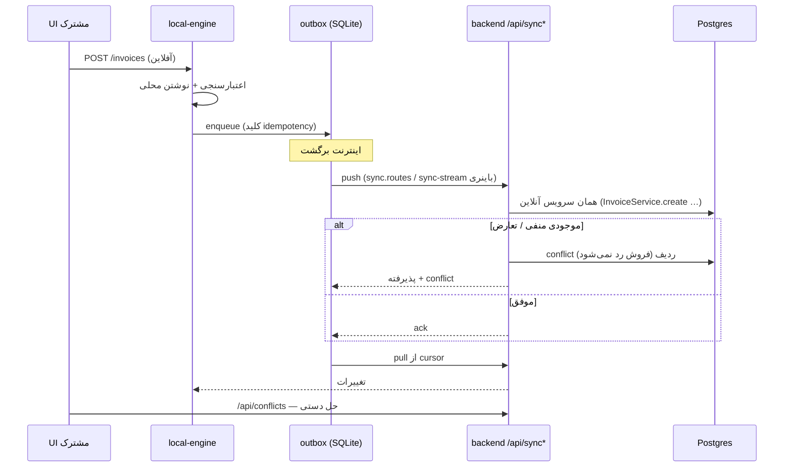
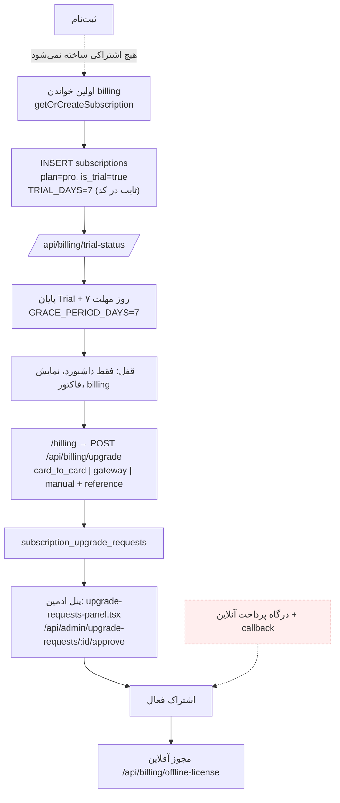

# سفر کامل کاربر در حسابچه — مهندسی معکوس از روی کد

> **تاریخ:** ۷ نوامبر ۲۰۲۶ · **کامیت:** `28154aca` (شاخه‌ی `claude/hisabche-user-journey-audit-fbe868`)
> **روش:** فقط خواندن کد مخزن + اجرای چند سوئیت تست امن. هیچ کد برنامه‌ای تغییر نکرد، هیچ درخواستی به سرور زنده یا دیتابیس Supabase زده نشد، هیچ اسکرین‌شاتی گرفته نشد (محیط امن staging در دسترس نبود).
> **اسناد همراه:**
> [ماتریس ردیابی](HISABCHE_WORKFLOW_TRACEABILITY_MATRIX.md) ·
> [ماتریس سه پلتفرم](HISABCHE_PLATFORM_PARITY_MATRIX.md) ·
> [شکاف‌ها و مسدودکننده‌ها](HISABCHE_WORKFLOW_GAPS_AND_BLOCKERS.md)

## راهنمای وضعیت‌ها

| وضعیت                           | معنا در این سند                                                                  |
| ------------------------------- | -------------------------------------------------------------------------------- |
| `VERIFIED_COMPLETE`             | با HTTP یا دیتابیس واقعی دیده شد. **در این ممیزی هیچ مسیری این وضعیت را نگرفت.** |
| `IMPLEMENTED_NOT_LIVE_VERIFIED` | زنجیره‌ی کامل UI → API → سرویس → دیتابیس در کد هست؛ اجرای زنده دیده نشد.         |
| `PARTIALLY_IMPLEMENTED`         | بخشی از زنجیره هست، حلقه‌ای گم است.                                              |
| `PARTIALLY_VERIFIED`            | تست واحد/ادغام همین ممیزی اجرا و سبز شد، ولی زنده نه.                            |
| `BLOCKED_BY_ENVIRONMENT`        | برای سنجش، محیطی لازم بود که در دسترس نبود.                                      |
| `NOT_IMPLEMENTED`               | در کد پیدا نشد.                                                                  |
| `UNKNOWN`                       | نتوانستم با شواهد تصمیم بگیرم.                                                   |

> ⚠️ **اصل این سند:** «route هست» ≠ «کار می‌کند». هر ادعا مسیر فایل دارد. جایی که ننوشتم «اجرا شد»، فقط کد را خوانده‌ام.

---

## ۰. نقشه‌ی پلتفرم‌ها

| مورد            | وب                                                                                                                                          | ویندوز                                                             | اندروید                                                                                                 | پنل ادمین                         |
| --------------- | ------------------------------------------------------------------------------------------------------------------------------------------- | ------------------------------------------------------------------ | ------------------------------------------------------------------------------------------------------- | --------------------------------- |
| برنامه          | `apps/web` (Next.js 16 App Router)                                                                                                          | `apps/desktop` (Electron)                                          | `apps/mobile` (Expo)                                                                                    | `apps/admin` (Next.js)            |
| نقطه‌ی ورود     | `apps/web/app/[lang]/page.tsx` (لندینگ)، `(dashboard)/layout.tsx`                                                                           | `apps/desktop/electron/main/index.ts` + رندرر `packages/app-shell` | `apps/mobile/index.js` → WebView روی بسته‌ی `app-shell` (`pnpm run build:shell`)                        | `apps/admin/app/[lang]/(admin)/…` |
| مسیریابی        | فایل‌محور با پیشوند locale همیشگی (`apps/web/proxy.ts` → `localePrefix: 'always'`)                                                          | `react-router-dom` (hash) در `packages/app-shell/src/app/app.tsx`  | همان `app-shell`                                                                                        | فایل‌محور                         |
| احراز هویت      | `useAuthStore` (`packages/store/src/slices/auth.slice.ts`) → `POST /api/auth/login                                                          | signup`؛ refresh در کوکی httpOnly روی http(s)                      | `packages/app-shell/src/features/auth/auth.store.ts` + vault (`electron/main/services/secure-store.ts`) | همان app-shell                    | ورود جدا (`apps/admin/app/[lang]/login`) |
| UI مشترک        | `@hisabche/ui`                                                                                                                              | `@hisabche/ui` از طریق app-shell                                   | `@hisabche/ui` از طریق app-shell                                                                        | primitives از `@hisabche/ui`      |
| کلاینت API      | `packages/api/src/lib/client.ts` (axios + `x-workspace-id`)                                                                                 | همان + `localRequest` به موتور محلی                                | همان + موتور محلی                                                                                       | همان                              |
| دیتابیس محلی    | ندارد                                                                                                                                       | better-sqlite3 (`electron/main/db/database.ts`)                    | expo-sqlite (`apps/mobile/src/host/local-db.ts`)                                                        | ندارد                             |
| آفلاین          | ندارد                                                                                                                                       | `packages/local-engine` (`electron/main/services/local-api.ts`)    | `packages/local-engine` (`apps/mobile/src/host/local-api.ts`)                                           | ندارد                             |
| تعیین workspace | `useWorkspaceStore.fetchWorkspace` (`packages/store/src/slices/workspace.slice.ts:78`) → `GET /workspaces`؛ سرور: `requireWorkspaceContext` | همان                                                               | همان                                                                                                    | —                                 |
| پوسته‌ی ناوبری  | `apps/web/app/[lang]/(dashboard)/dashboard-layout.tsx`                                                                                      | `app-shell` + `RequireAuth`                                        | همان                                                                                                    | layout ادمین                      |



---

## ۱. کاربر سایت را باز می‌کند

**مسیر:** `https://hisabche.com/` → middleware در `apps/web/proxy.ts` (next-intl، `localePrefix: 'always'`، `localeDetection: true`) کاربر را به `/fa`، `/af` یا `/en` می‌فرستد. صفحه: `apps/web/app/[lang]/page.tsx` (ISR، `revalidate = 3600`) که `LandingPage` از `packages/ui/src/components/ui/landing/landing-page.tsx` را رندر می‌کند.

### ۱.۱ آنچه روی صفحه دیده می‌شود (به ترتیب کد)

| ترتیب | بخش                                                                                                  | فایل                                                                                                                                           |
| ----- | ---------------------------------------------------------------------------------------------------- | ---------------------------------------------------------------------------------------------------------------------------------------------- |
| هدر   | `TopNav` با لینک‌های لنگری بخش‌ها (`#hero`, `#features`, `#offline`, …) + دکمه‌ی ورود/شروع رایگان    | `navigation/top-nav.tsx`، `navigation/public-auth-actions.tsx:53` (لینک `/{lang}/login`)، منوی موبایل `navigation/landing-mobile-menu.tsx:122` |
| ۱     | «سفر یک فاکتور» (Hero سه‌بعدی) با `<h1>` و دعوت به `/{lang}/signup` و `/{lang}/docs/getting-started` | `landing/journey/journey-hero.tsx:97,104,138`                                                                                                  |
| ۰۱    | ماژول‌ها                                                                                             | `landing/modules-scene.tsx`                                                                                                                    |
| ۰۲    | فصل آفلاین                                                                                           | `landing/chapter-scene.tsx`                                                                                                                    |
| ۰۳    | نوار اعتماد                                                                                          | `landing/trust-bar-scene.tsx`                                                                                                                  |
| ۰۴    | فصل AI                                                                                               | `landing/chapter-scene.tsx`                                                                                                                    |
| ۰۵    | امنیت                                                                                                | `landing/security-scene.tsx`                                                                                                                   |
| ۰۶    | مقایسه                                                                                               | `landing/compare-scene.tsx`                                                                                                                    |
| ۰۷    | قیمت‌گذاری (پلن enterprise → `/contact`، بقیه → `/signup`)                                           | `landing/pricing-scene.tsx:449`                                                                                                                |
| ۰۸    | سؤالات متداول                                                                                        | `landing/faq-scene.tsx`                                                                                                                        |
| پایان | دعوت پایانی → `/{lang}/signup`                                                                       | `landing/cta-scene.tsx:78`                                                                                                                     |
| فوتر  | امکانات (`/features/*`)، وبلاگ، راهنما، درباره، تماس، صفحات حقوقی                                    | `landing/site-footer-view.tsx:63-110`                                                                                                          |

### ۱.۲ کلیک‌ها

| کنش کاربر                               | نتیجه                                                                                 | مقصد             | پیاده‌سازی                   |
| --------------------------------------- | ------------------------------------------------------------------------------------- | ---------------- | ---------------------------- |
| «شروع رایگان» (هدر/Hero/CTA/قیمت‌گذاری) | ناوبری                                                                                | `/{lang}/signup` | لینک‌های بالا                |
| «ورود»                                  | ناوبری                                                                                | `/{lang}/login`  | `public-auth-actions.tsx:53` |
| «دمو»                                   | **لینک دمو در لندینگ پیدا نشد.** دکمه‌ی «ورود نمایشی» فقط داخل فرم ورود است (بخش ۴.۳) | —                | —                            |
| «قیمت‌گذاری»                            | اسکرول به `#pricing`                                                                  | همان صفحه        | `site-footer-view.tsx:64`    |
| «امکانات»                               | `#features` یا صفحات `/{lang}/features/[slug]`                                        | —                | `site-footer-view.tsx:73-83` |
| «دانلود»                                | **لینک دانلود در لندینگ پیدا نشد**                                                    | —                | —                            |

### ۱.۳ گذار از سایت عمومی به احراز هویت

- locale در همه‌ی لینک‌های لندینگ حفظ می‌شود (`/${locale}/signup`).
- `AuthContainer` پارامتر `?redirect=` را می‌خواند (`packages/ui/src/components/ui/auth/containers/auth-container.tsx:62`)؛ پیش‌فرض `/dashboard`.
- ⚠️ سوییچ ورود ↔ ثبت‌نام با `router.replace('/signup')` **بدون پیشوند locale** است (`auth-container.tsx:70,72`) — middleware آن را دوباره به locale تشخیص‌داده‌شده redirect می‌کند؛ لینک «فراموشی رمز» هم `href="/forgot-password"` بدون locale است (`AuthShell.tsx:801`). نتیجه: زبان می‌تواند عوض شود.
- ⚠️ گارد داشبورد کاربر بی‌نشست را به `/{lang}/login` **بدون** `?redirect=` می‌فرستد (`dashboard-layout.tsx:213-216`)، پس بازگشت به صفحه‌ی مقصد بعد از ورود انجام نمی‌شود.
- نشست موجود: صفحه‌ی `/login` در کد خوانده‌شده، کاربر واردشده را خودکار به داشبورد نمی‌برد (چنین شاخه‌ای در `auth-container.tsx` نیست) → `UNKNOWN` برای رفتار واقعی.

---

## ۲. ثبت‌نام

### ۲.۱ وب

**صفحه:** `apps/web/app/[lang]/signup/page.tsx` → `SignupClient.tsx` → `<AuthContainer initialMode="signup" />`.

| فیلد         | الزامی       | اعتبارسنجی کلاینت (`auth-container.tsx:34-40`) | اعتبارسنجی سرور (`packages/validation/src/schemas/auth.schema.ts:23-35`) |
| ------------ | ------------ | ---------------------------------------------- | ------------------------------------------------------------------------ |
| نام کامل     | بله          | حداقل ۲                                        | غیرخالی                                                                  |
| نام کسب‌وکار | بله (کلاینت) | حداقل ۲                                        | اختیاری، حداکثر ۲۰۰                                                      |
| تلفن         | خیر          | —                                              | **به سرور فرستاده نمی‌شود** (`auth-container.tsx:137-142`)               |
| ایمیل        | بله          | فرمت ایمیل                                     | فرمت ایمیل                                                               |
| رمز          | بله          | **فقط حداقل ۸**                                | حداقل ۸، حداکثر ۱۲۸، **یک حرف بزرگ + یک کوچک + یک رقم**                  |

- شرایط استفاده: چک‌باکس پذیرش در کد فرم پیدا نشد → `NOT_IMPLEMENTED`.
- ⚠️ رمزی مثل `password1` از کلاینت رد می‌شود ولی سرور با ۴۰۰ `Validation failed` رد می‌کند؛ پیام کاربر کلی است.

**قرارداد (نمونه‌ی ساختگی):**

```http
POST /api/auth/signup
{ "email": "owner@example.test", "password": "Example1234", "fullName": "نمونه", "businessName": "دکان نمونه" }

201 { "user": { "id": "…uuid…", "email": "owner@example.test", "role": null, "fullName": "نمونه",
                "businessName": "دکان نمونه", "createdAt": "…", "onboardingCompleted": false,
                "businessTypes": [], "storeSize": null, "businessNote": null },
      "token": "…", "refreshToken": "…(فقط بیرون از http(s)، وگرنه کوکی)…", "expiresAt": 0 }
400 { "error": "Email already registered" } | { "error": "Validation failed", "details": [...] }
```

**آنچه سرور انجام می‌دهد** (`backend/src/routes/auth.routes.ts:304-430`):

1. `supabase.auth.admin.createUser({ email_confirm: true, … })` — **ایمیل بدون تأیید، تأییدشده ثبت می‌شود**.
2. `profiles.upsert(...)` — **نتیجه بررسی نمی‌شود** (خط ۳۷۵).
3. `WorkspaceService.createWorkspace(userId, { name })` — **در try/catch؛ خطا فقط log می‌شود** (خط ۳۸۶-۳۹۹). یعنی ثبت‌نام بدون workspace هم ۲۰۱ برمی‌گرداند.
4. `signInWithPassword` و برگرداندن توکن.

`createWorkspace` (`backend/src/services/workspace.service.ts:133-201`): یک `INSERT` در `workspaces` و یک `INSERT` در `workspace_members` (`role: 'owner'`, `has_access: true`). **اتمیک نیست** (دو نوشتن جدا؛ کامنت خود فایل همین را می‌گوید و ردیف یتیم را با `docs/_repair-owner-memberships.sql` قابل‌ترمیم می‌داند). slug از نام ساخته می‌شود؛ وجود قید یکتایی روی `workspaces.slug` در `docs/*.sql` پیدا نشد → `UNKNOWN`.
**اشتراک/Trial در ثبت‌نام ساخته نمی‌شود** — به‌صورت تنبل در اولین خواندن billing ساخته می‌شود (بخش ۲۵).

### ۲.۲ ویندوز/اندروید

`packages/app-shell/src/features/auth/login-page.tsx` فرم ثبت‌نام خودش را دارد با **همان `signUpSchema` سرور** (خط ۱۱۷) — پس اعتبارسنجی رمز در پوسته سخت‌گیرتر و درست‌تر از وب است. همین صفحه «نسخه‌ی آفلاین» را هم دارد (بخش ۲۳).

### ۲.۳ تأیید ایمیل/تلفن

`NOT_IMPLEMENTED` — `email_confirm: true` در `auth.routes.ts:360`؛ هیچ endpoint تأیید کد/لینک پیدا نشد. فیلد تلفن جمع می‌شود و دور ریخته می‌شود.

---

## ۳. ورود، نشست، خروج

| کار            | پیاده‌سازی                                                                                                                                                                                                                               | وضعیت                                                                 |
| -------------- | ---------------------------------------------------------------------------------------------------------------------------------------------------------------------------------------------------------------------------------------- | --------------------------------------------------------------------- |
| ورود           | `POST /api/auth/login` (`auth.routes.ts:501`) از `apiLogin` (`auth.slice.ts:130`)؛ محدودکننده‌ی نرخ سراسری (`backend/src/index.ts:677`)                                                                                                  | `IMPLEMENTED_NOT_LIVE_VERIFIED`                                       |
| تمدید          | `POST /api/auth/refresh` (`auth.routes.ts:442`، rate-limit مجزا)؛ روی وب refresh در کوکی httpOnly                                                                                                                                        | `IMPLEMENTED_NOT_LIVE_VERIFIED`                                       |
| بازیابی نشست   | zustand-persist + `GET /api/auth/me` (`auth.slice.ts:235`)؛ `markTokenReady()` بعد از hydration (`auth.slice.ts:430,466`)                                                                                                                | `IMPLEMENTED_NOT_LIVE_VERIFIED`                                       |
| خروج           | `POST /api/auth/logout` (`auth.routes.ts:582`) + پاک‌کردن `workspaceId` (`auth.slice.ts:376-405`)؛ در پوسته، اگر صف خروجی پر باشد دیالوگ هشدار (`app-shell/src/components/layout/logout-pending-dialog.tsx`)                             | `IMPLEMENTED_NOT_LIVE_VERIFIED`                                       |
| فراموشی رمز    | `POST /api/auth/forgot-password` → `password-reset.service.ts` → ایمیل با Resend (`email.service.ts:27,445`)؛ بدون کلید Resend ارسال نمی‌شود                                                                                             | `BLOCKED_BY_ENVIRONMENT` (ارائه‌دهنده‌ی زنده سنجیده نشد)              |
| تنظیم رمز تازه | `POST /api/auth/reset-password` (`auth.routes.ts:734`)                                                                                                                                                                                   | `IMPLEMENTED_NOT_LIVE_VERIFIED`                                       |
| ورود نمایشی    | **کاملاً سمت کلاینت**: ایمیل/رمز ثابت در کد (`auth-container.tsx:95-104`، `auth.slice.ts:296-316`) توکن `'demo-token'` می‌سازد. سرور این توکن را نمی‌شناسد؛ اولین 401 → `setOnUnauthorized` نشست را پاک می‌کند (`auth.slice.ts:491-502`) | `PARTIALLY_IMPLEMENTED` (احتمالاً به صفحه‌ی ورود برمی‌گردد؛ اجرا نشد) |
| تعلیق حساب     | سرور در `GET /workspaces` و مجوز، `suspended_at IS NULL` را می‌سنجد (CLAUDE.md؛ `workspace.service.ts:210+`)                                                                                                                             | `IMPLEMENTED_NOT_LIVE_VERIFIED`                                       |
| چند دستگاه     | توکن Supabase مستقل به‌ازای هر ورود؛ محدودیت دستگاه فقط برای مجوز آفلاین (`/api/billing/devices/*`)                                                                                                                                      | `IMPLEMENTED_NOT_LIVE_VERIFIED`                                       |

### ۳.۱ درخت تصمیم بعد از ورود (وب)

منبع: `useRedirectGuard` در `apps/web/app/[lang]/(dashboard)/dashboard-layout.tsx:171-240` و محتوای شرطی در خط ۶۱۵.



| حالت               | مقصد واقعی                                                                        | شاهد                                                                   |
| ------------------ | --------------------------------------------------------------------------------- | ---------------------------------------------------------------------- |
| بدون workspace     | `/onboarding` و صفحات محافظت‌شده mount نمی‌شوند                                   | `dashboard-layout.tsx:221-226,615`                                     |
| یک workspace       | همان انتخاب می‌شود                                                                | `workspace.slice.ts:133-134`                                           |
| چند workspace      | workspace ذخیره‌شده اگر هنوز در فهرست باشد، وگرنه اولی؛ سوییچ با `enterWorkspace` | `workspace.slice.ts:132-134`؛ `packages/ui/src/lib/enter-workspace.ts` |
| onboarding ناتمام  | `/onboarding`                                                                     | `dashboard-layout.tsx:219-227`                                         |
| Trial فعال         | داشبورد عادی                                                                      | —                                                                      |
| اشتراک/Trial منقضی | فقط مسیرهای مجاز؛ سرور نوشتن را رد می‌کند                                         | `dashboard-layout.tsx:301-302`                                         |
| مجوز آفلاین        | فقط ویندوز/اندروید (بخش ۲۳)                                                       | `app-shell/src/features/auth/offline-license.ts`                       |
| دسترسی محدود       | `NoAccessNotice`                                                                  | `dashboard-layout.tsx:614`                                             |

---

## ۴. Onboarding و ایجاد Workspace

**مسیر:** `/{lang}/onboarding` — داخل همان گروه `(dashboard)`، پس همان layout و گارد را دارد. صفحه: `onboarding/page.tsx` → `OnboardingContainer` (`packages/ui/src/components/ui/onboarding/containers/onboarding-container.tsx`) → `OnboardingPage` (`onboarding/onboarding-page.tsx:562-604`). وضعیت قدم در `useOnboardingStore` (localStorage).

| قدم | کامپوننت                    | محتوا                                                                    | فیلدها                          | اثر سمت سرور                                                                                   |
| --- | --------------------------- | ------------------------------------------------------------------------ | ------------------------------- | ---------------------------------------------------------------------------------------------- |
| ۰   | `WelcomeStep` (خط ۶۹)       | خوش‌آمد                                                                  | —                               | —                                                                                              |
| ۱   | `BusinessTypeStep` (خط ۱۱۴) | انتخاب صنف/مدل (از `BUSINESS_MODELS`, `BUSINESS_TYPES` در `ui-contract`) | businessType (چندتایی، با کاما) | —                                                                                              |
| ۲   | `StoreSizeStep` (خط ۲۴۲)    | اندازه (کوچک/متوسط/بزرگ) + یادداشت آزاد                                  | storeSize، businessNote         | —                                                                                              |
| ۳   | `CurrencyStep` (خط ۳۹۰)     | ارز دفاتر                                                                | defaultCurrency                 | **فوراً** `useSetBaseCurrency` → `PUT /finance/currency/base` (`onboarding-container.tsx:235`) |
| ۴   | `CompleteStep` (خط ۴۵۲)     | مرور و «تمام»                                                            | —                               | `handleComplete` (پایین)                                                                       |

**`handleComplete`** (`onboarding-container.tsx:103-189`):

1. ارز الزامی است وگرنه toast.
2. `inferOperationalDna` (قطعی، سمت کلاینت).
3. اگر `workspaceId` در store نیست: `POST /workspaces` با نام، ارز و صنف، سپس `fetchWorkspace`.
   اگر هست: دوباره `saveBookCurrency`.
4. `PATCH /api/auth/profile` با `onboardingCompleted: true` و صنف.
5. `saveWorkspaceProfile(selected)`.
6. هر خطا → toast و **ماندن در wizard** (پایان محلی نمی‌دهد).
7. موفق → `completeOnboarding()` و `push('/dashboard')`.



**پاسخ به پرسش‌های بخش ۵.۳:**

| پرسش                                  | پاسخ با شاهد                                                                                                                                                                                                                                                                                                                                                     |
| ------------------------------------- | ---------------------------------------------------------------------------------------------------------------------------------------------------------------------------------------------------------------------------------------------------------------------------------------------------------------------------------------------------------------- |
| اتمیک است؟                            | **خیر.** دو INSERT جدا (`workspace.service.ts:151-195`) و در ثبت‌نام، خطا بلعیده می‌شود (`auth.routes.ts:398`).                                                                                                                                                                                                                                                  |
| عضویت مالک ساخته می‌شود؟              | بله؛ خطایش throw می‌شود (ولی در ثبت‌نام همان throw بلعیده می‌شود).                                                                                                                                                                                                                                                                                               |
| تلاش دوباره workspace تکراری می‌سازد؟ | `POST /workspaces` در onboarding فقط وقتی `workspaceId` در store خالی است صدا زده می‌شود. اگر `GET /workspaces` شکست بخورد، `fetchWorkspace` وضعیت را دست نمی‌زند (`workspace.slice.ts:95-101`)؛ با یک store پاک (دستگاه تازه) و شبکه‌ی خراب، همان wizard می‌تواند workspace دوم بسازد. کلید idempotency روی این درخواست دیده نشد. → **ریسک، `UNKNOWN` در عمل.** |
| پاسخ شامل ID است؟                     | `created.data?.id` خوانده می‌شود؛ ولی store از `fetchWorkspace` پر می‌شود.                                                                                                                                                                                                                                                                                       |
| `hasNoWorkspace` درست به‌روز می‌شود؟  | فقط با پاسخ موفق `GET /workspaces`؛ خطا وضعیت را نگه می‌دارد (طراحی آگاهانه).                                                                                                                                                                                                                                                                                    |
| ناوبری قبل از hydrate؟                | گارد تا `hasHydrated` صبر می‌کند (`dashboard-layout.tsx:207`).                                                                                                                                                                                                                                                                                                   |
| پاسخ API گم شود؟                      | onboarding در wizard می‌ماند و toast می‌دهد؛ تلاش دوباره ممکن است workspace دوم بسازد (بالا).                                                                                                                                                                                                                                                                    |
| حلقه‌ی redirect؟                      | `redirected` ref از تکرار جلوگیری می‌کند؛ حلقه در کد دیده نشد.                                                                                                                                                                                                                                                                                                   |

**شرط «onboarding تمام»:** `user.onboardingCompleted === true` از سرور (یا پرچم محلی وقتی سرور فیلد را نفرستاده). بعد از آن، داشبورد بلافاصله باز است.

---

## ۵. اولین داشبورد

**صفحه:** `(dashboard)/dashboard/page.tsx` → `DashboardContainer` (`packages/ui/src/components/ui/dashboard/containers/dashboard-container.tsx`، ۴۰۷ خط).

| جزء                                    | منبع داده                                                                            | endpoint                                                   | خالی برای کسب‌وکار تازه                                       |
| -------------------------------------- | ------------------------------------------------------------------------------------ | ---------------------------------------------------------- | ------------------------------------------------------------- |
| کارت‌های KPI                           | `useDashboardKPIs` (از `packages/ui/src/hooks/dashboard/use-dashboard-data.ts`)      | `GET /api/analytics/dashboard` (`analytics.routes.ts:130`) | عدد صفر/خالی با پیام (طبق قاعده‌ی «نامعلوم، صفر نیست» در سود) |
| نمودار فروش                            | `useDashboardSales`                                                                  | `GET /api/analytics/sales` (`:178`)                        | خالی                                                          |
| بینش AI                                | `useAIInsights`                                                                      | `GET /ai/insights`                                         | به تنظیم AI بستگی دارد                                        |
| فعالیت اخیر                            | `useActivities` + `useRealtime`                                                      | فید فعالیت (شخصی)                                          | خالی                                                          |
| فاکتورها/مشتری/کالا                    | `useInvoices`, `useCustomers`, `useProducts`                                         | `/invoices`, `/customers`, `/products`                     | خالی                                                          |
| جلسات خدمت                             | `useServiceDeliverySessions`                                                         | `/api/service-delivery/sessions`                           | خالی                                                          |
| چک‌لیست اولین ارزش                     | `FirstValueChecklist` (`dashboard/first-value-checklist.tsx`) با `useOperationalDna` | محاسبه‌ی محلی از DNA                                       | نمایش داده می‌شود                                             |
| سوییچر workspace، منوی کاربر، اعلان‌ها | `dashboard-layout.tsx`                                                               | `/workspaces`, `/notifications`                            | —                                                             |
| قفل اشتراک                             | `useSubscriptionLocked`                                                              | `/billing/subscription`                                    | —                                                             |

> سنجش رفتار واقعی کارت‌ها با داده‌ی خالی نیاز به اجرای برنامه داشت → `BLOCKED_BY_ENVIRONMENT`.

---

## ۶. اولین کارهای راه‌اندازی

چک‌لیست بر اساس DNA پیشنهاد می‌دهد (افزودن کالا، مشتری، اولین فاکتور، …). ورود فایل اکسل/CSV: `/data-and-sync?tab=details&view=migration` → `POST /api/migrations/inspect` و `commit` (`backend/src/routes/migration.routes.ts`).

---

## ۷. کالا و انبار

| عمل                    | UI                                                                                              | API                                 | اثر                                                                                                      | وضعیت                                                                         |
| ---------------------- | ----------------------------------------------------------------------------------------------- | ----------------------------------- | -------------------------------------------------------------------------------------------------------- | ----------------------------------------------------------------------------- |
| فهرست/ساخت/ویرایش کالا | هاب `/warehouse` (`warehouse/containers/Warehouse-container.tsx`، `add-to-warehouse-modal.tsx`) | `POST/PATCH /api/products`          | `ProductService.create`؛ موجودی اول = حرکت انبار + لایه‌ی بها اگر قیمت خرید داده شود                     | `IMPLEMENTED_NOT_LIVE_VERIFIED`                                               |
| واحد، واحد سفارشی      | همان                                                                                            | `/api/units`, `/api/product-units`  | —                                                                                                        | `IMPLEMENTED_NOT_LIVE_VERIFIED`                                               |
| بارکد، تصویر           | همان                                                                                            | `/api/product-images`               | —                                                                                                        | `IMPLEMENTED_NOT_LIVE_VERIFIED`                                               |
| واریانت                | `useProductVariants` یک مصرف‌کننده دارد                                                         | `/api/variant…`                     | —                                                                                                        | `PARTIALLY_IMPLEMENTED`                                                       |
| انبار و قفسه           | `/warehouse`, `?view=shelfMap`                                                                  | `/api/warehouses…`                  | —                                                                                                        | `IMPLEMENTED_NOT_LIVE_VERIFIED`                                               |
| انتقال بین انبار       | `useTransfer…`                                                                                  | local-engine `transfers.ts`         | حرکت انبار                                                                                               | `IMPLEMENTED_NOT_LIVE_VERIFIED`                                               |
| شمارش دوره‌ای          | `/stock-count`                                                                                  | `cycle-count.routes.ts`             | —                                                                                                        | `IMPLEMENTED_NOT_LIVE_VERIFIED`                                               |
| دسته (batch) و انقضا   | `add-to-warehouse-modal.tsx` → `useReceiveBatch` → `POST /operations/batches`                   | `traceability.service.ts:138`       | **فقط ردیف `stock_batches`؛ هیچ حرکت انبار یا لایه‌ی بهایی نمی‌سازد** — برچسب ردیابی است، نه دریافت کالا | `PARTIALLY_IMPLEMENTED`                                                       |
| روش بها FIFO/AVCO      | `CostingMethodPicker`                                                                           | `inventory_settings.costing_method` | —                                                                                                        | `IMPLEMENTED_NOT_LIVE_VERIFIED` (avco وابسته به migration اجراشده‌ی ۱۸ اکتبر) |
| رزرو موجودی            | —                                                                                               | —                                   | پیدا نشد                                                                                                 | `NOT_IMPLEMENTED`                                                             |

**منبع حقیقت موجودی:** `stock_movements` (تریگر projection روی `products.quantity`). فروش بیش از موجودی **رد نمی‌شود**؛ conflict می‌سازد (`invoice.service.ts:3374 flagNegativeStock`).

---

## ۸. خرید



- **مسیر واقعی خرید = فاکتور خرید** در همان جدول فاکتورها (`/invoices?type=purchase`). `InvoiceService.create` با `direction = +1` (`invoice.service.ts:1077`) حرکت انبار، لایه‌ی بها، سند دفتر و پرداخت اختیاری را می‌نویسد.
- **سفارش خرید (PO):** backend کامل (`purchasing.service.ts`: ساخت با RPC `purchase_order_write`، دریافت با ادعای اتمیک وضعیت در خط ۳۵۱-۴۱۸) ولی **هیچ UI ای آن را صدا نمی‌زند**: `useCreatePurchaseOrder`، `usePurchaseOrders`، `useReceiveGoods` صفر مصرف‌کننده‌ی tsx دارند؛ خودِ کد این را در `Warehouse-container.tsx:116-129` اعتراف می‌کند. دریافت PO **سند دفتر نمی‌زند** (کامنت خط ۴۱۴: «فاکتور خرید هزینه را ثبت می‌کند»).
- **رسید کالای جدا (GRN):** جز همان PO receive وجود ندارد.
- **مرجوعی خرید:** `invoice-return-02-purchase-return-accounting-migration.sql` + `purchase-return-accounting.test.ts` (اجرا شد، سبز).

---

## ۹. فروش و فاکتور

**UI:** `/invoices`, `/invoices/new`, `/invoices/new/preview`, `/invoices/[id]`؛ صندوق `/till`.
**API:** `POST /api/invoices` (`invoice.routes.ts:152`) → `InvoiceService.create` (`invoice.service.ts:820`).

ترتیب واقعی ساخت فاکتور (`invoice.service.ts:835-1420`):

1. تصمیم تأیید (گردش‌کار) فقط با خواندن؛ `isHeld` اگر نیاز به تأیید باشد.
2. سقف اعتبار مشتری (`assert_customer_credit` RPC، خط ۱۵۶۹).
3. محاسبه‌ی مبلغ از خطوط در سرور.
4. **نوشتن سند با RPC `invoice_write_document`** (فاکتور + خطوط + حرکت انبار با هم، خط ۲۶۶۹)؛ مسیر جایگزین گام‌به‌گام `writeInvoiceDocumentStepwise` (خط ۲۷۲۰) وقتی RPC نیست.
5. اگر نگه‌داشته نشده: قفسه‌ی خودکار (خرید)، بها (`applyCosting`)، **سند دفتر** (`createAccountingEntries`) و `markPosted` (خط ۱۳۳۶-۱۳۷۵).
6. پرداخت‌های همان لحظه با `PaymentsService.recordPayment` (`recordCreationPayments`، خط ۱۷۲۹).
7. رویداد کسب‌وکار.

> ⚠️ مراحل ۴ تا ۶ **یک تراکنش نیستند**. اگر بها/دفتر خطا بدهد، خطا throw می‌شود ولی فاکتور و حرکت انبار نوشته شده‌اند؛ کد این را آگاهانه «صادق و قابل‌ترمیم» می‌داند و `POST /api/invoices/post-unposted` و `/:id/post-to-ledger` برای ترمیم دارد.

### ۹.۱ ماشین وضعیت فاکتور

مقادیر مجاز `invoices.status` (`packages/validation/src/schemas/invoice.schema.ts:231`): `pending`, `paid`, `completed`, `cancelled`, `partial`, `overdue`.



| گذار                | UI            | API                                                    | اثر انبار             | اثر پرداخت                                                         | اثر دفتر                                                                      |
| ------------------- | ------------- | ------------------------------------------------------ | --------------------- | ------------------------------------------------------------------ | ----------------------------------------------------------------------------- |
| ساخت                | فاکتورساز     | `POST /api/invoices`                                   | حرکت ±                | `recordPayment`                                                    | سند فاکتور + COGS                                                             |
| تسویه               | دکمه‌ی پرداخت | `PATCH /api/invoices/:id` یا `POST /api/payments`      | —                     | پرداخت + تخصیص                                                     | سند پرداخت                                                                    |
| لغو                 | جزئیات فاکتور | `PATCH … status=cancelled` (`invoice.service.ts:1821`) | حرکت معکوس            | پرداخت‌های خود فاکتور لغو؛ پرداخت مشترک ⇒ `INVOICE_PAYMENT_SHARED` | `ledger.reverseDocument` (خط ۲۱۴۲)                                            |
| حذف                 | همان          | `DELETE /api/invoices/:id` (`invoice.service.ts:2004`) | همان `reverseEffects` | همان                                                               | همان                                                                          |
| ثبت دوباره در دفتر  | —             | `POST /:id/post-to-ledger`                             | —                     | —                                                                  | سند جاافتاده                                                                  |
| `partial`/`overdue` | —             | —                                                      | —                     | —                                                                  | **نویسنده‌ای برای این دو مقدار در `invoice.service.ts` پیدا نشد** → `UNKNOWN` |

`reverse-invoice.test.ts` و `reverse-guards.test.ts` در این ممیزی **اجرا شدند و سبزند** (mock، نه دیتابیس واقعی).

---

## ۱۰. پرداخت و صندوق

| عمل                    | API                                        | پیاده‌سازی                                                                                                                                                            | وضعیت                           |
| ---------------------- | ------------------------------------------ | --------------------------------------------------------------------------------------------------------------------------------------------------------------------- | ------------------------------- |
| ثبت پرداخت             | `POST /api/payments`                       | `PaymentsService.recordPayment` → `ledger.postDocument` (`payments.service.ts:670`)؛ تخصیص فقط به فاکتور هم‌ارز؛ سود/زیان تسعیر                                       | `IMPLEMENTED_NOT_LIVE_VERIFIED` |
| لغو پرداخت             | `POST /api/payments/:id/cancel`            | `ledger.reverseDocument` (`:759`)                                                                                                                                     | `IMPLEMENTED_NOT_LIVE_VERIFIED` |
| باز کردن صندوق         | `POST /api/pos/sessions`                   | `pos.service.ts`                                                                                                                                                      | `IMPLEMENTED_NOT_LIVE_VERIFIED` |
| سرمایه‌ی افتتاحیه      | `POST /api/pos/opening-capital`            | سند دفتر cash ↔ owner_capital (`pos.service.ts:862-875`)                                                                                                              | `IMPLEMENTED_NOT_LIVE_VERIFIED` |
| ورود/خروج نقد          | `POST /api/pos/sessions/:id/cash`          | `pos_cash_movements`                                                                                                                                                  | `IMPLEMENTED_NOT_LIVE_VERIFIED` |
| انتقال صندوق ↔ بانک    | `POST /api/pos/sessions/:id/bank-transfer` | سند فوری `till_transfer` (`pos.service.ts:758-790`)                                                                                                                   | `IMPLEMENTED_NOT_LIVE_VERIFIED` |
| بستن و شمارش           | `POST /api/pos/sessions/:id/close`         | `closeSession` (`:932`)؛ `expected_cash_minor`، `counted_cash_minor`، `variance_minor`، `variance_reason`                                                             | `IMPLEMENTED_NOT_LIVE_VERIFIED` |
| سند بستن               | —                                          | `postSession` (`:1006`): نقد به مبلغ **شمرده‌شده**، اختلاف به حساب خودش؛ نقش‌ها `cash, sales, receivable, bank, purchase` (`validation/src/schemas/till-view.ts:172`) | `IMPLEMENTED_NOT_LIVE_VERIFIED` |
| تأیید اختلاف توسط مدیر | —                                          | **پیدا نشد** در `pos.service.ts`                                                                                                                                      | `NOT_IMPLEMENTED`               |
| تطبیق بانک             | `/api/finance/bank/*`                      | واردکردن صورتحساب + پیشنهاد + تطبیق با کلیک                                                                                                                           | `IMPLEMENTED_NOT_LIVE_VERIFIED` |



`reverse-till.test.ts` و `pos-rules.test.ts` اجرا شدند و سبزند.

---

## ۱۱. مشتری و تأمین‌کننده

- یک جدول `customers`؛ نقش خرید/فروش از فاکتورها مشتق می‌شود (`customer_invoice_roles`، `CustomerService#listByRole`).
- UI: هاب `/customers`، جزئیات `/customers/[id]` با `CustomerCrmPanel`.
- مانده و صورت‌حساب: `GET /api/payments/summary|activity|ledger/:partyType/:partyId`، سالخوردگی `/aging/:kind`؛ به تفکیک ارز.
- سقف اعتبار/مهلت/مدارک: `services/customer-profile`.
- پیش‌پرداخت سفارش: backend کامل با سند دفتر (`sales/order-deposit.service.ts:622`) ولی **`useOrderDeposits` و `useCreateOrderDeposit` صفر مصرف‌کننده‌ی UI دارند** → `PARTIALLY_IMPLEMENTED`.
- مرجوعی خرید و پرداخت به تأمین‌کننده: از همان مسیرهای فاکتور/پرداخت.

---

## ۱۲. حسابداری

| مورد                                                   | پیاده‌سازی                                                                                                                                                                                                                          |
| ------------------------------------------------------ | ----------------------------------------------------------------------------------------------------------------------------------------------------------------------------------------------------------------------------------- |
| دفتر حساب‌ها                                           | `/api/accounting/accounts`؛ `ensureAccountsForRoles` حساب‌های نقش‌دار را خودکار می‌سازد                                                                                                                                             |
| سند دستی                                               | `POST /api/accounting/journal`، `/:id/post`، `/:id/reverse`                                                                                                                                                                         |
| دفتر کل، تراز آزمایشی، ترازنامه، سود و زیان، جریان نقد | `/general-ledger`, `/trial-balance`, `/balance-sheet`, `/income-statement`, `/cash-flow`                                                                                                                                            |
| قفل دوره، بستن سال                                     | `/period-lock`, `/year-end/plan                                                                                                                                                                                                     | close`, `/month-end` |
| تولید خودکار سند                                       | **فاکتور** (فروش/خرید + COGS)، **پرداخت**، **بستن صندوق**، **انتقال صندوق**، **سرمایه‌ی افتتاحیه**، **حقوق پرداخت‌شده** (`human-resources.service.ts:764-800`)، **پیش‌پرداخت سفارش**، **مرجوعی** (داخل RPC های `invoice-return-0x`) |
| بدون سند دفتر                                          | **تولید** (عمداً؛ CLAUDE.md و نبود `postDocument` در `manufacturing*`)، **موجودی اول کالا** (CLAUDE.md «باز مانده»)، **دریافت PO**                                                                                                  |

توازن سند فقط در تابع `accounting_post_journal_entry` و تریگر deferred فاز ۱ یکپارچگی (منتظر اجرای انسانی) — CLAUDE.md.

---

## ۱۳. مرجوعی و بازپرداخت



- مرجوعی ≠ لغو: لغو کل فاکتور را با `reverseEffects` برمی‌گرداند؛ مرجوعی سند جدا با خطوط خودش است (یک سند به‌ازای هر فاکتور، چندقلمی — migration ۰۴/۰۵).
- دلیل‌ها شامل `damaged_in_transit` (`invoice-return.service.ts:98`).
- اعتبار فروشگاهی جدا از بازپرداخت: اعتبار در `grand_total_minor` ثبت و از دریافتنی کم می‌شود؛ «کیف اعتبار» جدا پیدا نشد.
- بازپرداخت بسته‌ی اعتباری عمداً به تعویق افتاده (`invoice-return.service.ts:351`).
- ⚠️ migration های `invoice-return-03/04/05` طبق CLAUDE.md **منتظر اجرا و VERIFY انسانی**‌اند → روی دیتابیس زنده `UNKNOWN`.
- آزمون‌ها: `invoice-return-core.test.ts`, `reverse-sales-return.test.ts` اجرا و سبز؛ `invoice-return-05.pg.test.ts` (Postgres واقعی) **به دلیل نبودِ باینری embedded-postgres اجرا نشد** → `BLOCKED_BY_ENVIRONMENT`.

---

## ۱۴. هزینه‌ها

**ماژول هزینه‌ی جدا وجود ندارد** (`NOT_IMPLEMENTED`): هیچ route `/api/expenses` و هیچ هوک `useExpenses` پیدا نشد. راه‌های موجود:

- سند دستی در حسابداری.
- «خروج نقد» از صندوق با دلیل متنی (`kind: 'cash_out'`، `pos.routes.ts:61`) که در سند بستن صندوق جمع می‌شود — دسته‌بندی هزینه ندارد.
- `/api/transactions` (قدیمی، جدول `transactions`).
  هزینه‌ی تکرارشونده، تأیید هزینه، گزارش هزینه به تفکیک دسته: پیدا نشد.

---

## ۱۵. کارمندان، حضور و غیاب، حقوق

| مورد                                   | وضعیت                                                                                                                             |
| -------------------------------------- | --------------------------------------------------------------------------------------------------------------------------------- |
| کارمند، دعوت، نقش، نقش سفارشی، شعبه    | `IMPLEMENTED_NOT_LIVE_VERIFIED` — هاب `/team-and-payroll`، `/governance`، `workspace-access.service.ts`                           |
| حضور و غیاب، برگه، لینک کارمند، دستگاه | `IMPLEMENTED_NOT_LIVE_VERIFIED`؛ migration های `attendance-devices-01`, `attendance-02` منتظر اجرا (CLAUDE.md)                    |
| شیفت، مرخصی                            | `IMPLEMENTED_NOT_LIVE_VERIFIED` (`shift.service.ts`, `PATCH /api/leaves/:id`)                                                     |
| حقوق و پرداخت آن                       | `PayrollOutcome` + `useSettlePayroll`؛ سند دفتر در پرداخت (`human-resources.service.ts:764`)؛ `payroll-ledger.test.ts` اجرا و سبز |
| حضور ← حقوق                            | **وصل نیست** (CLAUDE.md و کد) → `NOT_IMPLEMENTED`                                                                                 |
| مساعده                                 | پیدا نشد → `UNKNOWN`                                                                                                              |

---

## ۱۶. تولید

`/manufacturing` → `ProductionEditor`؛ فرمول `manufacturing_save_bom`، تولید `manufacturing_complete` (RPC)؛ بها `computeProductionCost`. مواد کم و کالای ساخته اضافه می‌شود. **WIP، رزرو مواد، ضایعات و سند دفتر وجود ندارد**؛ آنلاین‌فقط (`offline-endpoint-matrix.ts`: `manufacturing.* → online_required`). → `PARTIALLY_IMPLEMENTED`.

---

## ۱۷. خدمات، نوبت‌دهی و DNA عملیاتی

| قابلیت                                              | backend                                                                                   | UI                                                                                                                                       | وضعیت                                 |
| --------------------------------------------------- | ----------------------------------------------------------------------------------------- | ---------------------------------------------------------------------------------------------------------------------------------------- | ------------------------------------- |
| جلسه‌ی خدمت (تحویل/لغو)                             | `/api/service-delivery/sessions*`                                                         | `service-delivery-container.tsx`                                                                                                         | `IMPLEMENTED_NOT_LIVE_VERIFIED`       |
| بسته‌ی اعتباری (grant/consume/reverse/expire)       | `/api/package-credits/*`؛ فاکتورِ کالای بسته‌ای grant می‌سازد (`invoice.service.ts:2201`) | از طریق فاکتور و جلسه‌ی خدمت                                                                                                             | `IMPLEMENTED_NOT_LIVE_VERIFIED`       |
| نوبت (Appointment)                                  | `GET/POST /api/appointments`                                                              | `useAppointments`/`useCreateAppointment` **صفر مصرف‌کننده**                                                                              | `PARTIALLY_IMPLEMENTED` (فقط backend) |
| پیش‌پرداخت                                          | backend + سند                                                                             | صفر مصرف‌کننده                                                                                                                           | `PARTIALLY_IMPLEMENTED`               |
| کشاورزی، باربری، پیک، خودرو، نرخ فلز، حواله‌ی تحویل | route + hook                                                                              | **صفر مصرف‌کننده** (`useCropCycles`, `useFreightTrips`, `useCourierDeliveries`, `useVehicles`, `useLatestMetalRate`, `useDeliveryNotes`) | `PARTIALLY_IMPLEMENTED`               |
| گارانتی                                             | `useWarranties` یک مصرف‌کننده                                                             | —                                                                                                                                        | `PARTIALLY_IMPLEMENTED`               |
| DNA عملیاتی                                         | `inferOperationalDna` (کلاینت) → چک‌لیست و منوی تطبیقی                                    | —                                                                                                                                        | `IMPLEMENTED_NOT_LIVE_VERIFIED`       |

برای ۴۹ صنف: هیچ صنفی «گردش‌کار اختصاصی کامل» ندارد؛ تفاوت‌ها در DNA، چک‌لیست و پنهان/نمایش ماژول‌هاست.

---

## ۱۸. گزارش‌ها

سود کالا/فاکتور فقط از `AccountingService` (`getProfitReport`, `getProductProfits`, `getInvoiceMargins`) با `costStatus` (بها نامعلوم ⇒ سود `null`)؛ `/analysis`؛ گزارش سفارشی و داشبورد گزارش (`custom-reports.routes.ts`)؛ خروجی CSV از `packages/formatting`.

---

## ۱۹. کار آفلاین (ویندوز و اندروید)

- **وب آفلاین ندارد**؛ فقط پوسته‌ها `packages/local-engine` را بار می‌کنند (`electron/main/services/local-api.ts`، `apps/mobile/src/host/local-api.ts`).
- ماتریس `packages/validation/src/schemas/offline-endpoint-matrix.ts`: **۱۹۱ endpoint `available`، ۳۱۰ `online_required`، ۱۵ `not_supported`** (شمارش ردیف‌های `'METHOD /path'` با `grep`).
- آفلاین در دسترس (نمونه): `POST /invoices`، `POST /payments`، `POST /payments/:id/cancel`، `POST /invoices/:id/returns`، `POST|PATCH /customers`، `POST|PATCH /products`، صندوق (`/pos/*`)، `GET /accounting/journal`.
- آنلاین‌فقط (نمونه): `PATCH /invoices/:x`، بازپرداخت مرجوعی، تولید، billing، دعوت اعضا، `post-to-ledger`.
- صف خروجی: یک جدول در SQLite (`app-bridge` `buildEnqueue`)؛ مهاجرت صف قدیمی AsyncStorage (`local-db.ts`).
- خروج با صف پر: دیالوگ هشدار (`logout-pending-dialog.tsx`).
- مجوز آفلاین: `/api/billing/offline-license/*` و `/api/billing/devices/*`؛ صفحه‌ی `OfflineLicenceScreen`؛ صندلی `computer | mobile`؛ ۳ انتقال در سال.

## ۲۰. همگام‌سازی



آزمون‌ها: `offline-invoice-sync.test.ts`, `sync-invariants.test.ts` اجرا و سبز؛ `sync-cursor-concurrency.pg.test.ts` اجرا نشد (embedded-postgres).

---

## ۲۱. اشتراک و صورتحساب



- `TRIAL_DAYS = 7`, `GRACE_PERIOD_DAYS = 7` ثابت در `backend/src/services/billing.service.ts:126-127`؛ **از پنل ادمین قابل تنظیم نیست** (هیچ `trial_days` در ادمین یا routes ادمین پیدا نشد).
- `'gateway'` فقط یک برچسب در enum است؛ **هیچ ادغام درگاه/callback پیدا نشد** → پرداخت آنلاین `NOT_IMPLEMENTED`؛ فعال‌سازی فقط با تأیید دستی ادمین.

---

## ۲۲. خروج و ورود دوباره، چرخه‌ی حساب و workspace

- خروج `workspaceId` را پاک می‌کند تا حساب بعدی در همان مرورگر workspace قبلی را به ارث نبرد (`auth.slice.ts:387-394`).
- ورود دوباره → `fetchWorkspace` و گارد onboarding بر پایه‌ی پاسخ سرور.
- حذف حساب/داده: صفحه‌ی حقوقی `/legal/data-deletion` هست؛ endpoint حذف حساب پیدا نشد → `UNKNOWN`.
- پشتیبان‌گیری: `GET /workspaces/backup` (آفلاین هم در دسترس).
- Sandbox: workspace جدا با `create_sandbox_workspace`.

---

## ۲۳. پنل ادمین (خلاصه)

صفحات: ai، audit-logs، blog، cms، content، customers، dashboard، market، oauth-apps، offline، operations، product، revenue، security، servers، subscriptions (+ `upgrade-requests-panel.tsx`)، users، wallet، workspaces.
مدیر پلتفرم با `platformAdminGuard` از مالک workspace جداست. تنظیم مدت Trial در ادمین وجود ندارد.

---

## ۲۴. شواهد اجرا (همین ممیزی)

| فرمان                                                                                                                                                                                                                                                                                                                                        | خروجی                                                                                         | کد خروج                      |
| -------------------------------------------------------------------------------------------------------------------------------------------------------------------------------------------------------------------------------------------------------------------------------------------------------------------------------------------- | --------------------------------------------------------------------------------------------- | ---------------------------- |
| `cd backend && vitest run` روی ۱۳ فایل: `reverse-invoice`, `reverse-sales-return`, `reverse-till`, `purchase-receive-once`, `purchase-return-accounting`, `payroll-ledger`, `invoice-return-core`, `offline-license-policy`, `offline-invoice-sync`, `sync-invariants`, `billing-workspace-scoping`, `active-workspace-travels`, `pos-rules` | **13 files passed, 191 tests passed** (10.8s)                                                 | 0                            |
| `cd backend && vitest run invoice-return-05.pg.test.ts workspace-access.pg.test.ts`                                                                                                                                                                                                                                                          | **2 failed / 25 skipped** — `ENOENT … @embedded-postgres\windows-x64\native\bin\postgres.exe` | 1 → `BLOCKED_BY_ENVIRONMENT` |
| `cd packages/ui && vitest run one-ux.test.ts` (+ دو نام فایلی که در این پکیج نبود)                                                                                                                                                                                                                                                           | **1 file passed, 18 tests passed**                                                            | 0                            |

> ⚠️ worktree این ممیزی `node_modules` نداشت؛ تست‌ها از checkout اصلی (`C:\Users\hamed\Desktop\hisabche`) اجرا شدند که **همان کامیت `28154aca`** است و در `backend/src` هیچ تغییر محلی ندارد. هیچ تست E2E مرورگری و هیچ سنجش staging/production اجرا نشد.

---

## ۲۵. حکم نهایی آمادگی

| مسیر                                    | وضعیت پیاده‌سازی                                                                 | وضعیت سنجش                                           |
| --------------------------------------- | -------------------------------------------------------------------------------- | ---------------------------------------------------- |
| لندینگ → ثبت‌نام → onboarding → داشبورد | `IMPLEMENTED_NOT_LIVE_VERIFIED` (با شکاف‌های اتمیک‌بودن و تأیید ایمیل)           | `BLOCKED_BY_ENVIRONMENT`                             |
| فروش نقدی تا دفتر                       | `IMPLEMENTED_NOT_LIVE_VERIFIED` (غیرتراکنشی)                                     | `PARTIALLY_VERIFIED` (unit)                          |
| فروش نسیه، پرداخت جزئی، صورت‌حساب       | `IMPLEMENTED_NOT_LIVE_VERIFIED`                                                  | `PARTIALLY_VERIFIED`                                 |
| خرید نسیه تا پرداختنی                   | `IMPLEMENTED_NOT_LIVE_VERIFIED` از راه فاکتور خرید؛ PO = `PARTIALLY_IMPLEMENTED` | `PARTIALLY_VERIFIED`                                 |
| بستن صندوق                              | `IMPLEMENTED_NOT_LIVE_VERIFIED` (بدون تأیید مدیر)                                | `PARTIALLY_VERIFIED`                                 |
| مرجوعی و بازپرداخت                      | `IMPLEMENTED_NOT_LIVE_VERIFIED` در کد؛ migration زنده نامعلوم                    | `PARTIALLY_VERIFIED` / pg = `BLOCKED_BY_ENVIRONMENT` |
| هزینه                                   | `NOT_IMPLEMENTED` (ماژول جدا)                                                    | —                                                    |
| تولید                                   | `PARTIALLY_IMPLEMENTED`                                                          | —                                                    |
| خدمات/نوبت                              | `PARTIALLY_IMPLEMENTED`                                                          | —                                                    |
| آفلاین/همگام‌سازی                       | `IMPLEMENTED_NOT_LIVE_VERIFIED`                                                  | `PARTIALLY_VERIFIED`                                 |
| Trial → پرداخت → اشتراک                 | `PARTIALLY_IMPLEMENTED` (دستی، بدون درگاه)                                       | `PARTIALLY_VERIFIED`                                 |

**حکم کلی:** هسته‌ی فروش/پرداخت/صندوق/دفتر در کد کامل و به هم وصل است و تست‌های واحدش سبزند؛ ولی **هیچ مسیری در این ممیزی با HTTP یا دیتابیس واقعی سنجیده نشد**، ثبت‌نام بدون تأیید ایمیل و غیراتمیک است، چند قابلیت صنفی فقط backend دارند، و پرداخت اشتراک دستی است. وضعیت کلی: **`IMPLEMENTED_NOT_LIVE_VERIFIED` با شکاف‌های P0/P1 ثبت‌شده در سند شکاف‌ها.**
