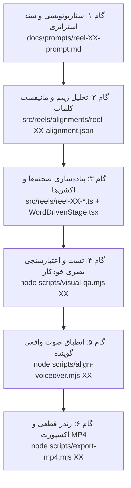

# راهنمای جامع و استاندارد ساخت ریلزهای تبلیغاتی حسابچه (Promo Reel Production Workflow)

> **سند مرجع برای کلیه مهندسان و هوش‌های مصنوعی همکار در پروژه حسابچه**  
> این سند، فرآیند دقیق و استاندارد تولید ویدیوهای تبلیغاتی کوتاه (Reels / Shorts) حسابچه را از ایده اولیه و سناریونویسی تا خروجی نهایی MP4 با کیفیت استودیویی (10/10 SaaS Production) مستند می‌سازد.  
> رعایت تمامی قوانین و استانداردهای این سند برای هر ریلز جدید **الزامی و غیرقابل‌تغییر** است.

---

## ۱. اصول و معماری موشن‌گرافی اختصاصی حسابچه

موتور ساخت ریلز حسابچه بر پایه وب و فناوری‌های استاندارد مدرن (React + TypeScript + Vite + Puppeteer + Web Audio API / FFmpeg) به صورت کاملاً قطعی (Deterministic) کار می‌کند:

1. **نسبت ابعاد:** عمودی استاندارد ۹:۱۶ با ابعاد دقیق ۱۰۸۰×۱۹۲۰ پیکسل و نرخ فریم ۳۰ فریم بر ثانیه (30 FPS).
2. **حرکت مبتنی بر کلام (Word-Driven Choreography):** تمامی حرکات، انیمیشن‌ها، فرود کارت‌ها، شکستن نمودارها و استامپ‌ها مستقیماً با کلمات سناریوی صوتی گوینده همگام (Sync) هستند.
3. **پایداری صددرصدی فریم‌ها (Frame-by-Frame Determinism):** زمان با متغیر پیوسته `t` (ثانیه) در سطح کامپوننت‌ها کنترل می‌شود تا هر فریم دقیقاً در زمان معین بدون وابستگی به قدرت سخت‌افزار رندر شود.

---

## ۲. شش قانون طلایی و تخطی‌ناپذیر پروداکشن (The 6 Non-Negotiable Rules)

هر هوش مصنوعی که ریلز جدیدی می‌سازد یا ریلزهای موجود را اصلاح می‌کند، باید این ۶ قانون را بدون استثنا رعایت کند:

### قانون ۱: زیرنویس کپسولی شیشه‌ای تمیز (بدون هیچ‌گونه برچسب دیباگ یا متادیتا روی ویدیو)

- **زیرنویس همگام زنده (Live Karaoke Subtitle):** زیرنویس پایین صفحه باید واژه به واژه همگام با صدای گوینده هایلایت شود و بدرخشد.
- **حذف کامل لیبل‌های متادیتا:** به هیچ وجه برچسب‌هایی مانند `⏱ ریتم هجاهای فارسی (تخمینی)`، `● هوک اضطراری`، یا توضیحات استراتژی در کادر ویدیو نمایش داده نشوند.
- **محل یادداشت‌های استراتژیک:** کلیه توضیحات استراتژی، هوک، لحن و پرامپت‌ها منحصراً در فایل سند `docs/prompts/reel-XX-prompt.md` ثبت می‌شوند.
- **استایل زیرنویس:** یک کپسول شیشه‌ای تیره مات (Glassmorphic Caption Bar) با انحنای کامل (`border-radius: 999px`)، فونت ۱۹ پیکسل خوانا، چیدمان افقی متوازن و بدون پرش عمودی.

### قانون ۲: محاسبات زمانی کاملاً مثبت و کنترل‌شده (ممنوعیت اعداد منفی در تایمرها)

- هیچ‌گاه نباید خروجی یک تایمر شمارش معکوس به اعداد منفی مانند `-۱۸:۱۱:۵۸` تبدیل شود.
- کلیه توابع زمانی باید با `Math.max`، `Math.min` و Clamp مهار شوند.
- برای شمارش معکوس ساعت ۱۲ ظهر، زمان باید شسته و رفته از `۱۱:۵۹:۵۷` شروع شده و پله‌پله به `۱۲:۰۰:۰۰` برسد.

### قانون ۳: حفظ نقطه اوج صحنه‌ها و پرهیز از فید زودهنگام (Climax Hold & Late Fade)

- **مشکل قبلی:** رویداد اصلی صحنه در آخرین لحظه اتفاق می‌افتاد و به سرعت با ترنزیشن فیدآوت محو می‌شد.
- **استاندارد جدید:** نقطه عطف و رویداد کلیدی هر صحنه (نظیر برگشت خوردن چک، شکست نمودار، یا پاس شدن چک) باید **۱.۲ تا ۱.۸ ثانیه قبل از پایان صحنه** رخ دهد.
- **شفافیت ۱۰۰٪:** در تمام مدت این ۱.۲ الی ۱.۸ ثانیه، تصویر باید با `opacity: 1.0` و در اوج ثبات باقی بماند تا چشم مخاطب پیام را دریافت کند.
- **مدت فیدآوت نهایی:** محو شدن خروجی صحنه به حداکثر `0.18s` محدود شود.

### قانون ۴: پر کردن هوشمندانه یک‌سوم بالایی کادر عمودی ۹:۱۶

- **مشکل قبلی:** متمرکز شدن کارت‌ها در وسط و رها شدن یک‌سوم بالایی کادر به صورت فضای خالی مرده.
- **استاندارد جدید:**
  - **صحنه‌های بحران/مشکل:** یک تیتر برجسته و جسورانه (`scene-top-headline`) در بالای کادر مهار شود (مانند «فروش بالا روی کاغذ؛ اما حساب بانکی خالی!»).
  - **کارت‌ها و اتصال‌دهنده‌ها:** بزرگ‌تر کردن ابعاد کارت‌ها و افزودن المان‌های رابط متحرک (مانند فلش‌های تخلیه نقدینگی و جریان وجوه).
  - **صحنه‌های راهکار:** لوگو و نشان رسمی حسابچه به همراه شعار عملکردی باید از ثانیه صفر صحنه (`t = 0`) در بالای کادر لنگر انداخته باشند تا کارت‌های راهکار زیر آن مرتب شوند.

### قانون ۵: میکرواینتراکشن‌های حسی و فیزیکی (Tactile Micro-Interactions)

- انیمیشن‌ها نباید خشک و بی‌روح باشند:
  - هنگام کوبیده شدن استامپ «برگشت خورد ❌»، کارت باید دارای لرزش افقی فیزیکی (`translateX` Micro-Shake) و پالس نئونی قرمز در حاشیه‌ها باشد.
  - هنگام تسویه مطالبات و پاس شدن چک، بنر پاس شدن باید دارای پالس درخشان زمردی (`emeraldGlowPulse`) باشد.
  - کارت‌های ورودی باید دارای فرود جهنده و فنری طبیعی (`spring`) باشند.

### قانون ۶: طراحی صدای گرم، ارگانیک و آکوستیک (Acoustic Audio Design)

- **وووش (Whoosh):** هرگز از نویز سفید خام (White Noise) شبیه به برفک تلویزیون استفاده نشود. نویز صوتی باید با فیلتر پایین‌گذر (Low-Pass Filter) زیر ۴۵۰ هرتز نرم شود و صدای جابجایی هوا را تداعی کند.
- **ضربه (Impact):** صدای ضربه استامپ باید ترکیب ساب پانچ عمیق ۵۵ هرتز به همراه صدای فیزیکی سیلی چوب و لاستیک مهر باشد.
- **چایم و موفقیت (Chime / Success):** زنگ‌های الکترونیکی زیر و تیز و گوش‌خراش حذف شده و آکوردهای گرم و ملایم گیتار/پیانو (ترایادهای E4, G4, B4) جایگزین شوند.

---

## ۳. مراحل گام‌به‌گام ساخت ریلز (از ایده تا خروجی نهایی)



---

### گام ۱: نگارش سناریو و سند پرامپت (`docs/prompts/reel-XX-prompt.md`)

ابتدا سناریوی دقیق ۲۶ ثانیه‌ای را بر اساس فرمول طلایی تبدیل (قلاب شوک‌آور → تناقض و بحران نقدینگی → علت ساختاری → راهکار نجات‌بخش حسابچه → فراخوان به اقدام CTA) بنویسید.
تمام جزئیات لحن گوینده، کلمات کلیدی، و اکشن‌های مورد انتظار در این فایل ثبت می‌شود.

### گام ۲: ایجاد مانیفست هماهنگی کلمات (`src/reels/alignments/reel-XX-alignment.json`)

با استفاده از مدل Cadence زبان فارسی (`cadence-model.ts`) یا ساختار JSON، زمان دقیق شروع و پایان هر کلمه و اکشن متناظر آن (`action`) تعریف می‌شود.

### گام ۳: کدنویسی اکترهای صحنه (`WordDrivenStage.tsx` و تعریف ریلز)

۱. صحنه‌ها در فایل اختصاصی ریلز (`src/reels/reel-XX-*.ts`) با نوع `kind: 'word-sync'` رجیستر می‌شوند.
۲. اکترهای بصری در `src/components/WordDrivenStage.tsx` پیاده‌سازی شده و تغییر وضعیت‌ها با استعلام مستقیم کلمه از `SentencePlan` انجام می‌پذیرد.
۳. استایل‌ها و انیمیشن‌های CSS در `src/styles.css` اضافه می‌شوند.

### گام ۴: آزمون کیفیت بصری خودکار (`scripts/visual-qa.mjs`)

با اجرای دستور زیر، سیستم بدون نیاز به رندر کل ویدیو، فریم‌های حیاتی (شروع، میانه، نقطه اوج و انتهای هر صحنه) را با ابعاد ۱۰۸۰×۱۹۲۰ اسکرین‌شات گرفته و در پوشه `.tmp/visual-qa/` ذخیره می‌کند:

```bash
node scripts/visual-qa.mjs <ID>
```

این فریم‌ها باید از نظر پر بودن یک‌سوم بالا، عدم وجود اعداد منفی، و تمیزی زیرنویس بازبینی شوند.

### گام ۵: وارد کردن صدای گوینده و انطباق (`scripts/align-voiceover.mjs`)

فایل صدای واقعی گوینده در مسیر `audio/reel-XX-vo.wav` قرار گرفته و فرمان انطباق اجرا می‌شود:

```bash
node scripts/align-voiceover.mjs <ID>
```

### گام ۶: اکسپورت نهایی ویدیو (`scripts/export-mp4.mjs`)

با اجرای دستور زیر:

```bash
node scripts/export-mp4.mjs <ID>
```

۱. سرور Vite داخلی راه‌اندازی می‌شود.
۲. مرورگر کروم بی‌سر پیپتیر باز شده و با سرعت بالا تک‌تک ۷۸۰ فریم (برای ویدیو ۲۶ ثانیه‌ای) را شکار می‌کند.
۳. ترک صوتی سینتزشده یا صدای میکس‌شده گوینده ساخته می‌شود.
۴. دستور FFmpeg ویدیوی نهایی H.264 با صدای AAC را در مسیر `exports/reel-XX.mp4` تولید می‌کند.

---

## ۴. چک‌لیست اعتبارسنجی پیش از تحویل (Definition of Done)

قبل از اعلام پایان کار روی هر ریلز، موارد زیر را کنترل کنید:

- [ ] تست‌های خودکار پروژه سبز باشند: `npm test`
- [ ] خطای تایپ‌اسکریپت وجود نداشته باشد: `npm run typecheck`
- [ ] بیلد موفقیت‌آمیز باشد: `npm run build`
- [ ] فریم‌های ذخیره‌شده در `.tmp/visual-qa/` فاقد هرگونه لیبل متادیتا در زیرنویس باشند.
- [ ] تایمرها از ثانیه صفر کاملاً مثبت و بدون علامت منفی باشند.
- [ ] یک‌سوم بالای صحنه‌ها دارای تیترهای جسورانه یا هدر ثابت برند باشد.
- [ ] فایل `exports/reel-XX.mp4` بدون نقص تولید شده و قابل پخش باشد.
